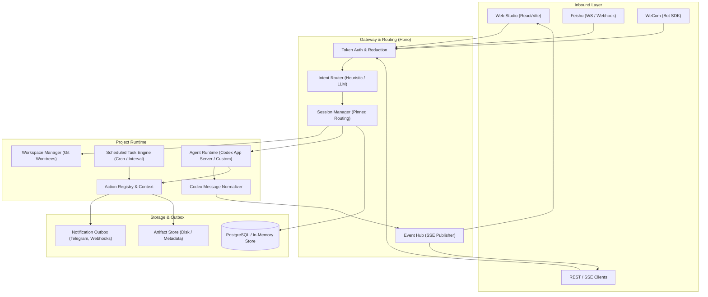

# Agent Orchestrator

<p align="center">
  <strong>A high-performance Bun/TypeScript gateway and orchestrator for long-lived, project-scoped coding agents.</strong>
</p>

<p align="center">
  <a href="https://bun.sh"></a>
  <a href="https://www.typescriptlang.org/"></a>
  <a href="https://github.com"></a>
  <a href="LICENSE"></a>
</p>

<p align="center">
  <a href="README.md">English</a> • <a href="README_zh.md">简体中文</a>
</p>

---

## Overview

**Agent Orchestrator** manages and schedules autonomous coding agents (such as OpenAI Codex App Server) across multi-repository workspaces. It bridges external user channels (Web Studio, REST API, Feishu/Lark, WeChat Work) with isolated execution environments, enforcing strict type safety, canonical domain event streaming, and resilient workspace isolation.

### Why Agent Orchestrator?

- **Git Worktree Isolation**: Concurrent agent sessions operate in independent git worktrees cloned from single-flight pre-warmed base repositories. No branch collision, no dirty workspace leaks.
- **Strict Canonical Event Stream**: Unifies heterogeneous agent outputs into a strongly-typed domain event protocol (`agent.message.*`, `agent.reasoning.*`, `command.*`, `file.change`, etc.). Transient streaming deltas are published live via SSE but bypassed from DB storage to avoid bloat.
- **Immutable Session Pinning**: Inbound queries are intelligently routed to a project via heuristic or LLM router. Once bound, `sessionId -> projectId -> runtime` routing is pinned forever.
- **Enterprise Chat Connectors**: Native bidirectional Feishu (WebSocket & Webhook) and WeChat Work integrations featuring interactive streaming cards and message serialization per thread.
- **Autonomous Task & Action Engine**: Cron and interval scheduled tasks trigger agent actions (`createArtifact`, `notify`, `emitDomainEvent`) with structured audit trails and auto-recovery.
- **Built-in Web Studio**: Bundled React + Vite dashboard providing real-time turn visualization, session inspection, and workspace management.

---

## Architecture



---

## Key Features

### 1. Multi-Project & Multi-Repo Workspaces
- Each managed project defines its repositories, git committers, credentials, and custom prompts under `projects/<project-id>/project.yaml`.
- Base repositories are automatically cloned and synchronized via single-flight locking, preventing concurrent fetch collisions.
- Every session generates a dedicated Git worktree (`ensureSessionWorkspaces`) and prunes on teardown.

### 2. Standardized Agent Runtime & Canonical Protocol
- Runtime interface decouples agent implementations. Includes first-class support for OpenAI Codex App Server JSON-RPC protocol, with extension points for Pi or custom CLI agents.
- Normalizes proprietary agent dialects into a Discriminated Union `RuntimeEvent`:
  - `agent.message.delta` & `agent.message.completed`
  - `agent.reasoning.delta` & `agent.reasoning.completed`
  - `command.started` & `command.completed`
  - `file.changed`
  - `runtime.unmapped` (safely encapsulates vendor dialects inside `metadata.raw` without root pollution)

### 3. Native Enterprise Channels
- **Feishu / Lark**: WebSocket long-connection mode (`FeishuWsAdapter`) for zero-public-IP deployments, plus standard Webhook callbacks. Renders markdown responses directly into updating interactive cards (`FeishuCardStreamer`).
- **WeChat Work (企业微信)**: Native bot SDK integration with chunked card streaming (`WecomCardStreamer`).
- Automatic deduplication of external message IDs to guarantee turn idempotency.

### 4. Action Engine & Scheduled Tasks
- Unified action capabilities: `createArtifact`, `notify`, `emitDomainEvent`.
- Truncates oversized parameters safely in audit logs.
- Configurable cron/interval tasks invoke project lifecycle handlers and maintenance jobs.
- Outbox fanout delivers notifications to Feishu, WeCom, Telegram, and generic Webhooks with partial-failure tracking.

---

## Quick Start

### Prerequisites
- [Bun](https://bun.sh) (v1.2 or higher)
- Git (v2.30+ recommended for worktree features)
- Docker & Docker Compose (optional, for containerized run)

### 1. Installation

```bash
# Clone the repository
git clone https://github.com/your-org/agent-orchestrator.git
cd agent-orchestrator

# Install dependencies
bun install
```

### 2. Configuration

Copy the example configuration:

```bash
cp config.example.yaml config.yaml
```

Update `config.yaml` with your environment values:

```yaml
server:
  host: 0.0.0.0
  port: 7070

storage:
  dataDir: .data
  projectsDir: projects
  databaseUrl: "" # Leave empty for in-memory store, or provide postgres://...

runtimes:
  codex:
    apiKey: "your-codex-or-openai-api-key"
    baseUrl: "https://api.openai.com/v1"
```

### 3. Run Locally

```bash
# Verify typecheck and tests
bun run check

# Start development server (serves Gateway API & Web Studio)
bun run dev
```

Open [http://localhost:7070](http://localhost:7070) in your browser to access the Web Studio.

---

## Docker Deployment

Build and run using Docker Compose:

```bash
# 1. Prepare configuration
cp config.example.yaml config.yaml
# Ensure storage.databaseUrl points to postgres service if using PostgreSQL

# 2. Build images and start services
docker compose up -d --build
```

The application image incorporates:
- Multi-repo developer runtime environment (Go, Python/uv, Node.js, Bun, Git, Task, `rg`, `jq`)
- Dedicated non-root runtime permissions
- Pre-packaged Web Studio assets served directly from the gateway

---

## Configuration Reference

### Gateway Service (`config.yaml`)

| Field | Type | Description |
|---|---|---|
| `server.host` | `string` | Bind host (default: `0.0.0.0`) |
| `server.port` | `number` | HTTP & SSE listening port (default: `7070`) |
| `logging.level` | `string` | Log level: `debug`, `info`, `warn`, `error` |
| `storage.dataDir` | `string` | Root directory for session workspaces and runtimes (default: `.data`) |
| `storage.projectsDir`| `string` | Path containing project YAML declarations (default: `projects`) |
| `storage.databaseUrl`| `string` | PostgreSQL connection URL. Empty uses In-Memory store |
| `auth.token` | `string` | Gateway API bearer token. Empty disables authentication |
| `router.model` | `string` | Optional model name for zero-shot LLM intent routing |
| `runtimes.codex.apiKey` | `string` | API Key passed to Codex App Server sessions |
| `channels.feishu.enabled` | `boolean` | Enable Feishu event receiver and interactive card streamer |
| `channels.wecom.enabled` | `boolean` | Enable WeChat Work intelligent bot streaming adapter |
| `notifications` | `array` | Global outbound notification endpoints (Telegram, Webhooks) |

### Project Definition (`projects/<project-id>/project.yaml`)

```yaml
project:
  enabled: true
  id: my-service
  displayName: My Microservice
  description: Core backend service repository.
  tags: [backend, golang]

routing:
  projectId: my-service
  summary: Golang microservice for order processing.
  keywords: [order, payment, checkout]

auth:
  type: token
  token: "{env:GITHUB_TOKEN}"

agent:
  model: gpt-5-codex
  reasoningEffort: high

repositories:
  - id: my-service-repo
    url: git@github.com:my-org/my-service.git
    baseBranch: main
    isPrimary: true
```

---

## REST API Examples

### 1. Create a Session

```bash
curl -X POST http://localhost:7070/sessions \
  -H "Content-Type: application/json" \
  -d '{
    "projectId": "my-service",
    "query": "Investigate unit test failures in the payment module"
  }'
```

Response (`201 Created`):
```json
{
  "sessionId": "ses_7f300c1e-3a87-43cf-bc08-f41cb8371302",
  "projectId": "my-service",
  "status": "ready"
}
```

### 2. Append a Turn

```bash
curl -X POST http://localhost:7070/sessions/ses_7f300c1e-3a87-43cf-bc08-f41cb8371302/turns \
  -H "Content-Type: application/json" \
  -d '{
    "input": "Apply the suggested patch and run the regression tests"
  }'
```

### 3. Stream Session Events (SSE)

```bash
curl -N -H "Accept: text/event-stream" \
  http://localhost:7070/sessions/ses_7f300c1e-3a87-43cf-bc08-f41cb8371302/events
```

Server-Sent Events output:
```text
event: agent.message.delta
data: {"sequence":1,"type":"agent.message.delta","payload":{"delta":"Analyzing error logs..."}}

event: command.started
data: {"sequence":2,"type":"command.started","payload":{"command":"go test ./..."}}

event: turn.completed
data: {"sequence":3,"type":"turn.completed","payload":{"status":"completed","finalText":"All tests passed."}}
```

---

## Project Structure

```text
.
├── src/
│   ├── actions/          # Unified Action Registry, ActionContext & execution audit
│   ├── artifacts/        # Artifact persistence & file management
│   ├── channels/         # Feishu and WeCom WebSocket/Webhook & Card Streamers
│   ├── domain/           # Canonical event protocol, payload maps & domain types
│   ├── events/           # EventHub, SSE streaming broker & replay buffer
│   ├── gateway/          # Hono HTTP server, route controllers & middleware
│   ├── notifications/    # Outbox delivery, Telegram & Webhook providers
│   ├── observability/    # Structured logger with automatic credential redaction
│   ├── persistence/      # PostgreSQL store & In-Memory fallback store
│   ├── project/          # Project schema validator, catalog loader & handlers
│   ├── router/           # Heuristic & LLM-based intent routing engine
│   ├── runtime/          # Codex App Server adapter, normalizers & FakeRuntime
│   ├── task/             # Scheduled task runner (cron / interval engine)
│   └── workspace/        # Git worktree manager & multi-repo synchronization
├── projects/             # Declarative project configurations and Taskfile
├── web/                  # Web Studio frontend (React 19, Vite, Tailwind CSS)
├── infra/                # Dockerfile and runtime base image recipes
├── tests/                # Bun automated test suite (30 test files, 273+ tests)
├── config.example.yaml   # Comprehensive configuration template
└── Taskfile.yaml         # Go-Task lifecycle automation
```

---

## Development & Testing

```bash
# Run full type check across all TypeScript files
bun run typecheck

# Run test suite
bun test

# Run code check (typecheck + test)
bun run check

# Build production bundle
bun run build

# Web Studio frontend development
cd web && bun install && bun run dev
```

---

## License

This project is licensed under the [MIT License](LICENSE).
