# Agent Orchestrator

<p align="center">
  <strong>A Bun/TypeScript gateway and orchestrator for long-lived, project-scoped coding agents.</strong>
</p>

<p align="center">
  <a href="https://bun.sh"></a>
  <a href="https://www.typescriptlang.org/"></a>
  <a href="LICENSE"></a>
</p>

<p align="center">
  <a href="README.md">English</a> • <a href="README_zh.md">简体中文</a>
</p>

---

## Overview

**Agent Orchestrator** manages and coordinates autonomous coding agents (**OpenAI Codex**, **Claude Code**, **Pi Agent**, and **ACP**-compatible runtimes such as **Antigravity (`agy`)**) across project-scoped workspaces. It bridges external user channels (Web Studio, REST/SSE API, Feishu/Lark, WeChat Work, and Webhooks) with isolated execution environments, enforcing strict type safety, canonical domain event streaming, and Git worktree isolation.

### Why Agent Orchestrator?

- **Multi-Runtime with Native Configuration**: First-class adapters for **Codex** (`codex app-server`), **Claude Code** (`@anthropic-ai/claude-agent-sdk`), and **Pi** (`@earendil-works/pi-coding-agent`), registered through a pluggable `RuntimeRegistry`. Each runtime reads its own standard global configuration (`~/.codex`, `~/.claude`, `~/.pi/agent`) while projects override only `type`, `model`, `reasoningEffort`, and `mcpServers`.
- **Single-Repo Git Worktree Isolation**: Each managed project maps to at most one repository. Concurrent sessions run in independent Git worktrees (`agent/<sessionId>`) branched from single-flight synchronized base repositories, with a built-in read-only `_global_` workspace for cross-project analysis.
- **Canonical Domain Event Stream**: Normalizes heterogeneous agent protocols into a strongly typed discriminated union (`agent.message.*`, `agent.reasoning.*`, `plan.updated`, `command.*`, `file_change.*`, `tool.*`, `mcp_call.*`, `approval.*`, `session.*`, `turn.*`, etc.). High-frequency transient deltas stream live over SSE without bloating persistent storage.
- **Four-Tier Routing with Session Pinning**: Routes inbound queries through sticky session lookup, deterministic keyword scoring, optional OpenAI-compatible LLM routing, and read-only `_global_` fallback. Once created, a session stays pinned to its project.
- **Enterprise Chat Connectors & Unified Notifications**: Bidirectional Feishu (WebSocket & Webhook) and WeChat Work (Bot SDK WebSocket) channels with streaming card updates, strictly separated from one-way outbound notifications (Feishu, WeCom, Telegram, Webhook, Log).
- **Declarative Tasks, Scheduled Jobs & Actions**: Cron-scheduled Markdown tasks (`tasks/*.md`) supporting `agent`, `script`, and `action` executors, delayed per-session `scheduled_jobs`, and audited built-in actions exposed to agents.
- **Web Studio**: Bundled React 19 + Vite + Tailwind CSS v4 frontend for real-time SSE turn streaming, session kanban management, task history, and scheduled job inspection.

---

## Architecture

```mermaid
flowchart TD
    subgraph Inbound["Inbound Layer"]
        UI["Web Studio (React 19 / Vite)"]
        API["REST / SSE / Webhook Clients"]
        FS["Feishu (WebSocket / Webhook)"]
        WC["WeCom (Bot WebSocket)"]
    end

    subgraph Gateway["Gateway & Routing (Hono)"]
        Auth["Bearer Auth & Request Logging"]
        Router["4-Tier Router (Sticky / Keyword / LLM / Global)"]
        SessionMgr["Session Manager & Entity State"]
        EventHub["Event Hub (SSE Pub/Sub & Replay)"]
    end

    subgraph Execution["Project Runtime"]
        WkMgr["Workspace Manager (Single-Repo Git Worktrees)"]
        ActionReg["Action Registry & Audit Context"]
        TaskEng["Task Engine (Cron) & Scheduled Jobs"]
        RuntimeReg["Runtime Registry (Codex / Claude / Pi)"]
        Normalizer["Canonical Event Normalizers"]
    end

    subgraph Persistence["Storage & Outbound"]
        DB[("PostgreSQL / MemoryStore")]
        Outbox["Notification Outbox (Feishu / WeCom / Telegram / Webhook)"]
        Artifacts["Artifact Store (Disk & Metadata)"]
    end

    UI --> Auth
    API --> Auth
    FS --> Auth
    WC --> Auth

    Auth --> Router
    Router --> SessionMgr
    SessionMgr --> WkMgr
    SessionMgr --> RuntimeReg
    RuntimeReg --> Normalizer
    Normalizer --> EventHub
    EventHub --> UI
    EventHub --> API
    EventHub --> FS
    EventHub --> WC

    RuntimeReg --> ActionReg
    TaskEng --> ActionReg
    TaskEng --> SessionMgr
    ActionReg --> Outbox
    ActionReg --> Artifacts
    SessionMgr --> DB
    Outbox --> DB
```



---

## Key Features

### 1. Project-Scoped Workspaces & Global Read-Only Mode

- Each managed project lives under `projects/<project-id>/project.yaml` and defines at most one `repository` (with optional `path`, `committer`, and `ssh-key` or `token` auth), plus optional `scripts/init.sh` and `scripts/sync.sh` hooks.
- Base repositories are cloned and fetched with single-flight locking (`inFlightBases`) and per-base worktree locks to prevent concurrent Git collisions.
- Every session operates in its own Git worktree on branch `agent/<sessionId>`, cleaned up when archived or closed.
- A built-in `_global_` workspace provides read-only cross-project inspection enforced by `RuntimeContext.readOnly`.

### 2. Multi-Runtime Adapters & Canonical Protocol

- Built-in adapters in `RuntimeRegistry`:
  - **`codex`**: OpenAI Codex via `codex app-server` JSON-RPC (streaming, resume, steer, interrupt, compaction, approvals, MCP, sandbox).
  - **`claude`**: Claude Code via `@anthropic-ai/claude-agent-sdk` (streaming, resume, steer, interrupt, compaction, approvals, MCP).
  - **`pi`**: Pi Agent in-process TypeScript SDK via `@earendil-works/pi-coding-agent` (streaming, resume, steer, interrupt, compaction, MCP, sandbox).
  - **`agy`** (via generic `ACPRuntime`): Antigravity CLI over `@agentclientprotocol/sdk` (`agy acp --stdio --process-per-session`, supporting streaming, resume, interrupt, compaction, approvals, MCP, and `additionalDirectories` skills).
  - **`fake`**: In-memory mock runtime for automated tests and offline development.
- Normalizes vendor-specific events into `CanonicalEventPayloadMap`:
  - `agent.message.delta` / `agent.message.completed`
  - `agent.reasoning.delta` / `agent.reasoning.completed` / `plan.updated`
  - `command.started` / `command.output` / `command.completed`
  - `file_change.started` / `file_change.completed`
  - `tool.call.started` / `tool.called` / `mcp_call.started` / `mcp_call.completed`
  - `approval.requested` / `approval.resolved`
  - `session.*`, `turn.*`, `artifact.created`, `notification.*`, `compaction.*`, `runtime.unmapped`, `runtime.disconnected`
- Transient streaming events (`agent.message.delta`, `agent.reasoning.delta`, `command.output`) broadcast live through `EventHub` without being persisted to the `events` table.
- Project skills (`projects/<project-id>/.skills/`) and global skills (`projects/.skills/`) are injected per session via runtime APIs alongside repository-native skills and `AGENTS.md` / `CLAUDE.md`.

### 3. Enterprise Chat Channels & Unified Notifications

- **Bidirectional Channels (`src/channels/`)**:
  - **Feishu / Lark**: WebSocket long-connection mode (`FeishuWSAdapter`) and HTTP Webhook callbacks (`FeishuAdapter`), streaming Markdown updates into interactive cards (`FeishuSessionStreamer`).
  - **WeChat Work (企业微信)**: Official `@wecom/aibot-node-sdk` WebSocket adapter (`WeComWSAdapter`) with throttled Markdown streaming (`WeComSessionStreamer`).
  - Supports external message ID deduplication (`inbound_messages`) and session commands (`/cancel`, `/close`).
- **One-Way Notifications (`src/notifications/`)**:
  - Provider registry supporting `feishu`, `wecom`, `telegram`, `webhook`, and `log`.
  - Global `notifications` in `config.yaml` are inherited by all projects and can be overridden or disabled by name per project.
  - Reactive in-memory `NotificationOutbox` delivers concurrently via `Promise.allSettled` and records per-channel audit results in `notification_deliveries`.

### 4. Actions, Declarative Tasks & Scheduled Jobs

- **Built-in Actions (`src/actions/`)**: `update_task_state`, `send_notification`, `create_artifact`, `schedule_job`, `cancel_job`, and `dispatch_agent_task`, bridged to runtimes by scope (`conversation` vs `task`) with audited execution records (`action_executions`).
- **Declarative Cron Tasks (`src/task/`)**: Defined as Markdown files with YAML frontmatter under `projects/<project-id>/tasks/*.md`. Supports `agent`, `script`, and `action` executors and automatically recovers `state_after` from the previous successful run.
- **Delayed Scheduled Jobs**: Agents can schedule follow-up prompts on their own session (`scheduled_jobs`) or cancel pending jobs dynamically.

---

## Quick Start

### Prerequisites

- [Bun](https://bun.sh) (v1.2 or higher; tested with v1.4+)
- Git (v2.30+ recommended for worktree features)
- At least one configured agent CLI/runtime (Codex, Claude Code, or Pi) for real agent execution
- Docker & Docker Compose (optional, for containerized deployment)

### 1. Installation

```bash
git clone <your-repo-url> agent-orchestrator
cd agent-orchestrator

# Install backend dependencies
bun install

# Optional: install and build Web Studio static assets
cd web && bun install && bun run build && cd ..
```

### 2. Configuration

Copy the example configuration:

```bash
cp config.example.yaml config.yaml
```

Minimal `config.yaml`:

```yaml
defaultRuntime: codex # codex | claude | pi | agy

server:
  host: 0.0.0.0
  port: 7070

storage:
  dataDir: .data
  projectsDir: projects
  databaseUrl: "" # Leave empty for MemoryStore, or provide postgres://...
```

Agent runtimes are not configured in `config.yaml`. Each runtime reads its own native configuration, the same as when you use its CLI directly: Codex from `~/.codex` (`CODEX_HOME`), Claude Code from `~/.claude` (`CLAUDE_CONFIG_DIR`), and Pi from `~/.pi/agent` (`PI_CODING_AGENT_DIR`). See [docs/references/runtime-setup.md](docs/references/runtime-setup.md) for login, provider, and migration details.

When PostgreSQL is configured, initialize a new database explicitly before starting the service:

```bash
bun run db:init
```

The application never applies DDL during startup. Table schemas are defined in TypeScript under `src/persistence/schema.ts` and managed with Drizzle Kit (`bun run db:generate` generates SQL migrations under `database/migrations/`, applied via `bun run db:init`).

### 3. Run Locally

```bash
# Run typecheck, lint, and backend tests
bun run check

# Start the gateway server (also serves Web Studio if web/dist exists)
bun run dev
```

For frontend hot-reload development, run Vite in a second terminal (`cd web && bun run dev`, which proxies API requests to `http://127.0.0.1:7070`). Otherwise, once `web/dist` is built, open [http://localhost:7070](http://localhost:7070).

---

## Docker Deployment

`docker-compose.yaml` builds the application image on top of the local `agent-runtime-base` image (`infra/agent-runtime-base/Dockerfile`). Build the base image first, then start the service:

```bash
# 1. Prepare configuration
cp config.example.yaml config.yaml

# 2. Build the local runtime base image
docker compose --profile build build agent-runtime-base

# 3. Build and start the orchestrator container
docker compose up -d --build
```

What the container images include:

- Runtime base image (`infra/agent-runtime-base`): Debian 13 slim with Go, Node.js, Python/`uv`, Bun, `task` (go-task), `tman`, Git, and non-root `agent` user permissions.
- Application image (`Dockerfile`): Pre-built backend bundle (`dist/main.js`), `database/`, `scripts/init-database.ts`, `projects/`, and `config.example.yaml`. Note that `Dockerfile` packages the backend service without building `web/dist`; mount or copy `web/dist` into `/app/web/dist` if you want the container gateway to serve Web Studio.
- Mount persistent volumes for runtime configuration directories (`~/.codex`, `~/.claude`, `~/.pi`) or set `CODEX_HOME` / `CLAUDE_CONFIG_DIR` / `PI_CODING_AGENT_DIR` as described in [docs/references/runtime-setup.md](docs/references/runtime-setup.md).

---

## Configuration Reference

### Gateway Service (`config.yaml`)

| Field                       | Type      | Default                      | Description                                                                   |
| --------------------------- | --------- | ---------------------------- | ----------------------------------------------------------------------------- |
| `defaultRuntime`            | `string`  | `codex`                      | Runtime for `_global_` and projects without `runtime.type` (`codex\|claude\|pi\|agy`) |
| `server.host`               | `string`  | `0.0.0.0`                    | HTTP bind host                                                                |
| `server.port`               | `number`  | `7070`                       | HTTP & SSE listening port                                                     |
| `logging.level`             | `string`  | `info`                       | Log level: `debug`, `info`, `warn`, `error`                                   |
| `storage.dataDir`           | `string`  | `.data`                      | Root directory for base repos, session workspaces, and secrets                |
| `storage.projectsDir`       | `string`  | `projects`                   | Directory containing managed project subdirectories                           |
| `storage.artifactDir`       | `string`  | `<dataDir>/artifacts`        | Directory for persisted session artifacts                                     |
| `storage.databaseUrl`       | `string`  | `""`                         | PostgreSQL URL; empty enables in-memory `MemoryStore`                         |
| `auth.token`                | `string`  | `""`                         | Gateway API Bearer token                                                      |
| `auth.allowUnauthenticated` | `boolean` | `true`                       | Set to `false` together with `auth.token` to enforce Bearer auth              |
| `router.model`              | `string`  | `""`                         | Optional OpenAI-compatible model for Tier 3 LLM intent routing                |
| `router.apiKey`             | `string`  | `""`                         | API key for `router.model`                                                    |
| `router.baseUrl`            | `string`  | `https://api.openai.com/v1`  | Base URL for the router model endpoint                                        |
| `titles.model`              | `string`  | `""`                         | Optional OpenAI-compatible chat model for async session title generation      |
| `titles.apiKey`             | `string`  | `""`                         | API key for `titles.model` (falls back to first message line when blank)      |
| `titles.baseUrl`            | `string`  | `https://api.openai.com/v1`  | Base URL for the title model endpoint                                         |
| `channels.feishu.enabled`   | `boolean` | `false`                      | Enable Feishu Webhook/WebSocket receiver and card streamer                    |
| `channels.wecom.enabled`    | `boolean` | `false`                      | Enable WeChat Work Bot SDK WebSocket adapter and streamer                     |
| `notifications`             | `array`   | `[]`                         | Global outbound notification endpoints inherited by all projects              |

### Project Definition (`projects/<project-id>/project.yaml`)

```yaml
project:
  enabled: true
  id: my-service
  displayName: My Microservice
  description: Core backend service repository.
  tags: [backend, golang]

routing:
  projectId: my-service
  summary: Golang microservice for order processing.
  keywords: [order, payment, checkout]

runtime:
  type: codex # optional; defaults to config.yaml defaultRuntime
  model: gpt-5-codex
  reasoningEffort: high # minimal | low | medium | high | xhigh | max
  mcpServers:
    - name: github
      url: https://api.githubcopilot.com/mcp
      http_headers:
        Authorization: "Bearer {env:GITHUB_TOKEN}"

session:
  idleTimeoutMs: 1800000
  archiveTimeoutMs: 3600000

repository:
  url: git@github.com:my-org/my-service.git
  baseBranch: main
  # path: repos/my-service # optional local base checkout relative to project directory
  committer:
    name: orchestrator-bot
    email: bot@example.com
  auth:
    type: token
    token: "{env:GITHUB_TOKEN}"
```

---

## REST API Examples

### 1. Create a Session

```bash
curl -X POST http://localhost:7070/sessions \
  -H "Content-Type: application/json" \
  -d '{
    "projectId": "my-service",
    "query": "Investigate unit test failures in the payment module"
  }'
```

Response (`201 Created`):

```json
{
  "session": {
    "sessionId": "ses_7f300c1e-3a87-43cf-bc08-f41cb8371302",
    "projectId": "my-service",
    "status": "running",
    "source": "web",
    "runtime": "codex"
  },
  "routedProject": "my-service",
  "turn": {
    "id": "turn_...",
    "sessionId": "ses_7f300c1e-3a87-43cf-bc08-f41cb8371302",
    "status": "queued"
  }
}
```

### 2. Append a Turn

```bash
curl -X POST http://localhost:7070/sessions/ses_7f300c1e-3a87-43cf-bc08-f41cb8371302/turns \
  -H "Content-Type: application/json" \
  -d '{
    "input": "Apply the suggested patch and run the regression tests"
  }'
```

Returns `202 Accepted` with `{ "turn": { ... } }`. Additional session controls are available at `POST /sessions/:sessionId/steer`, `POST /sessions/:sessionId/interrupt`, `POST /sessions/:sessionId/compact`, `POST /sessions/:sessionId/approvals`, `PATCH /sessions/:sessionId`, and `DELETE /sessions/:sessionId`.

### 3. Stream Session Events (SSE)

```bash
curl -N -H "Accept: text/event-stream" \
  http://localhost:7070/sessions/ses_7f300c1e-3a87-43cf-bc08-f41cb8371302/events
```

Server-Sent Events output:

```text
id: 1
data: {"id":"evt_...","sequence":1,"type":"agent.message.delta","payload":{"delta":"Analyzing error logs..."}}

id: 2
data: {"id":"evt_...","sequence":2,"type":"command.started","payload":{"itemId":"cmd_1","command":"go test ./..."}}

id: 3
data: {"id":"evt_...","sequence":3,"type":"turn.completed","payload":{"status":"completed","finalText":"All tests passed."}}
```

---

## Project Structure

```text
.
├── src/
│   ├── actions/          # Built-in Action Registry, ActionContext & execution audit
│   ├── artifacts/        # Artifact persistence & file management
│   ├── channels/         # Feishu and WeCom WebSocket/Webhook adapters & session streamers
│   ├── config/           # Service YAML schema, .env parser & project config loader
│   ├── domain/           # Canonical event protocol, Zod schemas & domain types
│   ├── events/           # EventHub, SSE streaming broker & replay buffer
│   ├── gateway/          # Hono HTTP server, domain route modules, inbox & title generator
│   ├── notifications/    # Reactive Outbox & Feishu/WeCom/Telegram/Webhook/Log providers
│   ├── observability/    # Structured JSON logger with automatic credential redaction
│   ├── persistence/      # Drizzle schema, Store interface, PostgreSQL & MemoryStore implementations
│   ├── project/          # ProjectManager, ProjectRuntime, skills loader & _global_ project
│   ├── router/           # 4-tier routing chain (sticky / keyword / LLM / global fallback)
│   ├── runtime/          # RuntimeRegistry, Codex/Claude/Pi/ACP(agy) adapters, action bridge & FakeRuntime
│   ├── session/          # SessionEntity state machine, SessionManager & lifecycle hooks
│   ├── task/             # Declarative Markdown task loader, cron scheduler & executors
│   └── workspace/        # Single-repo synchronization & per-session Git worktree manager
├── projects/             # Declarative project definitions (example template & Taskfile)
├── database/             # Drizzle Kit generated SQL migrations and metadata snapshots
├── scripts/              # Explicit database initialization script (init-database.ts)
├── docs/                 # Design proposals, runtime setup reference & context notes
├── web/                  # Web Studio frontend (React 19, Vite 6, Tailwind CSS v4)
├── infra/                # Runtime base container image definitions
├── tests/                # Bun automated test suite
├── config.example.yaml   # Service configuration template
└── Taskfile.yaml         # Go-Task project init/sync lifecycle automation
```

---

## Development & Testing

```bash
# TypeScript validation
bun run typecheck

# Biome lint check
bun run lint

# Backend test suite
bun test

# Full backend check (typecheck + lint + test)
bun run check

# Backend production bundle
bun run build

# Web Studio development & build
cd web && bun install && bun run dev
cd web && bun run build
```

---

## License

This project is licensed under the [MIT License](LICENSE).
