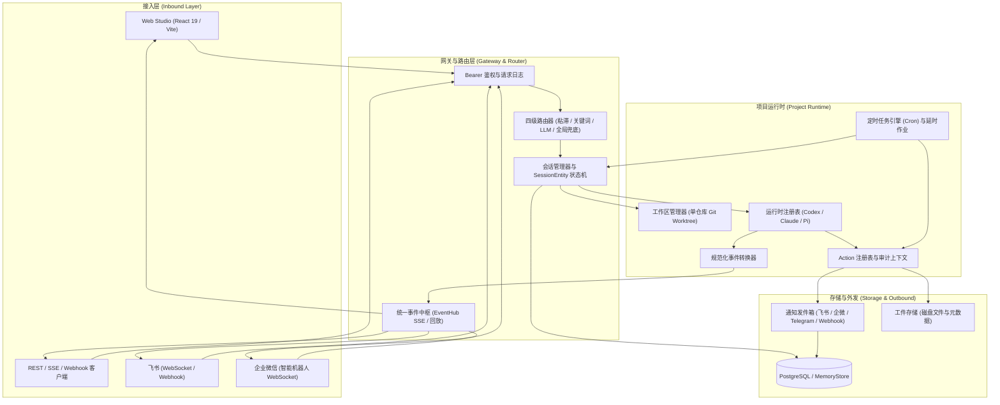

# Agent Orchestrator

<p align="center">
  <strong>基于 Bun/TypeScript 构建的多项目自主编码 Agent（Coding Agent）调度与长周期运行网关。</strong>
</p>

<p align="center">
  <a href="https://bun.sh"></a>
  <a href="https://www.typescriptlang.org/"></a>
  <a href="LICENSE"></a>
</p>

<p align="center">
  <a href="README.md">English</a> • <a href="README_zh.md">简体中文</a>
</p>

---

## 概述

**Agent Orchestrator** 是一套面向项目级工作区的自主编码 Agent 调度与长周期会话网关，原生支持 **OpenAI Codex**、**Claude Code** 与 **Pi Agent** 三种运行时。系统向上接入 Web Studio、REST/SSE API、飞书（Lark）、企业微信与 Webhook，向下驱动单仓库 Git Worktree 隔离工作区与 Agent 运行时，提供严格的类型约束、规范化的领域事件流（Canonical Event Stream）以及任务与动作编排能力。

### 核心能力与设计

- **多运行时与原生配置**：通过可扩展的 `RuntimeRegistry` 内置支持 **Codex**（`codex app-server`）、**Claude Code**（`@anthropic-ai/claude-agent-sdk`）与 **Pi**（`@earendil-works/pi-coding-agent`）。各运行时直接读取自身标准全局配置（`~/.codex`、`~/.claude`、`~/.pi/agent`），项目级仅按需覆盖 `type`、`model`、`reasoningEffort` 与 `mcpServers`。
- **单仓库 Git Worktree 隔离**：每个受管项目对应至多一个仓库；基础仓采用单飞（Single-Flight）锁同步，每个会话在独立工作树与分支（`agent/<sessionId>`）中运行，避免并发修改冲突。同时内置只读 `_global_` 全局项目用于跨项目分析。
- **规范化领域事件流**：将异构运行时的私有协议归一化为强类型判别联合事件（`agent.message.*`、`agent.reasoning.*`、`plan.updated`、`command.*`、`file_change.*`、`tool.*`、`mcp_call.*`、`approval.*`、`session.*`、`turn.*` 等）。高频瞬态流式增量仅经 SSE 实时推送，不落库以防存储膨胀。
- **四级路由与会话粘滞绑定**：依次通过粘滞会话、确定性关键词打分、可选 OpenAI 兼容 LLM 决策路由与 `_global_` 只读兜底完成分流；会话一旦建立即绑定目标项目，后续对话不发生漂移。
- **双向交互渠道与单向通知解耦**：支持飞书（WebSocket 长连接 / Webhook）与企业微信（智能机器人 WebSocket）双向流式卡片交互，并与单向通知推送（飞书、企微、Telegram、Webhook、Log）严格分层。
- **声明式任务、延时作业与 Action 审计**：支持 `projects/<project-id>/tasks/*.md` Cron 定时任务（`agent` / `script` / `action` 三类执行器）、会话级延时唤醒作业（`scheduled_jobs`）及完整的 Action 执行审计。
- **Web Studio 控制台**：内置 React 19 + Vite 6 + Tailwind CSS v4 前端控制台，提供实时 SSE 对话流、四栏会话看板、任务历史与延时作业管理。

---

## 系统架构



---

## 核心特性

### 1. 项目工作区与全局只读模式

- 每个受管项目在 `projects/<project-id>/project.yaml` 中声明至多一个 `repository`（支持 `path` 本地仓、`committer`、`ssh-key` 或 `token` 认证），并可配合 `scripts/init.sh` 与 `scripts/sync.sh` 生命周期脚本。
- 基础仓库克隆与拉取具备防击穿单飞锁（`inFlightBases`）与 worktree 操作锁，避免并发 Git 冲突。
- 每个会话拥有独立的 Git Worktree 与分支 `agent/<sessionId>`，归档或关闭时自动清理释放。
- 内置只读 `_global_` 工作区，通过 `RuntimeContext.readOnly` 在代码层强制只读约束。

### 2. 多运行时适配器与标准领域事件协议

- `RuntimeRegistry` 内置适配器：
  - **`codex`**：基于 `codex app-server` JSON-RPC（支持 streaming、resume、steer、interrupt、compaction、approvals、MCP、sandbox）。
  - **`claude`**：基于 `@anthropic-ai/claude-agent-sdk`（支持 streaming、resume、steer、interrupt、compaction、approvals、MCP）。
  - **`pi`**：基于 `@earendil-works/pi-coding-agent` 进程内 SDK（支持 streaming、resume、steer、interrupt、compaction、MCP、sandbox）。
  - **`fake`**：用于自动化测试与离线开发的内存模拟运行时。
- 统一规范化事件（`CanonicalEventPayloadMap`）：
  - `agent.message.delta` / `agent.message.completed`
  - `agent.reasoning.delta` / `agent.reasoning.completed` / `plan.updated`
  - `command.started` / `command.output` / `command.completed`
  - `file_change.started` / `file_change.completed`
  - `tool.call.started` / `tool.called` / `mcp_call.started` / `mcp_call.completed`
  - `approval.requested` / `approval.resolved`
  - `session.*`、`turn.*`、`artifact.created`、`notification.*`、`compaction.*`、`runtime.unmapped`、`runtime.disconnected`
- 瞬态流式事件（`agent.message.delta`、`agent.reasoning.delta`、`command.output`）仅经 `EventHub` 实时广播，不写入数据库 `events` 表。
- 项目级技能（`projects/<project-id>/.skills/`）与全局技能（`projects/.skills/`）在会话启动时通过运行时 API 注入，与仓库自带的 skills 及 `AGENTS.md` / `CLAUDE.md` 协同工作。

### 3. 企业通讯渠道与统一通知系统

- **双向交互渠道（`src/channels/`）**：
  - **飞书（Lark）**：支持 WebSocket 长连接（`FeishuWSAdapter`）与 Webhook 回调（`FeishuAdapter`），通过 `FeishuSessionStreamer` 节流更新互动卡片。
  - **企业微信**：基于官方 `@wecom/aibot-node-sdk` 的 WebSocket 长连接适配器（`WeComWSAdapter`），通过 `WeComSessionStreamer` 实现 Markdown 流式输出。
  - 支持外部消息 ID 幂等去重（`inbound_messages`）及 `/cancel`、`/close` 会话指令。
- **单向通知推送（`src/notifications/`）**：
  - Provider 注册表内置支持 `feishu`、`wecom`、`telegram`、`webhook`、`log`。
  - 项目默认继承 `config.yaml` 中的全局 `notifications`，并可按同名配置进行覆盖或设置 `enabled: false` 禁用。
  - 内存响应式 `NotificationOutbox` 采用 `Promise.allSettled` 并发投递，并将各通道结果写入 `notification_deliveries` 审计表。

### 4. 统一 Action 体系、声明式任务与延时作业

- **内置 Actions（`src/actions/`）**：提供 `update_task_state`、`send_notification`、`create_artifact`、`schedule_job`、`cancel_job`、`dispatch_agent_task`，按作用域（`conversation` / `task`）桥接给 Agent 调用，并记录审计日志至 `action_executions`。
- **声明式定时任务（`src/task/`）**：通过 `projects/<project-id>/tasks/*.md` 的 YAML Frontmatter 与 Prompt 模板声明 Cron 任务，支持 `agent`、`script`、`action` 三类执行器，并自动从上次成功执行恢复状态（`state_after`）。
- **延时调度作业（`scheduled_jobs`）**：支持 Agent 在会话中动态预约未来时间点再次唤醒当前会话或取消待执行作业。

---

## 快速开始

### 环境依赖

- [Bun](https://bun.sh)（v1.2 或更高版本，当前验证环境 v1.4+）
- Git（建议 2.30+ 以支持完整 worktree 特性）
- 至少一个已登录/配置好的 Agent 运行时（Codex、Claude Code 或 Pi），用于执行真实任务
- Docker & Docker Compose（可选，用于容器化部署）

### 1. 安装依赖

```bash
git clone <your-repo-url> agent-orchestrator
cd agent-orchestrator

# 安装后端依赖
bun install

# 可选：安装并构建 Web Studio 静态资源
cd web && bun install && bun run build && cd ..
```

### 2. 配置文件

复制配置模板：

```bash
cp config.example.yaml config.yaml
```

最小化 `config.yaml` 示例：

```yaml
defaultRuntime: codex # codex | claude | pi

server:
  host: 0.0.0.0
  port: 7070

storage:
  dataDir: .data
  projectsDir: projects
  databaseUrl: "" # 留空使用 MemoryStore 纯内存存储，生产环境可配置 postgres://...
```

Agent 运行时不在这里配置。每个运行时都读取自己的标准配置，和直接使用其 CLI 一致：Codex 读 `~/.codex`（`CODEX_HOME`），Claude Code 读 `~/.claude`（`CLAUDE_CONFIG_DIR`），Pi 读 `~/.pi/agent`（`PI_CODING_AGENT_DIR`）。登录、provider 与迁移说明详见 [docs/references/runtime-setup.md](docs/references/runtime-setup.md)。

配置 PostgreSQL 时，需要在服务启动前显式初始化新数据库：

```bash
bun run db:init
```

应用启动过程不会执行 DDL。表结构统一定义在 `src/persistence/schema.ts`，由 Drizzle Kit 生成迁移文件至 `database/migrations/`（执行 `bun run db:generate` 生成，`bun run db:init` 执行迁移）。

### 3. 启动本地服务

```bash
# 执行类型检查、Lint 与后端单元测试
bun run check

# 启动网关服务（若已构建 web/dist 将同时托管 Web Studio）
bun run dev
```

前端开发热更新可在另一终端执行 `cd web && bun run dev`（Vite 会将 API 请求代理到 `http://127.0.0.1:7070`）。若已构建 `web/dist`，直接访问 [http://localhost:7070](http://localhost:7070) 即可打开 Web Studio。

---

## 容器化部署

`docker-compose.yaml` 中的应用镜像基于本地基础镜像 `agent-runtime-base`（`infra/agent-runtime-base/Dockerfile`）构建，需先构建基础镜像再启动服务：

```bash
# 1. 准备配置文件
cp config.example.yaml config.yaml

# 2. 构建本地运行时基础镜像
docker compose --profile build build agent-runtime-base

# 3. 构建并启动编排器容器
docker compose up -d --build
```

镜像包含内容说明：

- 运行时基础镜像（`infra/agent-runtime-base`）：基于 Debian 13 slim，内置 Go、Node.js、Python/`uv`、Bun、`task`（go-task）、`tman`、Git 及非 root `agent` 用户环境。
- 应用镜像（`Dockerfile`）：打包后端产物（`dist/main.js`）、`database/`、`scripts/init-database.ts`、`projects/` 与 `config.example.yaml`。注意 `Dockerfile` 默认不包含 `web/dist` 构建步骤，如需容器内托管 Web Studio，请将构建好的 `web/dist` 挂载或复制到 `/app/web/dist`。
- 运行时配置目录（`~/.codex`、`~/.claude`、`~/.pi`）建议挂载持久化卷或通过 `CODEX_HOME` / `CLAUDE_CONFIG_DIR` / `PI_CODING_AGENT_DIR` 指定，详见 [docs/references/runtime-setup.md](docs/references/runtime-setup.md)。

---

## 配置规范速查

### 网关主配置 (`config.yaml`)

| 配置项                      | 类型      | 默认值                      | 作用说明                                                               |
| --------------------------- | --------- | --------------------------- | ---------------------------------------------------------------------- |
| `defaultRuntime`            | `string`  | `codex`                     | `_global_` 与未指定 `runtime.type` 的项目使用的运行时（`codex\|claude\|pi`） |
| `server.host`               | `string`  | `0.0.0.0`                   | HTTP 服务监听地址                                                      |
| `server.port`               | `number`  | `7070`                      | HTTP 与 SSE 监听端口                                                   |
| `logging.level`             | `string`  | `info`                      | 日志级别：`debug`, `info`, `warn`, `error`                             |
| `storage.dataDir`           | `string`  | `.data`                     | 基础仓库、会话工作区与凭据文件的根目录                                 |
| `storage.projectsDir`       | `string`  | `projects`                  | 受管项目配置目录                                                       |
| `storage.artifactDir`       | `string`  | `<dataDir>/artifacts`       | 会话产物文件存储目录                                                   |
| `storage.databaseUrl`       | `string`  | 空                          | PostgreSQL 连接串；留空则使用纯内存 `MemoryStore`                      |
| `auth.token`                | `string`  | 空                          | 网关 API Bearer Token                                                  |
| `auth.allowUnauthenticated` | `boolean` | `true`                      | 需与 `auth.token` 配合设为 `false` 才会强制开启 Bearer 鉴权            |
| `router.model`              | `string`  | 空                          | 可选，第三级 LLM 意图路由使用的 OpenAI 兼容模型名                      |
| `router.apiKey`             | `string`  | 空                          | 意图路由模型 API Key                                                   |
| `router.baseUrl`            | `string`  | `https://api.openai.com/v1` | 意图路由模型接口 Base URL                                              |
| `titles.model`              | `string`  | 空                          | 可选，异步提炼会话标题使用的 OpenAI 兼容模型名                         |
| `titles.apiKey`             | `string`  | 空                          | 标题生成模型 API Key（留空时回退取首条消息首行）                       |
| `titles.baseUrl`            | `string`  | `https://api.openai.com/v1` | 标题生成模型接口 Base URL                                              |
| `channels.feishu.enabled`   | `boolean` | `false`                     | 是否启用飞书 Webhook/WebSocket 接收与流式卡片推送                      |
| `channels.wecom.enabled`    | `boolean` | `false`                     | 是否启用企业微信智能机器人 WebSocket 适配与流式推送                    |
| `notifications`             | `array`   | `[]`                        | 全局出站通知端点（各项目默认继承，可按同名覆盖或禁用）                 |

### 项目配置 (`projects/<project-id>/project.yaml`)

```yaml
project:
  enabled: true
  id: example-service
  displayName: 示例微服务
  description: 核心后端订单处理服务。
  tags: [backend, golang]

routing:
  projectId: example-service
  summary: 负责订单与支付流程的 Golang 微服务。
  keywords: [order, payment, checkout]

runtime:
  type: codex # 可选，默认继承 config.yaml 中的 defaultRuntime
  model: gpt-5-codex
  reasoningEffort: high # minimal | low | medium | high | xhigh | max
  mcpServers:
    - name: github
      url: https://api.githubcopilot.com/mcp
      http_headers:
        Authorization: "Bearer {env:GITHUB_TOKEN}"

session:
  idleTimeoutMs: 1800000
  archiveTimeoutMs: 3600000

repository:
  url: git@github.com:my-org/my-service.git
  baseBranch: main
  # path: repos/my-service # 可选，使用项目目录下已有的本地仓库作为基础仓
  committer:
    name: orchestrator-bot
    email: bot@example.com
  auth:
    type: token
    token: "{env:GITHUB_TOKEN}"
```

---

## REST API 调用示例

### 1. 创建会话

```bash
curl -X POST http://localhost:7070/sessions \
  -H "Content-Type: application/json" \
  -d '{
    "projectId": "example-service",
    "query": "排查支付模块近期单元测试偶尔超时的原因"
  }'
```

返回示例（`201 Created`）：

```json
{
  "session": {
    "sessionId": "ses_7f300c1e-3a87-43cf-bc08-f41cb8371302",
    "projectId": "example-service",
    "status": "running",
    "source": "web",
    "runtime": "codex"
  },
  "routedProject": "example-service",
  "turn": {
    "id": "turn_...",
    "sessionId": "ses_7f300c1e-3a87-43cf-bc08-f41cb8371302",
    "status": "queued"
  }
}
```

### 2. 追加交互轮次（Turn）

```bash
curl -X POST http://localhost:7070/sessions/ses_7f300c1e-3a87-43cf-bc08-f41cb8371302/turns \
  -H "Content-Type: application/json" \
  -d '{
    "input": "应用修复补丁并重新运行单元测试"
  }'
```

返回 `202 Accepted` 及 `{ "turn": { ... } }`。其他会话控制端点包括 `POST /sessions/:sessionId/steer`、`POST /sessions/:sessionId/interrupt`、`POST /sessions/:sessionId/compact`、`POST /sessions/:sessionId/approvals`、`PATCH /sessions/:sessionId` 与 `DELETE /sessions/:sessionId`。

### 3. 订阅会话实时事件流（SSE）

```bash
curl -N -H "Accept: text/event-stream" \
  http://localhost:7070/sessions/ses_7f300c1e-3a87-43cf-bc08-f41cb8371302/events
```

SSE 输出示例：

```text
id: 1
data: {"id":"evt_...","sequence":1,"type":"agent.message.delta","payload":{"delta":"正在检查代码变动..."}}

id: 2
data: {"id":"evt_...","sequence":2,"type":"command.started","payload":{"itemId":"cmd_1","command":"go test ./..."}}

id: 3
data: {"id":"evt_...","sequence":3,"type":"turn.completed","payload":{"status":"completed","finalText":"所有单元测试均已通过。"}}
```

---

## 工程目录结构

```text
.
├── src/
│   ├── actions/          # 内置 Action 注册表、执行上下文与调用审计
│   ├── artifacts/        # 工件持久化与文件管理
│   ├── channels/         # 飞书、企业微信的长连接/Webhook 适配与会话流式器
│   ├── config/           # 服务配置校验、.env 解析与项目配置加载
│   ├── domain/           # 规范化领域事件协议、Zod Schema 与领域类型
│   ├── events/           # EventHub 事件中枢、SSE 广播与历史回溯
│   ├── gateway/          # Hono HTTP 网关、分模块路由、入站队列与标题生成
│   ├── notifications/    # 响应式 Outbox 与飞书/企微/Telegram/Webhook/Log 提供者
│   ├── observability/    # 结构化 JSON 日志记录器（自动敏感数据脱敏）
│   ├── persistence/      # Drizzle Schema、Store 接口、PostgreSQL 与 MemoryStore 实现
│   ├── project/          # ProjectManager、ProjectRuntime、技能加载与 _global_ 全局项目
│   ├── router/           # 四级意图路由链（粘滞 / 关键词 / LLM / 全局兜底）
│   ├── runtime/          # RuntimeRegistry、Codex/Claude/Pi 适配器、Action 桥接与 FakeRuntime
│   ├── session/          # SessionEntity 状态机、SessionManager 与生命周期 Hook
│   ├── task/             # 声明式 Markdown 任务加载器、Cron 调度与多类型执行器
│   └── workspace/        # 单仓库同步与会话级 Git Worktree 管理
├── projects/             # 声明式项目配置（含 example 模板与公共 Taskfile）
├── database/             # Drizzle Kit 生成的 SQL 迁移脚本与元数据快照（migrations/）
├── scripts/              # 显式数据库初始化脚本（init-database.ts）
├── docs/                 # 技术设计文档、运行时配置参考与上下文记录
├── web/                  # Web Studio 前端应用（React 19, Vite 6, Tailwind CSS v4）
├── infra/                # 运行时基础容器镜像定义
├── tests/                # Bun 自动化测试套件
├── config.example.yaml   # 服务配置示例模板
└── Taskfile.yaml         # Go-Task 项目 init/sync 生命周期脚本
```

---

## 本地开发与测试

```bash
# TypeScript 类型检查
bun run typecheck

# Biome 静态检查
bun run lint

# 运行后端单元测试
bun test

# 完整后端校验（类型检查 + Lint + 单元测试）
bun run check

# 构建后端生产包
bun run build

# Web Studio 前端开发与构建
cd web && bun install && bun run dev
cd web && bun run build
```

---

## 开源协议

本项目采用 [MIT 许可证](LICENSE)。
