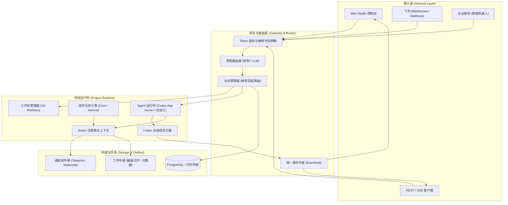

# Agent Orchestrator

<p align="center">
  <strong>基于 Bun/TypeScript 构建的自主编码 Agent（Coding Agent）多项目调度与长周期运行网关。</strong>
</p>

<p align="center">
  <a href="https://bun.sh"></a>
  <a href="https://www.typescriptlang.org/"></a>
  <a href="https://github.com"></a>
  <a href="LICENSE"></a>
</p>

<p align="center">
  <a href="README.md">English</a> • <a href="README_zh.md">简体中文</a>
</p>

---

## 概述

**Agent Orchestrator** 是一套专为自主编码 Agent（如 OpenAI Codex App Server）设计的项目级调度与长周期会话网关。系统向上接入 Web Studio、RESTful API、飞书（Lark）与企业微信，向下驱动隔离的代码仓工作区与 Agent 运行时，提供严谨的类型约束、规范化的领域事件流（Canonical Event Stream）以及并发无冲突的 Git Worktree 隔离机制。

### 核心解决的问题

- **Git 工作区并发冲突**：基于单飞（Single-Flight）锁预热基础仓，为每个会话动态建立独立的 Git Worktree，避免多会话并发修改时的分支污染与文件冲突。
- **Agent 方言碎片化**：将异构 Agent（如 Codex、Pi 等）的底层 JSON-RPC 消息转换为强类型的判别联合领域事件（Discriminated Union `RuntimeEvent`），私有参数统一封装进 `metadata.raw`，保证核心协议干净。
- **长会话路由防飘移**：用户首条消息根据关键词或大模型意图分析匹配目标项目，一旦建立会话即持久化绑定（`sessionId -> projectId -> runtime`），后续对话绝不发生意外重路由。
- **企业通讯工具原生交互**：原生支持飞书（WebSocket 长连接免公网 IP / Webhook）与企业微信，实现交互式 Markdown 消息卡片的流式打字机更新。
- **定时任务与扩展动作编排**：内置 Cron 与间隔触发引擎，调度标准化 Action（生成工件、多渠道通知、自定义领域事件），并提供完整的审计日志。
- **开箱即用的 Web Studio**：内置基于 React 19 + Vite 的控制台，提供实时 SSE 状态流回放、会话历史、工作区状态可视化。

---

## 系统架构



---

## 核心特性

### 1. 多项目与多代码仓隔离（Multi-Project & Multi-Repo）

- 每个受管项目在 `projects/<project-id>/project.yaml` 中声明代码仓、Git 提交人身份、认证凭证与专有 Prompt。
- 基础仓库克隆与同步具备防击穿合并机制（Single-Flight），避免多个会话并发请求时重复拉取。
- 每个会话通过 `ensureSessionWorkspaces` 自动分配专用的 Git Worktree，会话清理时自动释放。

### 2. 标准化 Agent 运行时与领域事件协议

- 抽象统一的 Agent 运行时接口，当前包含经过高覆盖测试的 OpenAI Codex App Server 适配器，同时保留 Pi 等自定义 Agent 的扩展能力。
- 将各 Agent 专有协议规范化为标准的领域事件体系：
  - `agent.message.delta` 与 `agent.message.completed`
  - `agent.reasoning.delta` 与 `agent.reasoning.completed`
  - `command.started` 与 `command.completed`
  - `file.changed`
  - `runtime.unmapped`（安全封装未知或方言方法至 `metadata.raw`，根部不引入方言字段）
- 细粒度过滤瞬态流式事件（`TRANSIENT_EVENT_TYPES`），保证 SSE 实时可消费的同时不污染数据库持久化存储。

### 3. 企业通讯平台无缝接入

- **飞书（Lark）**：支持 WebSocket 长连接模式（无需公网固定 IP 与域名穿透）及标准 Webhook 回调；响应内容自动挂载到互动卡片中流式更新（`FeishuCardStreamer`）。
- **企业微信**：基于智能机器人 SDK 实现卡片流式渲染（`WecomCardStreamer`）。
- 具备严格的外部消息 ID 幂等排重机制，确保同一条消息不重复触发 Agent 执行。

### 4. 统一 Action 体系与定时任务引擎

- 提供统一的操作能力接口：`createArtifact`（工件生成）、`notify`（跨渠道通知）、`emitDomainEvent`（自定义事件派发）。
- 审计日志自动对超大参数进行截断保护，防止日志膨胀。
- 内置 Cron 与定时轮询触发器，联动项目的 `Taskfile.yaml` 脚本执行自动化巡检与修复任务。
- 通知发件箱（Notification Outbox）支持 Telegram、飞书 Webhook、企微 Webhook 等渠道分发，具备单渠道失败隔离记录机制。

---

## 快速开始

### 环境依赖

- [Bun](https://bun.sh)（推荐 v1.2 或更高版本）
- Git（需 2.30+ 以支持完整 worktree 特性）
- Docker & Docker Compose（可选，用于容器化一键部署）

### 1. 安装与初始化

```bash
# 克隆仓库
git clone https://github.com/your-org/agent-orchestrator.git
cd agent-orchestrator

# 安装依赖
bun install
```

### 2. 配置文件就绪

复制配置模板：

```bash
cp config.example.yaml config.yaml
```

根据本地环境调整 `config.yaml`：

```yaml
server:
  host: 0.0.0.0
  port: 7070

storage:
  dataDir: .data
  projectsDir: projects
  databaseUrl: "" # 留空使用纯内存存储，生产环境可配置 postgres://...

runtimes:
  codex:
    apiKey: "your-codex-or-openai-api-key"
    baseUrl: "https://api.openai.com/v1"
```

配置 PostgreSQL 时，需要在服务启动前显式初始化新数据库：

```bash
bun run db:init
```

应用启动过程不会执行 DDL。`database/schema.sql` 是新数据库的最终结构定义，不负责升级已有数据库。

### 3. 启动本地服务

```bash
# 执行类型检查与单元测试验证
bun run check

# 启动开发服务器（同时托管 Gateway API 与 Web Studio）
bun run dev
```

在浏览器中打开 [http://localhost:7070](http://localhost:7070) 即可访问 Web Studio 可视化管理控制台。

---

## 容器化部署

使用 Docker Compose 快速打包并运行完整服务栈：

```bash
# 1. 准备配置文件
cp config.example.yaml config.yaml
# 单机内存模式保持 storage.databaseUrl 为空

# 2. 构建镜像并启动服务
docker compose up -d --build
```

应用镜像内部已集成：

- 多语言开发环境（Go, Python/uv, Node.js, Bun, Git, Task, `rg`, `jq`）
- 专用的非 root 运行权限与目录安全限制
- 网关已直接内嵌预编译好的 Web Studio 静态资源

---

## 配置规范速查

### 网关主配置 (`config.yaml`)

| 配置项                    | 类型      | 默认值     | 作用说明                                   |
| ------------------------- | --------- | ---------- | ------------------------------------------ |
| `server.host`             | `string`  | `0.0.0.0`  | HTTP 服务监听地址                          |
| `server.port`             | `number`  | `7070`     | HTTP 与 SSE 监听端口                       |
| `logging.level`           | `string`  | `info`     | 日志级别：`debug`, `info`, `warn`, `error` |
| `storage.dataDir`         | `string`  | `.data`    | 会话工作区与运行时的根存储路径             |
| `storage.projectsDir`     | `string`  | `projects` | 项目配置目录路径                           |
| `storage.databaseUrl`     | `string`  | 空         | PostgreSQL 连接串，留空自动启用纯内存存储  |
| `auth.token`              | `string`  | 空         | 网关 API Bearer Token，留空则免鉴权        |
| `router.model`            | `string`  | 空         | 用于大模型零样本意图分流的模型名           |
| `runtimes.codex.apiKey`   | `string`  | 空         | 传递给 Codex App Server 的认证密钥         |
| `channels.feishu.enabled` | `boolean` | `false`    | 是否启用飞书事件接收与互动卡片流式适配     |
| `channels.wecom.enabled`  | `boolean` | `false`    | 是否启用企业微信智能机器人适配器           |
| `notifications`           | `array`   | `[]`       | 全局出站通知端点（Telegram、Webhooks）     |

### 项目配置 (`projects/<project-id>/project.yaml`)

```yaml
project:
  enabled: true
  id: example-service
  displayName: 示例微服务
  description: 核心后端订单处理服务。
  tags: [backend, golang]

routing:
  projectId: example-service
  summary: 负责订单与支付流程的 Golang 微服务。
  keywords: [order, payment, checkout]

auth:
  type: token
  token: "{env:GITHUB_TOKEN}"

agent:
  model: gpt-5-codex
  reasoningEffort: high

repositories:
  - id: example-service-repo
    url: git@github.com:my-org/example-service.git
    baseBranch: main
    isPrimary: true
```

---

## REST API 调用示例

### 1. 创建会话

```bash
curl -X POST http://localhost:7070/sessions \
  -H "Content-Type: application/json" \
  -d '{
    "projectId": "example-service",
    "query": "排查支付模块近期单元测试偶尔超时的原因"
  }'
```

返回示例 (`201 Created`):

```json
{
  "sessionId": "ses_7f300c1e-3a87-43cf-bc08-f41cb8371302",
  "projectId": "example-service",
  "status": "ready"
}
```

### 2. 追加交互轮次（Turn）

```bash
curl -X POST http://localhost:7070/sessions/ses_7f300c1e-3a87-43cf-bc08-f41cb8371302/turns \
  -H "Content-Type: application/json" \
  -d '{
    "input": "应用修复补丁并重新运行单元测试"
  }'
```

### 3. 订阅会话实时事件流（SSE）

```bash
curl -N -H "Accept: text/event-stream" \
  http://localhost:7070/sessions/ses_7f300c1e-3a87-43cf-bc08-f41cb8371302/events
```

SSE 输出示例:

```text
event: agent.message.delta
data: {"sequence":1,"type":"agent.message.delta","payload":{"delta":"正在检查代码变动..."}}

event: command.started
data: {"sequence":2,"type":"command.started","payload":{"command":"go test ./..."}}

event: turn.completed
data: {"sequence":3,"type":"turn.completed","payload":{"status":"completed","finalText":"所有单元测试均已通过。"}}
```

---

## 工程目录结构

```text
.
├── src/
│   ├── actions/          # Action 注册表、执行上下文与调用审计
│   ├── artifacts/        # 工件持久化与管理
│   ├── channels/         # 飞书、企业微信的长连接/Webhook 与卡片流式适配器
│   ├── domain/           # 规范化领域事件协议、载荷映射与领域类型
│   ├── events/           # EventHub 事件中枢、SSE 广播与历史回溯
│   ├── gateway/          # Hono HTTP 网关、路由控制器与鉴权中间件
│   ├── notifications/    # 通知发件箱（Outbox）及各渠道 Provider 实现
│   ├── observability/    # 结构化 JSON 日志记录器（自动敏感数据脱敏）
│   ├── persistence/      # PostgreSQL 驱动及纯内存备用持久化实现
│   ├── project/          # 项目配置校验、目录加载与生命周期处理器
│   ├── router/           # 规则与 LLM 意图路由器
│   ├── runtime/          # Codex App Server 适配器、消息规范化器与 FakeRuntime
│   ├── task/             # 定时任务执行引擎（Cron / 轮询调度器）
│   └── workspace/        # Git Worktree 管理与多代码仓并发同步
├── projects/             # 声明式项目配置与 Taskfile 脚本定义
├── database/             # 新 PostgreSQL 数据库的最终结构定义
├── scripts/              # 显式数据库初始化与维护命令
├── web/                  # Web Studio 前端应用（React 19, Vite, Tailwind CSS）
├── infra/                # Dockerfile 及运行时环境基础镜像配置
├── tests/                # Bun 自动化测试套件（30 个测试文件，273+ 测试用例）
├── config.example.yaml   # 完整的服务配置示例模板
└── Taskfile.yaml         # Go-Task 自动化构建脚本
```

---

## 本地开发与测试

```bash
# 全局类型检查
bun run typecheck

# 运行自动化测试
bun test

# 一键运行代码验证（类型检查 + 单元测试）
bun run check

# 构建后端生产包
bun run build

# Web Studio 前端独立调试
cd web && bun install && bun run dev
```

---

## 开源协议

本项目采用 [MIT 许可证](LICENSE)。
