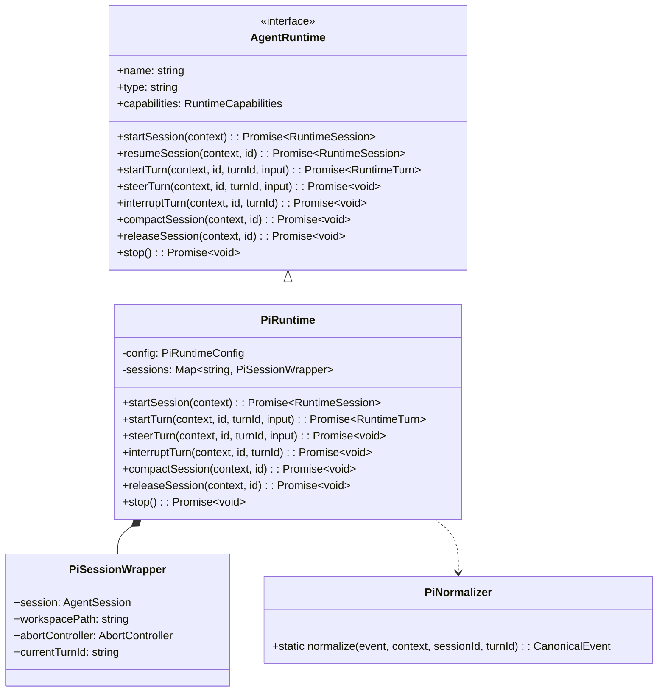

# 02 - Pi Agent Native TypeScript SDK Integration Design

| Metadata          | Details                                      |
| :---------------- | :------------------------------------------- |
| **Document ID**   | `02-pi-agent-sdk-integration`                |
| **Status**        | `Accepted`                                   |
| **Author**        | Agent Orchestrator Team                      |
| **Created At**    | 2026-11-18                                   |
| **Target Module** | `src/runtime/pi/`, `src/runtime/registry.ts` |

---

## 1. Overview & Context

Agent Orchestrator is a Bun and TypeScript coordination platform managing multi-agent runtimes, isolated Git worktrees, and real-time streaming events. Currently, the service provides an OpenAI Codex runtime adapter (`CodexRuntime`), which operates by spawning `codex app-server` as a subprocess communicating over JSONL stdin/stdout pipes.

We recently decoupled the runtime layer by introducing `RuntimeRegistry`, dynamic runtime configuration schemas, and full session runtime persistence. This laid the foundation for zero-modification runtime extensibility.

**Pi Agent** (`@earendil-works/pi-coding-agent`, originally created by Mario Zechner) is a minimalist, modular coding assistant and agent toolkit. Unlike Codex, Pi is built natively in **pure TypeScript** and publishes a first-class programmatic SDK (`createAgentSession`).

Rather than regressing to a child-process CLI/RPC model (`pi --mode rpc`), which introduces process-spawning overhead, IPC pipe parsing fragility, and file-based state exchange, this design specifies an **in-process TypeScript SDK integration** that executes Pi Agent natively within Agent Orchestrator's Bun process.

---

## 2. Motivation & Why In-Process SDK

Integrating Pi Agent via its native TypeScript SDK (`createAgentSession`) yields significant architectural and performance advantages over CLI subprocess execution:

```
┌────────────────────────────────────────────────────────────────────────┐
│                   CLI RPC Subprocess (Discouraged)                     │
│                                                                        │
│   Agent Orchestrator ──(spawn/pipe)──► node/bun pi --mode rpc          │
│          ▲                                   │                         │
│          └─────────── JSONL stdout ──────────┘                         │
│       * IPC serializing / string-splitting / OS pipe overhead           │
│       * Disk-bound config generation & process tree management         │
└────────────────────────────────────────────────────────────────────────┘

                                    vs

┌────────────────────────────────────────────────────────────────────────┐
│                   In-Process SDK Integration (Selected)                │
│                                                                        │
│   Agent Orchestrator (Bun Process)                                     │
│   ┌────────────────────────────────────────────────────────────────┐   │
│   │  PiRuntime (AgentRuntime)                                      │   │
│   │    └── AgentSession (In-Memory JS Object)                      │   │
│   │          ├── session.prompt(input)    ──► Direct async call    │   │
│   │          ├── session.subscribe(cb)    ──► Microsecond dispatch │   │
│   │          └── ActionRegistry Tools     ──► Direct JS functions  │   │
│   └────────────────────────────────────────────────────────────────┘   │
│       * Zero IPC serialization overhead                                │
│       * Zero temporary credential / config files on disk               │
│       * Compile-time type safety across all interfaces                 │
└────────────────────────────────────────────────────────────────────────┘
```

1. **Zero IPC & Microsecond Latency**: Direct JavaScript memory invocation eliminates string encoding/decoding, line splitting, and OS pipe context switches.
2. **Zero Temporary File Disk Footprint**: Credentials (`apiKey`), endpoints (`baseUrl`), and custom model definitions are injected directly in memory into Pi's `modelRegistry` and `authStorage`, avoiding credential leaks on disk.
3. **Compile-Time Type Safety**: Commands and session event subscriptions (`session.subscribe`) are fully typed in TypeScript.
4. **Direct Action & MCP Bridging**: Orchestrator's internal actions (`schedule_job`, `notify`, `dispatch_task`) can be passed directly as JavaScript functions conforming to Pi's tool interface, without requiring external MCP bridge daemons.

---

## 3. Goals & Non-Goals

### Goals

- **Full `AgentRuntime` Compliance**: Implement all lifecycle methods (`startSession`, `resumeSession`, `startTurn`, `steerTurn`, `interruptTurn`, `compactSession`, `releaseSession`, `stop`).
- **Workspace & Worktree Confinement**: Confine all file and shell executions (`read`, `write`, `edit`, `bash`) strictly to `context.workspacePath` (the session's isolated Git worktree).
- **Canonical Event Normalization**: Transform Pi Agent's native events (`message_update`, `tool_execution_start`, `tool_execution_end`, `turn_complete`) into Orchestrator's `CanonicalEvent` stream.
- **Dynamic Multi-Provider Configuration**: Seamlessly accept arbitrary provider parameters (OpenAI, Anthropic, Ollama, DeepSeek) through Orchestrator's `runtimes.pi` YAML configuration.
- **In-Memory Action Bridging**: Wrap Orchestrator's `ActionRegistry` and project-level MCP tools into native Pi tools.

### Non-Goals

- Modifying Pi Agent's internal loop algorithm or prompting heuristics.
- Replacing Codex as the primary default runtime; Pi Agent serves as an alternative registered runtime selected per project via `runtime: { type: "pi" }`.

---

## 4. Technical Architecture

### 4.1 Component Topology



### 4.2 Lifecycle & Method Mapping

| `AgentRuntime` Method                   | Pi SDK (`@earendil-works/pi-coding-agent`) API                        | Implementation Behavior                                                                                                            |
| :-------------------------------------- | :-------------------------------------------------------------------- | :--------------------------------------------------------------------------------------------------------------------------------- |
| `startSession(context)`                 | `createAgentSession(options)`                                         | Instantiates an in-process `AgentSession` bound to `context.workspacePath` with configured models and tools. Subscribes to events. |
| `resumeSession(context, id)`            | `createAgentSession({ sessionManager: SessionManager.create(path) })` | Restores prior branch and message history from disk.                                                                               |
| `startTurn(context, id, turnId, input)` | `session.prompt(input)`                                               | Queues input into the conversation loop. Dispatches execution asynchronously while returning `{ id: turnId }`.                     |
| `steerTurn(context, id, turnId, input)` | `session.steer(input)`                                                | Native SDK steer; instructs the agent to alter course immediately after the current active tool finishes.                          |
| `interruptTurn(context, id, turnId)`    | `session.abort()`                                                     | Aborts active tool/LLM execution via Pi's built-in abort mechanism.                                                                |
| `compactSession(context, id)`           | `session.compact()`                                                   | Triggers LLM-driven message tree compaction and context pruning.                                                                   |
| `releaseSession(context, id)`           | `session.dispose()`                                                   | Tears down memory references, listeners, and file watchers.                                                                        |
| `stop()`                                | Batch `session.dispose()`                                             | Disposes all active sessions and unloads the runtime adapter.                                                                      |

---

## 5. Event Stream Normalization

Pi SDK emits fine-grained events via `session.subscribe((event) => void)`. The `PiNormalizer` module converts these into Orchestrator canonical domain events:

```
Pi SDK Event                           Canonical Event
─────────────────────────────────────────────────────────────────────────────
event.type === "message_update"
  └─ assistantMessageEvent: text_delta ──► agent.message.delta
       payload: { delta: string }

event.type === "tool_execution_start"  ──► tool.call.started
       payload: { callId, name, input }

event.type === "tool_execution_end"    ──► tool.call.completed
       payload: { callId, name, output }

event.type === "turn_complete"         ──► turn.completed
       payload: { status: "completed" }

event.type === "error"                 ──► turn.failed
       payload: { error: string }
```

---

## 6. Action & MCP Tool Bridging

Pi's SDK supports registering custom JavaScript functions alongside or replacing default tools (`read`, `write`, `edit`, `bash`).

We bridge Orchestrator's `ActionRegistry` by mapping registered actions directly into Pi custom tools:

```typescript
export function bridgeActionsToPiTools(
  actionRegistry: ActionRegistry,
  context: ActionContext,
): Array<PiCustomTool> {
  return actionRegistry.getAvailableActions(context.scope).map((action) => ({
    name: action.name,
    description: action.description,
    parameters: action.parameters, // Zod schema
    execute: async (args: unknown) => {
      const result = await actionRegistry.execute(action.name, args, context);
      return result.success ? result.data : { error: result.error };
    },
  }));
}
```

This immediately empowers Pi Agent with full Orchestrator superpowers:

- `schedule_job` (minute-level delayed session triggers)
- `notify` (multi-channel alerts to Feishu, WeCom, Telegram, Webhook)
- `dispatch_task` (cross-task and sub-agent dispatching)

---

## 7. Configuration Specification

Thanks to the dynamic runtime configuration architecture, `service.yaml` accepts any native Pi SDK parameters:

### Global Configuration (`service.yaml`)

```yaml
runtimes:
  pi:
    provider: "anthropic" # "anthropic" | "openai" | "deepseek" | "ollama"
    model: "claude-3-5-sonnet-20241022"
    apiKey: "${ANTHROPIC_API_KEY}"
    baseUrl: "https://api.anthropic.com" # Optional custom proxy/gateway
    thinkingLevel: "off" # "off" | "low" | "medium" | "high"
    tools: ["read", "write", "edit", "bash"]
    # Pass arbitrary Pi SDK options directly
    settings:
      autoCompactContext: true
      maxTokens: 8192
```

### Project-Level Override (`projects/<project-id>.yaml`)

```yaml
runtime:
  type: "pi"
  model: "claude-3-7-sonnet"
  reasoningEffort: "low"
  # Project-specific custom tools or overrides
```

---

## 8. Implementation Phases

```
┌────────────────────────────────────────────────────────────────────────┐
│ Phase 1: SDK Dependency & Foundation                                   │
│  - Add `@earendil-works/pi-coding-agent` to package.json dependencies   │
│  - Establish `src/runtime/pi/` directory and capabilities export       │
├────────────────────────────────────────────────────────────────────────┤
│ Phase 2: Core Adapter & Normalizer                                     │
│  - Implement `PiNormalizer` for mapping `session.subscribe` events     │
│  - Implement `PiRuntime` class conforming to `AgentRuntime`            │
│  - Ensure working directory strictly respects `context.workspacePath`  │
├────────────────────────────────────────────────────────────────────────┤
│ Phase 3: Action & MCP Tool Bridging                                    │
│  - Bridge `ActionRegistry` into Pi custom tools                        │
│  - Support project MCP server tool definitions                         │
├────────────────────────────────────────────────────────────────────────┤
│ Phase 4: Registry Registration & Verification                          │
│  - Register `"pi"` in `createDefaultRuntimeRegistry()`                 │
│  - Add comprehensive test suite in `tests/pi-runtime.test.ts`          │
│  - Verify full test suite and build in `dev-orchestrator` container   │
└────────────────────────────────────────────────────────────────────────┘
```

---

## 9. Testing Strategy

1. **Lifecycle Unit Tests**: Validate `startSession`, `startTurn`, `steerTurn`, `interruptTurn`, `compactSession`, and `releaseSession` against a mocked `AgentSession`.
2. **Event Normalization Tests**: Verify that streaming tokens, tool calls, and completion statuses are translated into canonical events with matching sequence numbers and session IDs.
3. **Action Execution Tests**: Ensure Pi Agent can invoke Orchestrator's internal actions (`notify`, `schedule_job`) in-process.
4. **Multi-Session Worktree Concurrency**: Confirm that multiple simultaneous sessions created on different Git worktrees execute in parallel without cross-talk or shared state leakage.
