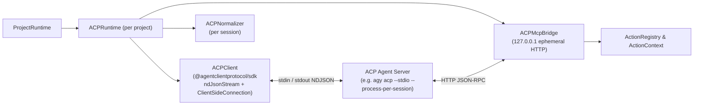

# 06 - 通用 ACP 运行时适配器与 Antigravity (`agy`) 接入设计

| 元数据       | 内容                                                                                 |
| :----------- | :----------------------------------------------------------------------------------- |
| **文档 ID**  | `06-acp-and-agy-runtime`                                                             |
| **状态**     | `Draft`                                                                              |
| **创建日期** | 2026-11-20                                                                           |
| **目标模块** | `src/runtime/acp/`、`src/runtime/registry.ts`、`docs/references/runtime-setup.md`    |
| **依赖**     | `@agentclientprotocol/sdk`（`^2.8.0`，Apache-2.0，零外部传递依赖）                    |
| **依赖原则** | 遵循 [设计 05](../05-native-runtime-config-and-single-repo-workspace/README.md) 职责边界 |

---

## 1. 背景与动机

目前编排器已接入三个原生运行时（`codex`、`claude`、`pi`），每个运行时都有各自的通信协议与 SDK：

- **Codex**：`codex app-server` 私有 stdio JSON-RPC 协议；
- **Claude Code**：`@anthropic-ai/claude-agent-sdk` 子进程流式协议；
- **Pi**：`@earendil-works/pi-coding-agent` 进程内 TypeScript SDK。

随着 **ACP（Agent Client Protocol）** 成为越来越多 Coding Agent 的开放接入标准（包括 Antigravity CLI `agy acp`，以及 OpenCode、Gemini CLI、Goose、Qwen Code 等），如果为每一个新 Agent 都从零重写通信层、事件映射、审批流和 MCP 桥接，维护成本会线性上升。

本设计基于 ACP 官方 TypeScript SDK（`@agentclientprotocol/sdk`），在 `src/runtime/acp/` 构建一套**通用 ACP 运行时内核（`ACPRuntime`）**，配合**极薄的厂商 Profile（`ACPProfile`）**，将 `agy` 作为首个落地运行时接入编排器，同时为后续接入任意 ACP 生态 Agent 铺平道路。

> 注：本设计作为第四条并行运行时跑道，**不替换**现有的 `codex` / `claude` / `pi` 原生适配器。

---

## 2. 目标与非目标

### 目标

1. **基于官方 SDK 的通用 ACP 协议层**：引入 `@agentclientprotocol/sdk`（`ndJsonStream`、`ClientSideConnection` 与官方协议类型定义），在其上封装进程托管（`ACPClient`）、规范化事件转换器（`ACPNormalizer`）与进程内 HTTP MCP 桥（`ACPMcpBridge`），可复用至任何遵循 ACP v1 的 Agent。
2. **薄 Profile 扩展模型**：通过 `ACPProfile` 收口不同 ACP Agent 在启动命令、只读模式、项目 Skills 注入、压缩命令与工具分类上的少量差异；首个内置 Profile 为 `agy`。
3. **完全遵循设计 05**：
   - `agy` 直接读取自身的原生全局配置（`~/.gemini/antigravity-cli/settings.json`、`~/.gemini/config/`）与登录态，编排器不代管凭据和配置；
   - `config.yaml` 与 `project.yaml` **零新增字段**，继续只接受 `runtime.type`、`model`、`reasoningEffort`、`mcpServers`；
   - 仓库自带的 `AGENTS.md` / `GEMINI.md` / `.agents/skills` 由 `cwd` 原生加载。
4. **完整接入编排器能力**：支持会话创建/恢复/关闭、实时流式事件、命令与文件变更结构化映射、人工审批桥接（`approval.requested`）、编排器内置 Actions 注入、`readOnly` 全局只读模式以及项目/全局 `.skills/` 注入。

### 非目标

- 不将现有 `codex` / `claude` / `pi` 迁移到 ACP。
- 不支持在 `config.yaml` 中配置任意自定义 shell 命令作为未注册 ACP 运行时（未来如有需求再单独评估安全边界）。
- 不实现 ACP 客户端侧的文件系统代理（`fs.readTextFile` / `fs.writeTextFile`）或终端代理（`terminal`），由 ACP Agent 使用自身原生工具在 `cwd`（会话 worktree）内执行。
- 不引入额外的 MCP SDK 依赖：本地 Action 桥仅需实现最小 HTTP JSON-RPC 工具子集，直接用 `Bun.serve` 实现即可。

---

## 3. 本机 `agy acp` 实测结论（Phase 0 协议勘探）

在独立临时目录（未触碰任何 `projects/` 业务目录）下对本机 `agy acp --stdio`（`Antigravity ACP Server v1.5.12`）进行了端到端握手、会话、MCP、工具调用、审批与技能发现实测，关键发现如下：

| 协议能力 | 实测结果 | 对设计的关键影响 |
| :--- | :--- | :--- |
| **`initialize`** | 返回 `protocolVersion: 1`，`agentCapabilities` 明确声明 `loadSession: true` 以及 `sessionCapabilities: { resume, close, load, list, additionalDirectories }`，并在 `_meta.antigravity.systemPrompt.append` 声明支持追加系统提示词 | 通用内核可基于 `agentCapabilities` 动态自适应不同 ACP 服务端能力 |
| **`session/new`** | 返回 `sessionId`、`models`、`modes` 与标准 `configOptions`（带 `category`：`model`、`thought_level`、`mode`） | `ACPRuntime` 可按标准 `category` 自动定位配置项并调用 `setSessionConfigOption`，无需硬编码 ID |
| **`session/set_config_option`** | `{ sessionId, configId: "thought_level", value: "low" }` 成功返回最新 `configOptions` | `model`（如 `gemini-4-neon`）与 `reasoningEffort`（`low\|medium\|high\|xhigh`）可在会话创建后立即生效 |
| **`session/resume` vs `session/load`** | **重要差异**：对不存在的 `sessionId` 调用 `session/load` 会静默成功并新建空会话；调用 **`session/resume`** 则正确返回 `-32603`（`Failed to read session ...`）。ACP 规范中 `session/resume` 也正是用于恢复上下文而不重放历史消息流 | 服务端支持 `sessionCapabilities.resume` 时，`resumeSession` 必须优先调用 `session/resume`，才能准确抛出 `RuntimeSessionNotFoundError` 触发 `session.runtime_reset`，且避免重复重放历史事件 |
| **`session/close`** | 返回 `{}`，优雅释放服务端会话资源 | `releaseSession` 可调用 `session/close` 清理单会话，而不必重启整个共享进程 |
| **HTTP MCP 注入** | 在 `session/new.mcpServers` 传入 `{ type: "http", name: "orchestrator", url: "http://127.0.0.1:<port>/mcp", headers: [] }` 后，`agy` 立即连入并完成 `initialize` → `notifications/initialized` → `tools/list` | 可用轻量进程内 `Bun.serve` HTTP MCP 桥向所有 ACP 运行时统一暴露 `ActionRegistry`（零额外依赖、零子进程） |
| **权限审批 (`session/request_permission`)** | 服务端主动发出 JSON-RPC 请求（`id` 为字符串如 `"1"`），含 `toolCall` 与 `options`（`kind: "allow_once" \| "reject_once"`）；回复 `{ outcome: { outcome: "selected", optionId } }` 即可放行或拒绝 | SDK 的 `requestPermission` 回调自动处理双向 JSON-RPC；编排器内置 MCP Action 自动选 `allow_once` 免审批 |
| **工具调用事件流** | `tool_call`（`status: "in_progress"`，`kind: "execute"`）→ 审批时发 `tool_call_update`（`status: "pending"`）→ 批准后发 `tool_call_update`（`status: "in_progress"`）→ 结束时发 `tool_call_update`（`status: "completed"`，携带 `rawOutput: { output, exit_code }` 与 `content`） | `ACPNormalizer` 需按 `toolCallId` 去重，确保 `started` 事件只发一次，终态精确映射 `command.completed` / `file_change.completed` / `tool.called` |
| **项目 Skills 注入** | 在 `session/new` 传入 `additionalDirectories: [<dir>]` 后，`agy` 自动扫描 `<dir>/.agents/skills/<name>/SKILL.md` 并在 `available_commands_update` 中暴露对应 skill | 可复用类似 Claude 插件目录的方式，在 `<dataDir>/acp-skills/<project>/{global,project}/.agents/skills` 建立软链，不污染仓库 worktree 与 `~/.gemini` |
| **会话压缩** | `available_commands_update` 明确列出 `compact` 命令（`Compact the conversation now`） | `compactSession` 可通过发送 `/compact` prompt 实现（需在测试阶段进一步确认压缩完成事件形态） |

---

## 4. 详细技术设计

### 4.1 模块结构

```text
src/runtime/acp/
├── index.ts          # 统一导出 ACPRuntime、ACPProfile、agy 注册工厂与 capabilities
├── profile.ts        # ACPProfile 接口定义与配置映射辅助类型
├── client.ts         # 基于 @agentclientprotocol/sdk (ndJsonStream + ClientSideConnection) 的进程与连接封装
├── mcp-bridge.ts     # 基于 Bun.serve(127.0.0.1:0) 的轻量 Streamable HTTP MCP Server，桥接 ActionRegistry
├── normalizer.ts     # ACPNormalizer：SDK SessionUpdate -> RuntimeEvent[]（含 toolCallId 去重与分类）
├── skills.ts         # 为支持 additionalDirectories 的 ACP 运行时准备只读 skills 软链目录
├── runtime.ts        # 通用 ACPRuntime implements AgentRuntime
└── profiles/
    └── agy.ts        # Antigravity (agy) Profile 定义与 AGY_CAPABILITIES
```

### 4.2 进程模型与连接架构



- **SDK 传输层对接 Bun 子进程**：
  - 使用 `Bun.spawn(command, { cwd, env, stdin: "pipe", stdout: "pipe", stderr: "inherit" })` 启动 ACP 进程；
  - 将 `proc.stdin` 包装为标准 `WritableStream<Uint8Array>`，配合 `proc.stdout`（Bun 原生 `ReadableStream<Uint8Array>`）传入 `@agentclientprotocol/sdk` 的 `ndJsonStream(input, output)`；
  - 创建 `ClientSideConnection((_agent) => clientHandler, stream)`，由 `clientHandler` 统一承接 `sessionUpdate` 通知和 `requestPermission` 请求；
  - 若 `additionalDirectories` 等较新的协议扩展字段尚未包含在 SDK 稳定方法参数类型中，在 `client.ts` 层通过轻量类型交叉或扩展方法透传，不侵入业务层。
- **单项目单前置进程**：与 `CodexRuntime` 保持一致，每个 `ProjectRuntime` 持有一个 `ACPRuntime` 实例与一个懒启动的 ACP 进程；对于 `agy`，默认传 `--process-per-session`，让 `agy` 自身将每个会话隔离到独立 worker，兼具单连接管理简洁性与会话级崩溃隔离。
- **意外退出处理**：监听 `proc.exited` 与 `connection.closed`，当 ACP 进程非预期退出时，对当前所有活跃会话发出 `runtime.disconnected`，清空挂起审批与活跃 Turn，下次请求按 `resumeSession` 自动拉起新进程恢复。

### 4.3 `ACPProfile` 抽象接口

不同 ACP 运行时的差异全部收敛在一个声明式 Profile 中：

```ts
export interface ACPProfile {
  readonly name: string;
  readonly type: string;
  readonly description: string;
  readonly capabilities: RuntimeCapabilities;

  /** 构造启动 ACP 服务端的命令与参数。 */
  buildCommand(options: { project: ProjectConfig; readOnly: boolean }): {
    command: string[];
    env?: Record<string, string | undefined>;
  };

  /** 可选：将项目 runtime.model / reasoningEffort 映射到 ACP configOptions。 */
  resolveConfigUpdates?(params: {
    model?: string;
    reasoningEffort?: string;
    configOptions: readonly SessionConfigOption[];
    models?: SessionModelState;
  }): Array<{ configId: string; value: string }>;

  /** 可选：readOnly 模式下除权限拦截外需要设置的 ACP mode（如 agy 的 "plan"）。 */
  readOnlyModeId?: string;

  /** 可选：是否通过 additionalDirectories 注入项目级 .agents/skills。 */
  injectSkillsViaAdditionalDirectories?: boolean;

  /** 可选：通过 slash command 触发上下文压缩（如 "/compact"）。 */
  compactCommand?: string;

  /** 可选：识别会话不存在的错误（供 resumeSession 抛出 RuntimeSessionNotFoundError）。 */
  isSessionNotFoundError?(error: unknown): boolean;
}
```

首个 Profile `AGY_PROFILE`（`src/runtime/acp/profiles/agy.ts`）：

- `name / type`: `"agy"`
- `command`: `["agy", "acp", "--stdio", "--process-per-session"]`
- `readOnlyModeId`: `"plan"`（并在权限回调中二次兜底拒绝所有非只读工具）
- `injectSkillsViaAdditionalDirectories`: `true`
- `compactCommand`: `"/compact"`
- `capabilities`:
  ```ts
  export const AGY_CAPABILITIES: RuntimeCapabilities = {
    streaming: true,
    resume: true,
    steer: false, // ACP 基础协议按 Turn 串行，后续若 agy 支持并发 prompt 再开启
    interrupt: true,
    compaction: true,
    approvals: true,
    mcp: true,
    structuredOutput: false,
    sandbox: false, // 沙箱由 agy 原生配置决定
  };
  ```

### 4.4 `AgentRuntime` 方法映射

| `AgentRuntime` 方法 | 通用 `ACPRuntime` 实现（经 `@agentclientprotocol/sdk`） |
| :--- | :--- |
| `startSession(context)` | 1. 懒连接并调用 `connection.initialize({ protocolVersion: PROTOCOL_VERSION, clientCapabilities: { fs: { readTextFile: false, writeTextFile: false }, terminal: false }, clientInfo })`（缓存 `agentCapabilities`）；<br/>2. 若存在可用内置 Actions，确保 `ACPMcpBridge` 已启动并构造 `mcpServers`（合并项目 `runtime.mcpServers`）；<br/>3. 若 profile 开启 skills 注入且服务端声明 `additionalDirectories`，准备 `<dataDir>/acp-skills/<project>/` 目录并传入；<br/>4. 调用 `connection.newSession(...)`，随后按 `configOptions`（匹配 `category === "model" \| "thought_level" \| "mode"`）调用 `setSessionConfigOption` 应用 `model`、`reasoningEffort` 与 `readOnlyModeId`（当 `context.readOnly` 为真）。 |
| `resumeSession(context, runtimeSessionId)` | 若当前连接已持有该会话则仅刷新 `context`；否则按 `agentCapabilities.sessionCapabilities?.resume` 优先调用 `resumeSession`（不支持时回退 `loadSession`），同步传入 `cwd`、`mcpServers`、`additionalDirectories`。命中“会话不存在”错误时抛出 `RuntimeSessionNotFoundError`。 |
| `startTurn(context, sessionId, turnId, input)` | 记录活跃 Turn（生成 `runtimeTurnId`），异步发起 `connection.prompt({ sessionId, prompt: [{ type: "text", text: input }] })` 并立刻返回 `{ id: runtimeTurnId }`。`prompt` 返回时按 `stopReason` 收尾：<br/>- `end_turn` / `max_tokens` / `max_turn_requests` / `refusal` → 先 flush 挂起的 message/reasoning 缓冲，再发 `turn.completed`；<br/>- `cancelled` → 发 `turn.interrupted`；<br/>- RPC 报错或进程断开 → 发 `turn.failed`。 |
| `steerTurn(...)` | `capabilities.steer === false` 时抛出明确错误（`ACP runtime does not support steering an active turn`），交由 `ProjectRuntime` 上层处理。 |
| `interruptTurn(context, sessionId)` | 标记当前 Turn 为已取消，并调用 `connection.cancel({ sessionId })`。 |
| `compactSession(context, sessionId)` | 若 `profile.compactCommand` 已配置且会话不在运行中，发送一次内部 `connection.prompt({ sessionId, prompt: [{ type: "text", text: "/compact" }] })`，完成后发出 `compaction.completed`（带 `usage_update` 前后 token 数）。 |
| `respondToApproval(context, requestId, decision)` | 查找挂起的 `requestPermission` Promise：`"approved"` 选第一个 `kind === "allow_once"`（回退 `allow_always`），`"rejected"` 选第一个 `kind === "reject_once"`（回退 `reject_always`），resolve `{ outcome: { outcome: "selected", optionId } }`。 |
| `releaseSession(context, sessionId)` | 取消该会话所有挂起审批（resolve `{ outcome: { outcome: "cancelled" } }`），若服务端声明 `sessionCapabilities?.close` 则调用 `closeSession({ sessionId })`，移除会话上下文与 normalizer 状态。 |
| `stop()` | 关闭 `ACPClient`（优雅停止子进程）与 `ACPMcpBridge` HTTP 服务，清理所有挂起 Promise。 |

### 4.5 规范化事件映射（`ACPNormalizer`）

直接使用 `@agentclientprotocol/sdk` 的 `SessionUpdate` 类型，每个会话持有一个轻量 `ACPNormalizer` 实例，维护：
- 当前流式文本/思考的 `itemId` 与累计文本（用于切段或 Turn 结束时补发 `*.completed`）；
- `seenToolCalls: Map<toolCallId, { kind, name, command?, path?, started: boolean }>`，用于去重 `tool_call_update` 的中间态。

| ACP `sessionUpdate` | 映射后的 Canonical Event | 说明 |
| :--- | :--- | :--- |
| `agent_message_chunk`（`content.type === "text"`） | `agent.message.delta` | 切入工具调用或 Turn 结束时自动闭合发出 `agent.message.completed` |
| `agent_thought_chunk`（`content.type === "text"`） | `agent.reasoning.delta` | 切入正文/工具或 Turn 结束时自动闭合发出 `agent.reasoning.completed` |
| `plan`（`entries`） | `plan.updated` | 映射 `pending` / `in_progress` / `completed` |
| `tool_call` / `tool_call_update`（`kind === "execute"`） | `command.started` → `command.completed` | 首次 `in_progress`/`pending` 发 `command.started`；`completed`/`failed` 提取 `rawOutput.exit_code` 与文本输出发 `command.completed` |
| `tool_call` / `tool_call_update`（`kind === "edit" \| "delete" \| "move"`） | `file_change.started` → `file_change.completed` | 从 `locations` / `rawInput` 提取路径，从 `content` 中 `type === "diff"` 提取变更摘要 |
| `tool_call` / `tool_call_update`（MCP 工具，如 `mcp__<server>__<tool>`） | `mcp_call.started` → `mcp_call.completed` | 识别 MCP 前缀并解析 `serverName` 与 `toolName` |
| `tool_call` / `tool_call_update`（其他 `read`/`search`/`think`/`fetch`/`other`） | `tool.call.started` → `tool.called` | 透传 `toolName`、`args`、结果与错误状态 |
| `usage_update` / `available_commands_update` / `current_mode_update` / `config_option_update` / `session_info_update` | 内部状态更新（不发冗余事件） | 用于追踪 token 用量、可用命令与当前配置，避免污染前端对话流 |

### 4.6 Action 桥接（`ACPMcpBridge`）与 MCP 转换

由于 ACP 规范没有类似 Codex `dynamicTools` 的私有回调，扩展外部工具的标准机制即为 `mcpServers`（与 [ClaudeRuntime](../../../src/runtime/claude/tools.ts) 使用进程内 MCP 暴露内置 Action 的方式一致）：

- **本地 HTTP MCP 桥（对用户完全透明）**：
  - 使用 `Bun.serve({ hostname: "127.0.0.1", port: 0 })` 启动仅监听本机回环地址的轻量 JSON-RPC 端点（例如 `/sessions/<sessionId>/mcp`），并携带单进程随机 Bearer Token（通过 ACP `headers: [{ name: "Authorization", value: "Bearer <token>" }]` 传入，防止本机其他进程误调用）。
  - 实现最小 MCP 工具子集：`initialize`、`notifications/initialized`、`tools/list`、`tools/call`（以及兼容 `server/discover`）。
  - 每个 `tools/call` 通过 URL 中的 `sessionId` 找到对应的 `ActionCallSite`，经共享的 [action-bridge.ts](../../../src/runtime/action-bridge.ts) 调用 `ActionRegistry.execute`，自动完成作用域过滤（`conversation` / `task`）与 `action_executions` 审计。
  - 若当前作用域下没有任何可暴露的 Action，则跳过注入。
- **项目级 `runtime.mcpServers` 转换（严格对齐 SDK `McpServer` 类型）**：
  - HTTP 型 `McpServerConfig`（含 `url`）→ `{ type: "http", name, url, headers: Object.entries(http_headers ?? headers).map(([name, value]) => ({ name, value })) }`；
  - Stdio 型 `McpServerConfig`（含 `command`）→ `{ name, command, args: args ?? [], env: [] }`。

### 4.7 只读模式（`_global_`）与审批策略

对于 SDK 的 `requestPermission` 回调，按优先级执行三层判断：

1. **编排器内置 Action 免审批**：若 `toolCall.name` 属于本会话挂载的 `orchestrator` MCP Action（例如 `send_notification`、`create_artifact`），直接回复 `allow_once`，不中断用户（与 `ClaudeRuntime` 行为一致）。
2. **`context.readOnly === true` 严格只读保护**：
   - 会话启动时优先切换到 `profile.readOnlyModeId`（`agy` 为 `plan`）；
   - 在 `requestPermission` 中，仅允许 `kind === "read" | "search" | "think"`，对 `execute` / `edit` / `delete` / `move` 等变更类工具一律自动回复 `reject_once`，形成“模式约束 + 权限兜底”双保险。
   - 若部署环境配置了自动放行导致服务端不回调 `requestPermission`，`agy` 的 `plan` 模式本身仍会阻止写文件与危险执行。
3. **常规审批流**：其余权限请求按 `toolCall.kind` 映射为 `actionType`（`"command" | "file_change" | "tool_call"`），发出 `approval.requested` 并挂起等待 `respondToApproval`。

### 4.8 项目与全局 Skills 注入

- 当 `agentCapabilities.sessionCapabilities?.additionalDirectories` 存在且 `profile.injectSkillsViaAdditionalDirectories` 为 `true` 时：
  - 使用共享的 [src/runtime/skills.ts](../../../src/runtime/skills.ts) 收集全局（`projects/.skills`）与项目（`projects/<id>/.skills`）的 skill 目录；
  - 在 `<dataDir>/acp-skills/<project>/{global,project}/.agents/skills` 创建目录软链指向实际 `.skills` 目录；
  - 在 `newSession` 与 `resumeSession` 中通过 `additionalDirectories` 传入，不改动任何 Git worktree 文件或用户全局配置目录。

---

## 5. 配置规范

严格遵守设计 05，**不引入任何新的配置 Schema 字段**：

- **服务级 (`config.yaml`)**：
  ```yaml
  defaultRuntime: agy # codex | claude | pi | agy
  ```
- **项目级 (`projects/<project-id>/project.yaml`)**：
  ```yaml
  runtime:
    type: agy
    model: gemini-4-neon        # 对应 agy configOptions 中 category=model 的选项 value
    reasoningEffort: high       # low | medium | high | xhigh（不支持的档位记录告警并忽略）
    mcpServers:
      - name: github
        url: https://api.githubcopilot.com/mcp
        http_headers:
          Authorization: "Bearer {env:GITHUB_TOKEN}"
  ```
- **运行时原生配置目录**：`agy` 读 `~/.gemini/antigravity-cli/settings.json` 与 `~/.gemini/config/`（容器部署时挂载持久化卷并执行 `agy acp --login` 或配置 Gemini API Key / ADC）。

---

## 6. 实施阶段与测试计划

### 实施拆解（建议原子提交顺序）

1. **`docs: add acp and agy runtime integration design`**
   - 提交本设计文档。
2. **`build: add agent client protocol sdk`**
   - 执行 `bun add @agentclientprotocol/sdk` 并保持 `bun.lock` 同步。
3. **`feat: add generic acp client, normalizer, and mcp bridge`**
   - 实现 `src/runtime/acp/profile.ts`、`client.ts`、`normalizer.ts`、`mcp-bridge.ts`、`skills.ts`；
   - 配套纯单元测试：`tests/acp-normalizer.test.ts`、`tests/acp-mcp-bridge.test.ts`。
4. **`feat: add generic acp runtime and agy profile`**
   - 实现 `src/runtime/acp/runtime.ts`、`profiles/agy.ts`、`index.ts`；
   - 在 `src/runtime/registry.ts` 注册 `"agy"`；
   - 配套端到端 Mock ACP Server 测试：`tests/acp-runtime.test.ts`（覆盖 `startSession`、`resumeSession` + `RuntimeSessionNotFoundError`、`startTurn`、`interruptTurn`、`respondToApproval`、编排器 Action 自动放行、`readOnly` 拒绝写操作、异常退出断连、`releaseSession`）。
5. **`docs: document agy runtime setup and update runtime list`**
   - 更新 `docs/references/runtime-setup.md`、`config.example.yaml`、`README.md` / `README_zh.md`，并将本设计状态更新为 `Accepted`。

### 验证标准

- `bun run check`（`typecheck` + `lint` + `bun test`）全部通过；
- `bun run build` 打包通过；
- 在临时目录（非 `projects/`）下使用真实 `agy acp` 完成一次端到端冒烟验证：普通问答流式输出、调用编排器 Action（`create_artifact`）、工具审批、项目 skill 识别与 `readOnly` 拦截。

---

## 7. 备选方案与取舍

| 备选方案 | 取舍说明 |
| :--- | :--- |
| **自写 stdio JSON-RPC 传输层与协议类型** | 放弃。`@agentclientprotocol/sdk`（`v2.8.0`）本身零传递依赖，提供官方维护的协议类型与 `ClientSideConnection`，与本项目接入 `@anthropic-ai/claude-agent-sdk` 和 `@earendil-works/pi-coding-agent` 的思路一致，长期跟进 ACP 演进成本更低 |
| **直接对接 `agy -p --input-format stream-json --output-format stream-json`** | 放弃。交互式权限审批与每会话动态 MCP 注入能力弱于 ACP，且无法复用给 OpenCode / Gemini CLI 等其他 ACP Agent |
| **封装 Antigravity Python SDK** | 放弃。需在 Bun/TypeScript 服务中维护 Python 进程桥与额外依赖，复杂度高于直接基于 `@agentclientprotocol/sdk` 对接 `agy acp` |
| **用 ACP 替代现有 Codex / Claude / Pi 适配器** | 暂不采用。现有三套原生适配器测试完备且依赖非 ACP 专有能力（Codex 沙箱、Claude 进程内 MCP 与 steer、Pi 零 IPC），并行共存风险最低 |
