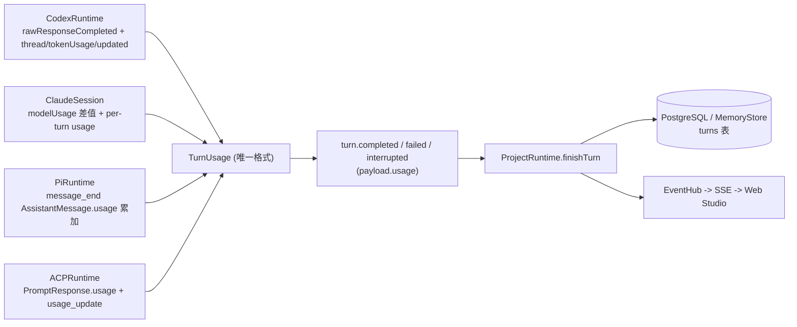

# 08 - 模型用量与缓存统计设计（Unified Model Usage Tracking）

| 元数据       | 内容                                                                                                                               |
| :----------- | :--------------------------------------------------------------------------------------------------------------------------------- |
| **文档 ID**  | `08-model-usage-tracking`                                                                                                          |
| **状态**     | `Accepted`                                                                                                                         |
| **创建日期** | 2026-11-23                                                                                                                         |
| **目标模块** | `src/domain/`、`src/runtime/{codex,claude,pi,acp}/`、`src/project/runtime.ts`、`src/persistence/`、`src/gateway/`、`web/src/`       |
| **前置依赖** | [07-drizzle-persistence-refactor](../07-drizzle-persistence-refactor/README.md)                                                    |

---

## 1. 背景与动机

目前四个 Agent 运行时（Codex、Claude Code、Pi、ACP/`agy`）的底层协议均已返回 Token 与缓存读取/写入明细，但编排器尚未对这些数据进行统一采集、落库和展示：

- `Codex` 的 `thread/tokenUsage/updated` 和 `rawResponseCompleted.usage` 在 [codex/normalizer.ts](../../../src/runtime/codex/normalizer.ts) 中被直接忽略；
- `Claude Code` 的 `SDKResultMessage.usage` / `modelUsage` 在 [claude/session.ts](../../../src/runtime/claude/session.ts) 中仅打印了 debug 日志；
- `Pi` 的 `AssistantMessage.usage` 未在 [pi/runtime.ts](../../../src/runtime/pi/runtime.ts) 中汇总上报；
- `ACP` 的 `PromptResponse.usage` 与 `usage_update` 在 [acp/normalizer.ts](../../../src/runtime/acp/normalizer.ts) 和 [acp/runtime.ts](../../../src/runtime/acp/runtime.ts) 中未透传。

结果导致：
1. 数据库 `turns` 表没有模型用量记录，无法按 Turn、Session 或 Project 回溯真实 Token 消耗与 Prompt Cache 命中效果；
2. Web Studio 界面看不到每轮对话的输入/缓存/输出消耗以及上下文窗口水位；
3. 后续如果要接入模型计费或配额告警，缺乏干净、统一、口径一致的底层事实数据。

本设计聚焦**用量统计本身（暂不做计费）**：在各个 Runtime 边界将异构协议归一化为**唯一标准格式 `TurnUsage`**，上层编排、存储、SSE 广播与 Web Studio 均只消费这一套数据契约。

---

## 2. 目标与非目标

### 目标

1. **单一统一契约**：在 `src/domain/` 定义严格互斥口径的 `TokenUsage`、`ModelTokenUsage`、`TurnUsage` 和 `SessionUsageSummary`，上层不感知任何厂商方言。
2. **四个 Runtime 边界全覆盖**：`codex`、`claude`、`pi`、`acp` 均在 Turn 终态（`turn.completed` / `turn.failed` / `turn.interrupted`）输出统一的 `payload.usage`，正确处理多步工具调用累加、缓存口径差异与 resume 恢复后的防重复计数。
3. **单次落库 + 高效聚合**：在 Drizzle `turns` 表中持久化每轮标量用量与扩展明细（含多模型拆分与上下文窗口水位），通过单条 `SUM()` 聚合查询提供会话级用量统计，不增加额外写库次数。
4. **前端实时与历史可见**：通过现有 SSE `turn.*` 事件实时展示每轮 Token / 缓存命中率，通过 `GET /sessions/:sessionId` 与右侧 Inspector 展示会话累计用量和上下文窗口占用。
5. **为未来计费预留完整事实**：保留 `model`、互斥的四类 Token（非缓存输入 / 缓存读 / 缓存写 / 输出）与 `byModel` 拆解，后续引入价格表即可直接纯函数计算费用，无需改动表结构。

### 非目标

- **不做价格/费用计算**：本期不引入模型单价表，不落库或展示 `costUsd`（不依赖 Claude/Pi 的估算费用字段，避免与中转/订阅账号价格失真）。
- **不做按天/全局财务报表页**：本期先打通 Turn 与 Session 级统计，项目级/时间维度报表留待后续基于 `turns` 表直接聚合扩展。
- **不引入新的高频瞬态事件**：用量随 Turn 终态事件下发（不向数据库写入中间步进用量）。

---

## 3. 详细技术设计

### 3.1 统一领域数据模型（`src/domain/types.ts`）

```ts
/**
 * 规范化 Token 拆解（严格互斥口径）。
 *
 * 恒等式：totalTokens === inputTokens + cacheReadTokens + cacheWriteTokens + outputTokens
 * 缓存命中率：cacheReadTokens / (inputTokens + cacheReadTokens + cacheWriteTokens)
 */
export interface TokenUsage {
  /** 未命中缓存的新输入 token（严格不含 cacheReadTokens 与 cacheWriteTokens） */
  readonly inputTokens: number;
  /** 命中 Prompt Cache 读取的输入 token */
  readonly cacheReadTokens: number;
  /** 写入 Prompt Cache 的输入 token（总缓存写，含 5m / 1h 等策略） */
  readonly cacheWriteTokens: number;
  /** 模型输出 token（已包含 reasoningTokens） */
  readonly outputTokens: number;
  /** 输出中的思考/推理 token（outputTokens 的子集；供应商未单独上报时为 0） */
  readonly reasoningTokens: number;
  /** 总消耗 token = inputTokens + cacheReadTokens + cacheWriteTokens + outputTokens */
  readonly totalTokens: number;
}

/** 按模型拆分的用量明细（支持单 Turn 内主模型 + 子代理/辅助模型） */
export interface ModelTokenUsage extends TokenUsage {
  readonly model: string;
  readonly provider?: string | undefined;
}

/** 各 Runtime 输出、上层唯一接收的 Turn 级用量格式 */
export interface TurnUsage extends TokenUsage {
  /** 本轮主模型标识 */
  readonly model?: string | undefined;
  /** 按模型拆分的明细（单模型 1 条，多模型多条） */
  readonly byModel?: readonly ModelTokenUsage[] | undefined;
  /** 本轮最后一次模型调用时的上下文窗口占用（水位，非多步累加值） */
  readonly contextUsedTokens?: number | undefined;
  /** 模型上下文窗口上限（用于计算上下文使用率） */
  readonly contextWindowTokens?: number | undefined;
}

/** 会话级聚合统计（由 turns 表实时聚合，不在 sessions 表冗余维护计数器） */
export interface SessionUsageSummary extends TokenUsage {
  /** 计入统计的 Turn 数量 */
  readonly turnCount: number;
  /** 最近一轮使用的主模型 */
  readonly lastModel?: string | undefined;
  /** 最近一轮结束时的上下文窗口占用 */
  readonly contextUsedTokens?: number | undefined;
  /** 最近一轮的模型上下文窗口上限 */
  readonly contextWindowTokens?: number | undefined;
}
```

同时提供共享纯函数工具（例如 `src/runtime/usage.ts`），供 4 个运行时复用，避免各自手写加减法：
- `normalizeTokenUsage(raw: { inputTokens; cacheReadTokens?; cacheWriteTokens?; outputTokens; reasoningTokens?; inputIncludesCache?: boolean }): TokenUsage`：统一裁剪负值、处理包含/互斥输入口径并计算精确的 `totalTokens`；
- `addTokenUsage(a: TokenUsage, b: TokenUsage): TokenUsage`：用于多步工具调用 / 多模型汇总；
- `buildTurnUsage(entries: ModelTokenUsage[], context?: { used?; window?; primaryModel? }): TurnUsage | undefined`：空数据时返回 `undefined`。

### 3.2 四个 Runtime 的边界采集与归一化

所有厂商差异与协议坑点严格收敛在 `src/runtime/{codex,claude,pi,acp}/` 内部：



#### 1. Codex (`src/runtime/codex/`)
- **采集源**：
  - 每步模型调用完成时的 `rawResponseCompleted`（`params.usage: TokenUsageBreakdown | null`）；
  - `thread/tokenUsage/updated`（`params.tokenUsage: { total, last, modelContextWindow }`）。
- **归一化策略**：
  - 每个活跃 Turn 维护一个步进累加器，收到 `rawResponseCompleted.usage` 时累加；
  - 若某版本 app-server 未发送 `rawResponseCompleted`，回退使用 `thread/tokenUsage/updated.total` 减去本 Turn 开始前缓存的基线 `prevTotal`（服务重启后 resume 首轮若无基线则优先使用 `last` 避免把整个历史 thread 算到当前 Turn）；
  - **口径转换**：OpenAI/Codex 的 `inputTokens` 包含 `cachedInputTokens`，归一化时传 `inputIncludesCache: true`（`uncachedInput = Math.max(0, inputTokens - cachedInputTokens - cacheWriteInputTokens)`），`reasoningTokens = reasoningOutputTokens`；
  - **上下文水位**：取最新 `thread/tokenUsage/updated` 的 `last.totalTokens`（或 `last.inputTokens + last.outputTokens`）与 `modelContextWindow`；
  - **模型名**：取 `context.project.runtime?.model` 或 `thread/start` / `turn/completed` 返回的实际模型名。

#### 2. Claude Code (`src/runtime/claude/`)
- **采集源**：
  - `SDKResultMessage` 上的 `modelUsage: Record<string, ModelUsage>`（含所有子代理、sidechain、压缩调用）与 `usage: NonNullableUsage`（仅主循环，per-turn）；
  - 流式过程中每条 `assistant` 消息的 `message.usage`（用于获取最新一步的上下文窗口占用水位）。
- **归一化策略（关键防坑）**：
  - 根据 `@anthropic-ai/claude-agent-sdk` 类型契约，在流式输入长会话中 `result.modelUsage` 是**跨 Turn 累计的**，且 **resume 会话的第一轮结果已经包含恢复前的历史累计值**；
  - `ClaudeSession` 在内存中维护 `prevModelUsage?: Record<string, ModelUsage>`：
    - 非 resume 会话或已有 `prevModelUsage` 时：按模型逐项做 `delta = max(0, curr - prev)`，精确得到包含子代理在内的本轮 `byModel` 与汇总，并更新 `prevModelUsage`；
    - **resume 会话且尚无 `prevModelUsage` 的第一轮**：记录 `prevModelUsage = result.modelUsage` 作为后续基线，本轮用量改用严格 per-turn 的 `result.usage`（匹配 `modelUsage` 中的主模型名与 `contextWindow`），彻底杜绝把历史旧用量重复计入当前 Turn；
  - **口径转换**：Anthropic 口径天然互斥（`inputIncludesCache: false`），`inputTokens = u.inputTokens`、`cacheReadTokens = u.cacheReadInputTokens`、`cacheWriteTokens = u.cacheCreationInputTokens`、`outputTokens = u.outputTokens`、`reasoningTokens = u.thinkingTokens ?? 0`；
  - **上下文水位**：取本轮最后一条 `assistant` 消息的 `input_tokens + cache_read_input_tokens + cache_creation_input_tokens + output_tokens` 作为 `contextUsedTokens`，主模型的 `ModelUsage.contextWindow` 作为 `contextWindowTokens`。

#### 3. Pi (`src/runtime/pi/`)
- **采集源**：
  - Turn 执行期间所有 `message_end` 事件中的 `AssistantMessage`（自带 `message.usage`、`message.model`、`message.provider`）；
  - `session.model?.contextWindow` 获取上下文窗口上限。
- **归一化策略**：
  - 每个 Turn 在 `startTurn` 时重置 Turn 用量桶；每次收到 `message_end` 的 `AssistantMessage.usage` 时按 `provider/model` 累加；
  - **口径转换**：Pi 的 `Usage`（`input`、`cacheRead`、`cacheWrite`、`output`、`reasoning`）已与本规范互斥口径完全一致（`inputIncludesCache: false`）；
  - **上下文水位**：取本轮最后一条 `AssistantMessage.usage` 的 `input + cacheRead + cacheWrite + output` 作为 `contextUsedTokens`，`session.model?.contextWindow` 作为 `contextWindowTokens`。

#### 4. ACP (`src/runtime/acp/`，含 `agy`)
- **采集源**：
  - `session/prompt` 返回的 `PromptResponse.usage`（ACP unstable 字段，实测 `agy` 返回 `{ inputTokens, outputTokens, cachedReadTokens, cachedWriteTokens, thoughtTokens, totalTokens }`）；
  - `session/update` 中的 `usage_update`（`{ used, size }`）；
  - 会话创建/切换时记录的当前激活模型（`configOptions` 中 `category === "model"` 的 `currentValue` 或 `models.currentModelId`）。
- **归一化策略**：
  - `PromptResponse.usage` 天然为本轮（per-turn）统计；
  - **兼容不同 ACP Agent 的输入口径**：实测 `agy` 满足 `inputTokens + cachedReadTokens + cachedWriteTokens + outputTokens === totalTokens`（即 `inputTokens` 不含缓存）。为兼容可能采用“包含式”的其他 ACP Agent，通用转换器检查：当 `cachedReadTokens > 0` 且 `raw.inputTokens + raw.outputTokens === raw.totalTokens` 时按包含式扣除，否则按互斥口径保留；
  - **上下文水位**：直接取该会话最新一次 `usage_update` 的 `used` 与 `size`。

### 3.3 事件协议与 `ProjectRuntime` 流转

- **[src/domain/events.ts](../../../src/domain/events.ts)**：
  - `TurnCompletedPayload` 新增 `readonly usage?: TurnUsage | undefined;`（`turn.completed`、`turn.failed`、`turn.interrupted` 共用该 Payload 类型）。
- **[src/project/runtime.ts](../../../src/project/runtime.ts)**：
  - `finishTurn(id, active, status, error?, event?)` 从终态事件提取 `usage`：
    ```ts
    const usage = extractTurnUsage(event);
    await this.store.updateTurn(active.turn.id, {
      status,
      finishedAt: new Date().toISOString(),
      ...(error ? { error } : {}),
      ...(usage ? { usage } : {}),
    });
    ```
  - 随后的 `this.emit(..., \`turn.${status}\`, ...)` 原样透传 `event.payload`（已包含 `usage`），Web Studio 和 IM 渠道通过现有事件流即可实时收到。

### 3.4 持久化层设计（Drizzle `turns` 表 + 聚合查询）

#### Schema 变更（`src/persistence/schema.ts`）

在 `turns` 表新增以下列（6 个数值列统一 `NOT NULL DEFAULT 0`，与 `action_executions.duration_ms`、`scheduled_jobs.delay_minutes` 风格保持一致；`model` 和 `usage_details` 保持可空）：

| 列名 | Drizzle 类型 | 说明 |
| :--- | :--- | :--- |
| `model` | `varchar("model", { length: 150 })` | 本轮主模型标识（可空） |
| `input_tokens` | `bigint("input_tokens", { mode: "number" }).notNull().default(0)` | 非缓存输入 token |
| `cache_read_tokens` | `bigint("cache_read_tokens", { mode: "number" }).notNull().default(0)` | 缓存读取 token |
| `cache_write_tokens` | `bigint("cache_write_tokens", { mode: "number" }).notNull().default(0)` | 缓存写入 token |
| `output_tokens` | `bigint("output_tokens", { mode: "number" }).notNull().default(0)` | 输出 token（含思考） |
| `reasoning_tokens` | `bigint("reasoning_tokens", { mode: "number" }).notNull().default(0)` | 思考/推理 token |
| `total_tokens` | `bigint("total_tokens", { mode: "number" }).notNull().default(0)` | 本轮总 token |
| `usage_details` | `jsonb("usage_details").$type<TurnUsageDetails>()` | 扩展明细：`{ byModel?, contextUsedTokens?, contextWindowTokens? }`（可空） |

> 区分“未上报用量（如 `queued`、`FakeRuntime`、模型调用前失败）”与“真实用量”：
> - 映射 `TurnRecord` 时，仅当 `totalTokens > 0 || model !== null || usageDetails !== null` 时组装 `turn.usage`，避免前端给无用量的轮次渲染全 `0` 标签；
> - 会话聚合 `SUM(...)` 对 `0` 值天然无副作用，`turnCount` 统计 `total_tokens > 0` 的轮次即可。
> - `turns` 表已有索引 `idx_turns_session(session_id, created_at DESC, id DESC)`，单会话聚合查询直接命中索引，无需新增额外索引。

#### `Store` 接口扩展（`src/persistence/types.ts`）

- `TurnRecord` 新增 `usage?: TurnUsage | undefined;`；
- `TurnPatch` 增加 `"usage"`，在 `PostgresTurnEventRepo.updateTurn` 中将 `patch.usage` 展开写入上述列（依旧保持单条原子 `UPDATE ... RETURNING`）；
- 新增只读聚合方法：
  ```ts
  getSessionUsage(sessionId: string): Promise<SessionUsageSummary | null>;
  ```
  - **PostgreSQL 实现**：单条聚合查询 `SUM(input_tokens)` / `SUM(cache_read_tokens)` / `SUM(cache_write_tokens)` / `SUM(output_tokens)` / `SUM(reasoning_tokens)` / `SUM(total_tokens)` / `COUNT(*)`（过滤 `total_tokens > 0`），并结合最近一条带用量的 Turn 取出 `lastModel`、`contextUsedTokens`、`contextWindowTokens`；无任何用量记录时返回 `null`。
  - **MemoryStore 实现**：遍历该会话的 `turns` 同步计算，语义与 PostgreSQL 100% 一致。

### 3.5 Gateway API 与 Web Studio 展示

#### HTTP API（`src/gateway/routes/sessions.ts`）
- `GET /sessions/:sessionId`：在返回体 `{ session, project }` 中新增可选字段 `usage: SessionUsageSummary | null`，页面进入会话时一次请求即可拿到会话累计用量与上下文水位，无需额外请求。
- `GET /sessions/:sessionId/events`（含 SSE）：历史与实时 `turn.completed` / `turn.failed` / `turn.interrupted` 事件自动携带 `payload.usage`。

#### Web Studio（`web/src/`）
1. **类型与解析**（`web/src/types/index.ts`、`web/src/utils/messageParser.ts`）：
   - 在 `ChatMessage` 上增加 `usage?: TurnUsage`；
   - `reconstructMessagesFromEvents` 与 `applyEventToAssistantMessage` 在处理 `turn.completed` / `turn.failed` / `turn.interrupted` 时提取 `payload.usage` 挂到对应 Assistant 消息上。
2. **每轮用量标签**（`web/src/components/ChatArea.tsx`）：
   - 在每条已完成的 Assistant 回复底部渲染一行紧凑的等宽字体元信息胶囊，例如：
     `gemini-4-neon · In 15.7k · Cache 11.4k (42%) · Out 124`
   - 悬停或展开可查看 `cacheWrite`、`reasoning` 与多模型明细（`byModel`）。
3. **会话汇总与上下文水位**（`web/src/components/Inspector.tsx`）：
   - 在右侧 Inspector（`Info` 标签页或顶部摘要区）展示：
     - 会话累计 `Total Tokens`、`Uncached Input`、`Cache Read`、`Cache Write`、`Output`、`Reasoning` 与总体**缓存命中率**；
     - 当存在 `contextUsedTokens` 与 `contextWindowTokens` 时，渲染简洁的上下文窗口占用进度条（如 `27.2k / 1.0M (2.6%)`）；
     - 每当新 Turn 结束收到 `turn.*` SSE 事件时前端增量刷新汇总，不额外轮询接口。

---

## 4. 配置规范

本设计**不新增任何 `config.yaml` 或 `project.yaml` 配置项**。用量采集对所有运行时自动启用，零配置即可生效。

---

## 5. 实施阶段与测试计划

### 原子提交拆解

1. **`docs: add unified model usage tracking design`**
   - 提交本设计文档。
2. **`feat: add canonical turn usage types and drizzle schema columns`**
   - 在 `src/domain/types.ts`、`src/domain/events.ts` 定义 `TokenUsage`、`ModelTokenUsage`、`TurnUsage`、`SessionUsageSummary`；
   - 新增共享工具 `src/runtime/usage.ts`；
   - 更新 `src/persistence/schema.ts`、`bun run db:generate` 生成 Drizzle 迁移；
   - 更新 `Store` / `MemoryStore` / `PostgresStore`（`updateTurn`、`toTurnRecord`、`getSessionUsage`）；
   - 补充单元测试：`tests/usage.test.ts` 与 `tests/persistence-drizzle.test.ts` 用例。
3. **`feat: report normalized model usage across all runtimes`**
   - 分别接入 `codex`、`claude`、`pi`、`acp` 四个运行时的用量采集与归一化；
   - 在 `ProjectRuntime.finishTurn` 中落库并透传 `usage`；
   - 补充各运行时纯单元测试（覆盖包含/互斥缓存换算、多步工具累加、Claude resume 首轮防重复计数、ACP `PromptResponse.usage` + `usage_update`）。
4. **`feat: expose session usage api and render usage in web studio`**
   - `GET /sessions/:sessionId` 返回 `usage`；
   - 更新 `web/src/types/`、`web/src/utils/messageParser.ts`、`ChatArea.tsx`、`Inspector.tsx`、`SessionsView.tsx`；
   - 补充 `web/src/utils/messageParser.test.ts` 用例；
   - 更新本设计文档状态为 `Accepted`。

### 验证标准

- `bun run check`（`typecheck` + `lint` + `bun test`）全部通过；
- `bun run build` 后端构建通过；
- `cd web && bun test && bun run build` 前端测试与构建通过；
- `bunx drizzle-kit generate` 确认无未生成迁移漂移；
- 全程使用纯单元测试验证，不启动 `projects/` 中的真实 Agent。

---

## 6. 备选方案与取舍

| 备选方案 | 取舍说明 |
| :--- | :--- |
| **只在 `events` 表 JSONB 里存 `turn.completed.payload.usage`，不改 `turns` 表** | 放弃。后续按会话、按项目、按模型做 `SUM()` 聚合或扩展计费时，扫描全量 `events` 表并解析 JSONB 成本过高且缺乏列级类型约束 |
| **新建独立的 `turn_usages` / `llm_calls` 表** | 暂不采用。当前需求以 Turn 粒度为核心，直接落在 `turns` 表可随既有 `updateTurn` 一次写入，查询少一次 JOIN；多模型明细放在 `usage_details` JSONB 已完全满足未来按模型计费 |
| **在 `sessions` 表维护冗余的累计 Token 字段** | 放弃。单个会话通常几十到几百个 Turn，`turns` 表已有 `idx_turns_session` 索引，直接 `SUM()` 耗时微秒级且不存在并发写漂移或软删不一致问题 |
| **本期顺带实现硬编码模型价格表** | 延后。各家模型与本地代理（如 `CLIProxyAPI`）命名及单价变化快，先落稳不可变的原始 Token/缓存事实，计费作为纯计算层可随时独立迭代 |
