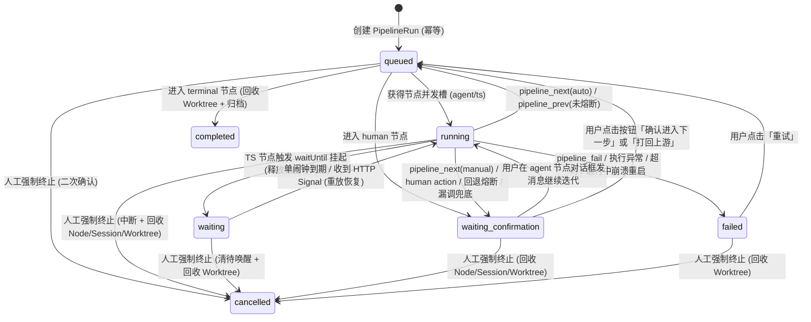

# 09 - 项目流水线设计（Project Pipeline）

| 元数据 | 内容 |
| :--- | :--- |
| **文档 ID** | `09-pipeline-workflow` |
| **状态** | `Accepted` |
| **创建日期** | 2026-11-24 |
| **更新日期** | 2026-11-26 |
| **目标模块** | `src/pipeline/`、`src/actions/`、`src/runtime/`、`src/workspace/`、`src/project/`、`src/persistence/`、`src/task/`、`src/gateway/`、`web/src/` |
| **关联设计** | [01-task-and-action](../01-task-and-action/README.md)、[05-native-runtime-config-and-single-repo-workspace](../05-native-runtime-config-and-single-repo-workspace/README.md)、[10-prompt-template-variables](../10-prompt-template-variables/README.md)、[13-typed-ts-pipeline-sdk](../13-typed-ts-pipeline-sdk/README.md) |

---

## 1. 背景与核心定位

当前平台提供 **`Sessions`**（临时人机对话）和 **`Tasks`**（单步定时/手动任务）。在多阶段交付场景（如「方案设计 → 开发实现 → Code Review → 人工审批 → 提 PR 并等待合并 → 完成」）中，靠定时任务加外部标签串联流程会导致状态脆弱、上下文断层、代码工作区无法共享。

为此引入 **`Pipelines`（项目流水线）**。其本质是一个**由固定有序节点（Node）组成的持久化状态机**：
- 前端看板上的**每一列泳道，本质上就是流水线的一个节点（`Node`）**；
- 在各节点间流转的每一个工作项，就是一次**流水线运行实例（`PipelineRun`）**；
- 节点拓扑与合法出口边由配置固定声明（类似经典 Workflow 的确定性），节点内 Agent 则通过 **Pipeline 专属 Actions** 触发固定边流转并强制附带明确上下文。

| 模块 | 核心实体 | 职责边界 |
| :--- | :--- | :--- |
| **`Sessions`** | 对话会话（`Session`） | 临时、探索性的人机自由协作。 |
| **`Tasks`** | 周期作业（`Task`） | 定时巡检与轻量入口触发器（如定时扫描 Issue 并幂等启动流水线运行）。 |
| **`Pipelines`** | **流水线运行（`PipelineRun`）** | 跨多节点、共享代码工作区、支持显式推进/回退、人工审批、持久化异步等待与强制终止的流程编排。 |

### 核心领域概念

- **`Pipeline`（流水线定义）**：项目目录下 `projects/<id>/pipelines/*.yaml` 声明的节点流程。
- **`PipelineRevision`（拓扑版本快照）**：记录流水线某次节点骨架对应的版本（`v1`、`v2`...），用于隔离运行中实例与看板泳道渲染。
- **`PipelineNode`（节点）**：流水线中的一个步骤，看板中每一列泳道对应一个节点。
- **`PipelineRun`（运行实例）**：一次具体的流水线执行，绑定启动时的版本号，持有共享 Git Worktree 与全生命周期状态。
- **`PipelineNodeRun`（节点执行记录）**：某次 Run 进入某个节点的单次执行记录（重入返工或重试会新建 `attempt + 1`）。
- **`PipelineActionRecord`（动作与上下文记录）**：不可变账本，完整保存每一次推进、回退、人工确认、失败、审批、终止的上下文与引擎裁决结果。

---

## 2. 一期范围与边界

### 一期必做

1. **三类节点 + 终态节点**：支持 `agent`、`ts`（同步执行 + 持久化异步轮询）、`human`（独立纯人工审批节点）三种执行类型，以及 `terminal` 终态归档节点。
2. **拓扑版本快照与干净看板**：按节点骨架 Hash 自动划分拓扑版本，运行实例绑定启动版本，前端看板始终按单一版本渲染泳道。
3. **Pipeline 专属 Agent Actions**：提供「推进下一步」「退回上游」「请求人工确认（human action）」「声明失败」4 个流转控制 Action，以及 3 个一期上下文只读 Action，强校验显式上下文并全量保存调用结果。
4. **TS 节点持久化异步轮询（重放 + 结果缓存）**：支持线性多段异步等待（`ctx.step` + `ctx.waitUntil`），零内存挂起、100% 抗重启，配合「单闹钟 + 最小合并窗口」调度，空闲 0 DB 查询。
5. **严格的资源生命周期与强制终止**：
   - `Session` 生命周期严格跟随单次 `PipelineNodeRun`（节点结束即归档只读）；
   - `Workspace` 生命周期严格跟随 `PipelineRun`（整条流水线终态才回收）；
   - 提供**仅限人工操作（前端二次确认）的强制终止能力**，一键中断并级联回收节点、Session 与共享工作区。
6. **清晰的人工交互规则**：确认放行与打回**必须点击 UI 按钮**（对话绝不触发流转）；`running` 态与普通 Session 一致支持自由对话/中断/插话；不做跳过、禁用、看板拖拽。
7. **Web Studio 看板与工作台**：支持单版本节点泳道看板、旧版本切换器、运行实例工作台（进度条、人工操作栏、对话/审批/日志主画布、节点执行与动作历史侧栏）。

### 一期明确不做

- **不做记忆系统与语义/向量检索**：不引入切块存储、Embedding、向量索引或跨 Run 历史召回，一期专注基于 `PipelineActionRecord` 的确定性上下文读取。
- **不做 `script` 节点类型**：由 `ts` 节点或 `agent` 节点覆盖。
- **不做可视化拖拽 DAG 编排、并行分支（Fork/Join）、跳过/禁用节点、看板拖拽改状态、IM 端双向审批**。

---

## 3. 核心功能与业务规则设计

### 3.1 节点类型与并发规则

一条流水线由至少 2 个有序节点组成，且仅最后一个节点标记为 `terminal: true`（终态归档节点）。

| 节点类型 | 行为说明 | 是否创建 Session | 是否占用并发槽 |
| :--- | :--- | :--- | :--- |
| **`agent`** | 启动独立 Agent 会话执行节点 Prompt，通过专属 Actions 驱动流转。可选配置 `gate: manual`（默认 `auto`）作为硬审批门禁。 | 是（1:1 绑定 `NodeRun`） | 仅 `running` 时占用；`waiting_confirmation` 时释放 |
| **`ts`** | 执行项目自定义 TypeScript 处理器，使用与 Agent 对称的上下文读写接口与流转返回值（`next` / `prev` / `fail` / `request_confirmation`），复用项目级 `ctx.callMcpTool` / `ctx.listMcpTools`，并支持持久化异步等待（`step` / `waitUntil`）。 | 否（日志落 `PipelineNodeLog`） | 仅 `running` 时占用；`waiting` 时释放 |
| **`human`** | 独立纯人工审批节点。进入后直接停在 `waiting_confirmation`，主画布展示上游产出，人工点按钮决定通过或打回；通过时自动将上游产出与审批批注透传给下一节点。 | 否 | 否 |
| **`terminal`** | 终态归档节点（如 `done`）。进入后自动标记 `PipelineRun` 完成并回收共享工作区。 | 否 | 否 |

---

### 3.2 拓扑版本化与快照策略

为解决「修改 YAML 增删改节点后，正在跑的 Run 不能崩 + 前端按节点拆分的泳道必须整齐渲染」两个问题，采用轻量**拓扑版本快照机制**：

1. **何时产生新版本**：
   - 加载流水线配置时，提取 Run 需要绑定的节点快照字段：`[{ id, name, executor, terminal, gate, allowPrev, prevTargets, maxLoops }, ...]`，对快照计算确定性 `topologyHash`（SHA-256）。快照里的字段就是参与 Hash 的字段，引擎流转时只读快照，因此改 `gate` 或 `maxLoops` 一定会产生新版本，不会出现「配置改了但运行规则没变」。
   - 与数据库最新一条 `PipelineRevision` 的 `topologyHash` 做 `===` 比较（无需复杂 Diff）：
     - **相同**：沿用当前版本号（平时改 Prompt、Handler、换模型、调并发、改说明**不会**升版本，这些字段执行时从当前定义读取）。
     - **不同**：版本号单调递增（`v1 → v2 → v3`），写入新版本快照。
2. **运行实例绑定版本**：
   - 每条 `PipelineRun` 创建时记录 `pipelineVersion`，其后续全部流转、回退校验及详情工作台进度条**严格以该版本快照为准**。
3. **前端看板渲染规则**：
   - 看板永远**只渲染单一版本**的节点泳道列（默认最新版本），不存在跨版本混合列或兜底列。
   - 仅当旧版本下仍存在活跃或历史 Run 时，看板顶栏才出现版本切换器（如 `v2 (当前)` / `v1 (2 运行中)`），切换即按对应版本节点完整渲染。

---

### 3.3 Pipeline 专属 Agent Actions 与上下文机制

在现有 `ActionScope` 中新增 `"pipeline"` 作用域，并通过统一 `RuntimeContext` 桥接层（覆盖 Codex / Claude / Pi / ACP 全部 4 个 Runtime）注入以下 7 个专属 Actions。普通 `conversation` 和 `task` 会话完全不可见；同时一期 `pipeline` 作用域不开放 `schedule_job` / `cancel_job`（异步等待统一由 TS 节点 `ctx.waitUntil` 承载）。

#### A. 流程控制类 Actions（固定出口边 + 强制显式上下文）

Agent 不能自由发明路由，只能触发配置声明的固定出口边，且**必须附带明确上下文**（空上下文会被校验拒绝，允许模型本轮修正重调）：

| Action | 触发的流转行为 | 必填上下文 | 可选上下文 |
| :--- | :--- | :--- | :--- |
| **`pipeline_next`** | 推进到拓扑中**固定的下一节点**（若当前节点配了 `gate: manual`，则保存产出并停在 `waiting_confirmation` 等人点按钮） | `summary`（简短结论摘要）<br>`content`（Markdown 完整产出正文） | `artifacts`（涉及文件路径列表）<br>`data`（给下游 TS 节点读取的结构化 JSON） |
| **`pipeline_prev`** | 退回到配置的**上游回退目标**（默认紧邻上一节点；若配置了多目标白名单，可通过 `targetNodeId` 指定；首节点禁止调用） | `reason`（一句话退回原因）<br>`feedback`（Markdown 具体问题与修改清单） | `targetNodeId`（多候选上游时指定）<br>`data`（附加检查数据） |
| **`pipeline_request_confirmation`**<br>*(human action)* | 主动挂起当前 `agent` 节点为 `waiting_confirmation`，保留当前 Session 并释放并发槽，等待人工答疑、指导修改或点按钮放行 | `summary`（当前进展/方案摘要）<br>`question`（需要人工确认或回答的具体问题） | `options`（建议选项）<br>`content`（当前阶段产出 Markdown）<br>`artifacts`、`data` |
| **`pipeline_fail`** | 遇到无法自行解决的阻塞，将当前节点标为 `failed`（不销毁工作区，留待人工排查后重试或强制终止） | `reason`（不可恢复的失败原因） | `summary`、`data` |

> **为什么不给 Agent 提供「强制终止整条流水线」的 Action？** 强制终止会销毁共享 Worktree 和代码现场，风险高，因此终止权限严格收口给人工（前端二次确认）；Agent 遇到无法继续的场景统一调用 `pipeline_fail` 保留现场。

#### B. 上下文读取类 Actions（一期核心读取能力）

| Action | 用途 | 返回内容 |
| :--- | :--- | :--- |
| **`pipeline_get_context`** | 读取当前流水线全局概览 | `PipelineRun` 初始输入、共享分支名、当前版本节点列表与位置、触发进入当前节点的直接上游上下文、历史各节点最新 `summary` 概览。 |
| **`pipeline_list_history`** | 查看全部历史动作目录 | 按 `sequence` 升序返回本次 Run 已保存的全部 `PipelineActionRecord` 精简列表（支持按 `nodeId` / `action` 过滤）。 |
| **`pipeline_get_history_detail`** | 查阅指定历史调用的完整结果 | 按 `recordId` / `sequence` 或 `nodeId + attempt` 返回该次调用保存的完整上下文（完整 `content`、`feedback`、`artifacts`、`data`、`humanNote` 及引擎执行结果）。 |

#### C. 上下文传递策略（只喂上一跳 + 历史节点 summary，细节按需自查）

1. **全量持久化**：每次流转、确认、打回、失败、审批、终止，均向 `pipeline_action_records` 追加一条不可变记录，完整保存提交的上下文与引擎执行结果。
2. **进入节点时自动注入（精简高信噪比）**：启动节点时自动组合以下内容：
   - 节点自身 Prompt（复用 [10-prompt-template-variables](../10-prompt-template-variables/README.md)，支持 `project.*`、`vars.*`、`now.*`、`pipeline.*`）；
   - 流水线初始输入与共享分支信息；
   - **上一跳完整交接上下文**（触发本次进入的最近一次流转记录：前进进入展示上游 `summary` + `content` + `artifacts` + 人工批注；退回进入醒目展示 `reason` + `feedback` + 人工批注）；
   - **历史各节点的 `summary` 摘要目录**（每个已执行节点只给一行精简摘要）。
3. **执行中按需自查**：若 Agent 需要更早节点的完整细节或历次返工记录，自主调用 `pipeline_list_history` / `pipeline_get_history_detail` 精准拉取。

---

### 3.4 TS 节点持久化异步轮询机制（重放 + 结果缓存 + 单闹钟合并唤醒）

研发与运维场景中，TS 节点常需多阶段外部等待（例如：`创建 PR → 等待 CI 通过 → 等待 PR Review 与合并`）。为同时满足**线性代码编写体验**、**100% 抗重启持久化**和**极低数据库负载**，采用 **轻量 Durable Steps（重放 + 结果缓存）+ 单闹钟最小窗口合并唤醒** 机制：

#### 1. 两个核心原语（线性 `await` 写法）
- **`ctx.step(key, fn)`（副作用步进缓存）**：
  - 首次执行：运行 `fn()`，将可序列化返回值立刻持久化写入 `pipeline_node_runs.step_state[key]`；
  - 后续重放：命中 `step_state[key]` 缓存直接返回结果，**绝不重复执行副作用**（如不会重复建 PR）。
- **`ctx.waitUntil(key, { intervalMs, timeoutMs, summary }, check)`（持久化异步等待）**：
  - 命中已完成缓存：直接返回缓存值，顺着往下一行继续执行；
  - 未完成：记录该等待的首次开始时间 `startedAt`（用于跨重启精准计算超时）并执行一次 `check()`：
    - 若返回 `false`（未就绪）：引擎内部抛出专用 `SuspendSignal`，落盘 `status = "waiting"`、`nextPollAt`、`stepState` 与 `statusSummary`，释放节点并发槽，**函数立刻退出、零内存挂起**；
    - 若返回 `true` 或非空结果对象（就绪）：立刻缓存进 `step_state[key]` 并返回，代码顺着线性执行下一段 `step` 或下一个 `waitUntil`。
- **编写约定**：同一 `NodeRun` 内每个 `step` / `waitUntil` 使用唯一 `key`；跨等待传递的值通过返回值（可 JSON 序列化）接收，不依赖外层可变 `let` 闭包。

#### 2. 正常执行与重启恢复路径
- **正常路径**：每次到点唤醒时重新调用 `run(ctx)`，已完成的 `step` 与 `waitUntil` 均微秒级读缓存跳过，直接续上当前正在等待的 `waitUntil`；完成后自然 `return { action: "next" | "prev" | "fail", ... }`。
- **处于 `waiting` 时服务重启（99% 场景）**：所有进度（`stepState`、`startedAt`、`nextPollAt`）全在数据库中。服务启动时查 1 次 DB 恢复唤醒闹钟，到点（或已过期立即）重放即可**全自动无感恢复**，超时判断依然准确。
- **处于 `running` 执行瞬间服务崩溃**：因无法确认未落盘外部请求的执行结果，重启时统一将残留 `running` 的 `NodeRun` 标为 `failed`（原因 `runtime_restarted`），由人工确认后重试（支持保留已落盘 `stepState` 从断点续跑或全新重跑）。

#### 3. 单闹钟精准唤醒 + 最小合并窗口（防 DB 压力）
- **绝不每秒空扫 DB**：引擎内存只维护一个「最早唤醒时间」和**全局唯一一个 `setTimeout`**。
- **最小合并窗口（如 1 秒）**：计算 `nextPollAt` 时对齐到整秒（或保证唤醒间隔 `≥ 1s`），闹钟响起时用**部分索引**（仅索引 `WHERE status = 'waiting' AND next_poll_at IS NOT NULL`，历史记录不入索引）一次性批量捞出所有已到期任务（受节点 `concurrency` 限流），随后将闹钟拨至下一条最早的 `MIN(next_poll_at)`。
- **三态负载特征**：
  - 空闲无等待任务 → **0 QPS**（完全休眠）；
  - 稀疏等待 → 按实际到期时间精准查 DB；
  - 大量任务时间挨着到期 → 自动合并为批量查询，DB 扫描频率天然封顶在 **≤ 1 QPS**。
- **外部信号唤醒**：支持 `POST /runs/:runId/signal` 按主键直接将目标 `NodeRun` 的 `nextPollAt` 提前并立即触发重放，不扫表。

---

### 3.5 状态机、人工交互与异常兜底



#### 核心交互与事务规则

1. **确认与打回必须点击按钮，对话绝不触发流转**：
   - `waiting_confirmation` 期间，用户在 `agent` 节点对话框发消息仅用于多轮讨论、修改或答疑（在同一 Session 执行新 Turn；Run 保持 `waiting_confirmation`、不占并发槽，“正在回复”由 Session 事件展示）；
   - 真正推进下一节点或打回上游节点，**只能通过 UI 按钮 / 对应 API 触发**。
   - 用户点「确认进入下一步」时，引擎自动取该 `NodeRun` 最近一次 Action 提交的上下文（若无则取末条助手回复兜底）合并 `humanNote`，写入 `human_approve` 记录并交接给下一节点。
2. **`running` 态与普通 Session 一致**：
   - `agent` 节点执行期间，用户可在对话框正常发消息干预（Steer）或点击中断（Interrupt）；
   - 若用户主动中断 Turn，节点不自动流转，保留现场供继续对话、重试或终止。
   - **明确不做**：跳过节点、禁用节点、看板卡片拖拽改状态。
3. **单 Turn 终结锁与 Turn 结束提交**：
   - 单次 Agent Turn 内只允许登记 1 次合法流转（参数校验不通过不锁，允许模型修正重调；已登记后再调其他流转 Action 返回拒绝提示）；登记的流转持久化在 `pipeline_node_runs.pending_decision`，引擎自己发起的 Turn 记录在 `agent_turn_id`，提醒是否已发记录在 `reminder_sent`，服务重启不丢；
   - 只有 `running` / `waiting_confirmation` 的节点接受流转 Action，`failed` 节点只能由人工重试或终止；
   - 真正的节点切换与旧 Session 归档在当前 Turn 正常完成（`turn.completed`）后执行；若本轮 Turn 失败或被中断，取消切换，避免半截状态。
4. **模型漏调 Action 兜底**：
   - `agent` 节点 Turn 结束但未调用任何流转 Action 时，引擎在同一 Session 自动补发 1 次系统提醒；
   - 补发 1 次仍未调用，则将末条助手回复作为兜底摘要落盘，安全转入 `waiting_confirmation` 交由人工处理，绝不静默流转。
5. **回退合法性与循环熔断**：
   - 仅允许退回当前版本拓扑中**严格位于当前节点之前**的合法上游目标；
   - 同一回退边累计达到 `maxLoops`（默认 `3`）时，保存退回上下文后触发熔断，自动停在 `waiting_confirmation` 通知人工裁决。
6. **状态变更的实现约束**：
   - 所有状态变更走同一条路径：读取 Run + 当前 NodeRun + 绑定版本快照 → 纯函数状态机（`machine.ts`，无 IO）计算变更 → 一个数据库事务写入（Run、NodeRun、新 NodeRun、ActionRecord），以 `pipeline_runs.state_version` 做乐观锁，读后被改则重算；
   - 事务提交后才执行副作用（启动节点、归档 Session、中断 Turn、回收 Worktree），执行时引擎不持有任何锁，`ProjectRuntime` 也不在会话准入锁内回调引擎；
   - 节点并发数在提交事务里按 `running` 状态的 NodeRun 计数（PostgreSQL 用 advisory lock 串行化同一节点的检查），内存里不另存槽位；
   - 调度每轮用一次查询取出 `queued` 与 `running` 的 NodeRun（部分索引 `idx_pipeline_node_runs_active` 只含这两种状态，与历史数据量无关），先按节点算出空闲名额，只对有名额的节点发起 claim，满并发节点的积压不产生事务；
   - 只有产生新 NodeRun、NodeRun 离开 `running` 或轮询时间变化的流转才唤醒调度，启动节点、登记流转 Action、发送提醒都不会。

---

### 3.6 Session、Worktree 生命周期与强制终止（Terminate）

| 资源 | 创建时机 | 存活范围 | 回收时机与动作 |
| :--- | :--- | :--- | :--- |
| **Node Session** | 进入 `agent` 节点创建 `PipelineNodeRun` 时 | 严格跟随单次 `PipelineNodeRun`（包含该节点内的多轮确认对话）。**豁免现有 `ProjectRuntime` 的 1 小时自动归档删除 Worktree 机制**。 | 离开节点（推进、打回、强制终止）时**立即释放 Runtime 并归档为只读**，对话记录永久保留回放。 |
| **共享 Worktree** | `PipelineRun` 首次进入执行节点时（独立分支 `pipeline/<runId>`） | 贯穿整条 `PipelineRun` 的全部节点与返工轮次。 | 整条 Run 进入终态（`completed` 或 `cancelled`）时**清理磁盘 Worktree**（保留分支名追溯）。 |

#### 强制终止操作（仅限人工 + 前端二次确认）

在任意非终态（`queued`、`running`、`waiting`、`waiting_confirmation`、`failed`）下，用户在工作台点击「**终止流水线**」并完成**二次确认弹窗**（可选填终止原因）后，引擎执行原子级联回收：

1. **中断执行 / 移出等待**：若处于 `running`，立刻中断 Agent Turn 或触发 TS `AbortSignal`；若处于 `queued` 移出队列并释放并发槽；若处于 `waiting` 清空 `nextPollAt` 使其不再被唤醒。
2. **终结当前 Node 并回收 Session**：将当前未结束的 `PipelineNodeRun` 标为 `cancelled`，立即释放对应 Runtime Session 并锁定为只读归档。
3. **回收共享 Workspace**：立即清理该 `PipelineRun` 对应的磁盘 Git Worktree。
4. **落盘终态与通知**：追加不可变 `human_cancel` 动作记录，将 `PipelineRun` 置为 `cancelled` 终态，推送 SSE 更新看板并按配置发通知；历史节点、会话与动作记录保留为只读可查。

---

### 3.7 触发方式、通知与 Web Studio 交互

#### 触发与通知
- **触发入口**：① Web Studio 看板手动发起；② TS 定时任务调用 `ctx.startPipelineRun(...)` 自动触发（通过 `externalKey` 如 `github:owner/repo#42` 保证幂等去重）。
- **消息通知**：复用现有 `NotificationOutbox`（飞书/企微），在配置的状态（默认 `waiting_confirmation`、`failed`、`completed`）推送精简提醒与工作台直达链接。

#### Web Studio 界面
1. **左侧导航新增 `Pipelines`**（与 `Sessions`、`Tasks` 并列）。
2. **流水线泳道看板（`/:projectId/pipelines/:pipelineId`）**：
   - 顶栏：Pipeline 切换器、拓扑版本切换器（仅存在旧版 Run 时显示）、搜索/状态过滤、`+ 新建运行`按钮。
   - 主区域：按当前选中版本的 `nodes` 顺序横向排布泳道列，列头展示节点名、类型徽章（`agent` / `ts` / `human`）、门禁标记与并发占用（如 `1/2`）；列内展示停留在该节点的 Run 摘要与状态；最右终态列按结束时间倒序展示（区分 `completed` 与 `cancelled` 徽章）并支持滚动分页加载。不支持跨泳道拖拽。
3. **运行实例工作台（`/:projectId/pipelines/:pipelineId/runs/:runId`）**：
   - **顶部操作栏**：返回看板 + 标题/外部链接 + 分支名 + 版本徽章 + 人工操作按钮（`确认进入下一步`、`打回至上游`、`重试`、`终止流水线`（带二次确认弹窗））。
   - **节点进度条**：严格按该 Run 绑定的 `PipelineRevision` 快照渲染完整节点顺序与状态。
   - **主画布（按节点类型自适应）**：
     - `agent` 节点：复用 `SessionConversation`（`running` 时自由对话/中断，`waiting_confirmation` 时展示确认卡片并可继续对话，历史节点自动只读回放）；
     - `human` 节点：渲染纯审批面板，完整展示上游交接上下文与审批/打回表单；
     - `ts` 节点：复用 `TaskExecutionDetail` 日志查看器，并展示当前等待摘要、已执行步骤缓存与下次轮询时间。
   - **右侧信息栏（2 个 Tab）**：
     - **`Node Runs`**：按顺序列出所有节点执行与返工轮次（如 `design #1 → develop #1 → review #1 → develop #2`），点击切换主画布回放；
     - **`Action History`**：按时间线展开每次流转、确认、打回、失败、终止保存的完整上下文与引擎执行结果。

---

## 4. 数据实体与接口契约概览

### 4.1 持久化实体（Postgres + Memory 双实现）

| 实体 | 职责 | 核心字段 |
| :--- | :--- | :--- |
| **`PipelineRevision`** | 拓扑版本快照 | `projectId`、`pipelineId`、`version`（自增整数）、`topologyHash`、`nodesSnapshot`、`createdAt`。 |
| **`PipelineRun`** | 流水线运行实例 | `runId`、`projectId`、`pipelineId`、`pipelineVersion`、`externalKey`（幂等唯一）、`externalUrl`、`title`、`description`、`input`、`currentNodeId`、`status`、`workspacePath`、`branchName`、`workspaceStatus`、`loopCounts`、`statusSummary`、`activeNodeRunId`、`latestNodeOutputs`、`createdBy`、`finishedAt`。 |
| **`PipelineNodeRun`** | 单次节点执行 | `nodeRunId`、`runId`、`nodeId`、`attempt`、`sequence`、`executorType`、`sessionId`、`triggeredByRecordId`、`status`、`inputContext`、`finalAction`、`outputSummary`、`errorMessage`、`stepState`（TS 重放缓存）、`nextPollAt`（带部分索引）、`pollCount`、`startedAt`、`finishedAt`、`durationMs`。 |
| **`PipelineActionRecord`** | 不可变动作与上下文账本 | `recordId`、`runId`、`sequence`（Run 内严格递增）、`nodeRunId`、`nodeId`、`attempt`、`action`、`actorType`、`actorId`、`fromNodeId`、`toNodeId`、`fromStatus`、`toStatus`、`context`、`result`、`createdAt`。 |
| **`PipelineNodeLog`** | TS 节点运行日志 | `nodeRunId`、`runId`、`sequence`、`level`、`message`、`fields`、`createdAt`（复用现有日志缓冲）。 |

### 4.2 Gateway REST & SSE 接口清单

| 接口 | 用途 |
| :--- | :--- |
| `GET /api/v1/projects/:projectId/pipelines` | 列出项目流水线定义、当前版本与存在 Run 的历史版本列表。 |
| `GET /api/v1/projects/:projectId/pipelines/:pipelineId/runs` | 按 `version`、`nodeId`、`status` 查询运行实例列表（`limit` + `beforeId` 游标分页）。 |
| `POST /api/v1/projects/:projectId/pipelines/:pipelineId/runs` | 手动发起或外部按 `externalKey` 幂等启动流水线运行。 |
| `GET /api/v1/projects/:projectId/pipeline-events` | SSE 实时推送项目内 Run 状态变更、节点流转、新创建与终止事件（支持 `pipelineId`、`runId` 过滤）。 |
| `GET /api/v1/pipeline-runs/:runId` | 获取运行实例详情、绑定版本的节点快照、`NodeRuns` 列表与动作计数。 |
| `GET /api/v1/pipeline-runs/:runId/actions` | 获取不可变动作与上下文记录流（支持 `afterSeq`、`nodeId`、`action` 过滤）。 |
| `POST /api/v1/pipeline-runs/:runId/approve` | 人工按钮确认放行至下一节点（可选 `humanNote`）。 |
| `POST /api/v1/pipeline-runs/:runId/reject` | 人工按钮打回至上游节点（必填 `reason`、`feedback`，可选 `targetNodeId`）。 |
| `POST /api/v1/pipeline-runs/:runId/retry` | 重试当前处于 `failed` 状态的节点（可选 `preserveStepState` 从断点续跑或新建干净 `attempt + 1`）。 |
| `POST /api/v1/pipeline-runs/:runId/cancel` | 人工强制终止整条流水线，级联中断并回收节点、Session 与共享 Worktree。 |
| `POST /api/v1/pipeline-runs/:runId/signal` | 外部 Webhook/脚本按主键精准唤醒处于 `waiting` 状态的 TS 节点。 |
| `GET /api/v1/pipeline-node-runs/:nodeRunId/logs` | 获取 TS 节点执行日志（`afterSeq` 游标分页）。 |

---

## 5. 配置规范示例

项目目录约定（节点 Prompt 复用 [10-prompt-template-variables](../10-prompt-template-variables/README.md) 的变量替换）：

```text
projects/example-service/
├── project.yaml
├── tasks/
│   └── github-issue-feeder.ts      # 定时拉取 Issue 并幂等调用 startPipelineRun
└── pipelines/
    ├── issue-to-pr.yaml            # 流水线配置
    ├── prompts/
    │   ├── design.md
    │   ├── develop.md
    │   └── review.md
    └── handlers/
        └── pr-watch.ts             # TS 节点（使用 ctx.step + ctx.waitUntil 线性等待 PR 合并）
```

配置示例（`issue-to-pr.yaml`）：

```yaml
id: issue-to-pr
name: GitHub Issue to PR Delivery
description: "方案设计、开发实现、Code Review、人工审批与 PR 合并跟踪交付流水线"
enabled: true

notifyOn:
  - waiting_confirmation
  - failed
  - completed

nodes:
  - id: design
    name: 方案设计
    executor: agent
    prompt: ./prompts/design.md
    runtime:
      reasoningEffort: high
    concurrency: 2
    gate: manual              # 硬门禁：写完方案必须经人工点按钮放行，期间可在对话框边聊边改
    allowPrev: false          # 首节点禁止回退

  - id: develop
    name: 开发实现
    executor: agent
    prompt: ./prompts/develop.md
    concurrency: 2
    gate: auto                # 调用 pipeline_next 后自动进入 review
    prevTargets: [design]
    maxLoops: 3

  - id: review
    name: Code Review
    executor: agent
    prompt: ./prompts/review.md
    concurrency: 2
    gate: auto                # 审查通过走 pipeline_next 进人工审批；有问题调 pipeline_prev 打回 develop
    prevTargets: [develop]
    maxLoops: 3

  - id: release_approval
    name: 发布前审批
    executor: human           # 独立纯人工审批节点：展示上游产出，人工点通过或打回
    prevTargets: [develop]
    maxLoops: 3

  - id: pr_watch
    name: PR 与 CI 跟踪
    executor: ts              # TS 持久化异步轮询节点：ctx.step 建 PR + ctx.waitUntil 等 CI 与合并
    handler: ./handlers/pr-watch.ts
    concurrency: 2
    prevTargets: [develop]
    maxLoops: 3

  - id: done
    name: Done
    terminal: true            # 终态节点：自动回收共享 Worktree 并锁定归档
```

---

## 6. 分阶段实施与验证计划

### Phase 1：持久化、版本快照、Workspace/Session 解耦与核心引擎
- **交付范围**：
  - 5 张持久化表（`PostgresStore` + `MemoryStore`）与 Drizzle Migration（含 `pipeline_node_runs` 的 `step_state` 与局部唤醒索引）；
  - `PipelineLoader`（YAML 校验、`topologyHash` 版本快照生成、Prompt 变量静态预检）；
  - `WorkspaceManager` 扩展 Run 级共享 Worktree 创建与回收；`ProjectRuntime` 扩展挂载外部 Worktree、节点结束归档 Session 并保留 Worktree、豁免 pipeline 会话的自动归档清理；
  - 引擎按职责拆分：`machine.ts`（纯函数状态机：固定边流转、单 Turn 终结锁、漏调兜底、`maxLoops` 熔断、强制终止、重启恢复）、`engine.ts`（加载状态、乐观锁事务提交、执行副作用）、`scheduler.ts`（按数据库计数的节点并发与单闹钟最小窗口合并唤醒）、`ts-node.ts`（TS Durable Steps 重放与超时）、`context.ts`（Prompt 组装与上下文/历史读取）。
- **核心验证**：单元测试覆盖版本 Hash 判定、拓扑校验、熔断、TS `step/waitUntil` 缓存重放与重启恢复、单闹钟合并调度、强制终止级联回收；集成测试跑通完整交付闭环与运行中强制终止闭环。

### Phase 2：Pipeline 专属 Actions、Runtime 桥接、Task 联动与 Gateway API
- **交付范围**：
  - 扩展 `ActionScope` 增加 `"pipeline"`，升级 `RuntimeContext` 与 `action-bridge.ts` 使 Codex / Claude / Pi / ACP 全部自动支持 `pipeline` 作用域；
  - 注册 7 个 Pipeline 专属 Actions（4 流转 + 3 只读）；
  - 扩展 TS Task SDK 增加 `ctx.startPipelineRun(...)`；
  - 实现 `src/gateway/routes/pipelines.ts` 全部 REST 接口（含 `/cancel`、`/signal`）与 SSE 推送。
- **核心验证**：作用域隔离测试（非 pipeline 会话不可见任何 `pipeline_*` 工具）；API 契约测试（幂等创建、版本分页过滤、非法状态 `409 Conflict` 防护、强终止与 Signal 唤醒校验）。

### Phase 3：Web Studio 泳道看板与运行实例工作台
- **交付范围**：
  - 左侧导航新增 `Pipelines`，实现单版本泳道看板（旧版本切换器、SSE 增量更新、终态列滚动加载、新建弹窗，不含拖拽）；
  - 实现运行实例工作台（快照进度条、人工操作栏与终止二次确认弹窗、复用 `SessionConversation` 与 `TaskExecutionDetail`、新增 `human` 纯审批面板、右侧 `Node Runs` 与 `Action History` 双栏）。
- **核心验证**：前后端检查与构建全通过（`bun run check`、`bun run build`、`cd web && bun test && bun run build`）；容器内真实 Git 仓库 + PostgreSQL 端到端联调验收。

---

## 7. 关键设计权衡

| 决策点 | 选定方案 | 权衡结论 |
| :--- | :--- | :--- |
| **流转模型** | 固定拓扑出口边 + Agent 专属 Action 触发并强制附上下文 | 结合了经典 Workflow 的 100% 确定性（模型不发明路由）与 Agent 原生工具调用的自然表达，省去额外 Router LLM 调用，同时把流转与上下文交接绑定为强契约。 |
| **配置变更与泳道渲染** | 按节点骨架 `topologyHash` 自动分版本，Run 绑定版本，看板按单版本渲染 | 实现极简（仅 hash 对比，无复杂 Diff），既保证运行中实例零崩溃，又保证前端泳道永远干净一致、无混合渲染负担。 |
| **一期上下文投喂** | 全量保存 `PipelineActionRecord`；进入节点只喂上一跳完整上下文 + 历史节点 `summary`，细节靠 Action 自查 | 省 Token 且高信噪比，不引入记忆/向量检索复杂度，同时保留 100% 确定性的完整历史回查能力。 |
| **TS 节点异步轮询** | 轻量 Durable Steps（重放 + `stepState` 结果缓存）+ 单闹钟最小窗口合并唤醒 | 兼具「线性多段 `await` 代码体验」「100% 持久化抗重启」「零内存挂起」与「空闲 0 DB 查询 / 密集封顶 ≤ 1 QPS」，彻底避免手写 `if (checkpoint)` 状态机。 |
| **人工确认与终止边界** | `human` 独立审批节点 + `human` action + `gate: manual`，放行必须点按钮；终止权限仅限人工且前端二次确认 | 覆盖纯审批卡点与边聊边改两类场景，防止模型擅自流转或误删工作区，任意状态下均可彻底级联回收节点、Session 与 Worktree。 |
