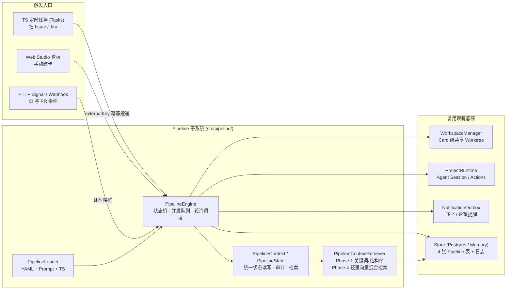
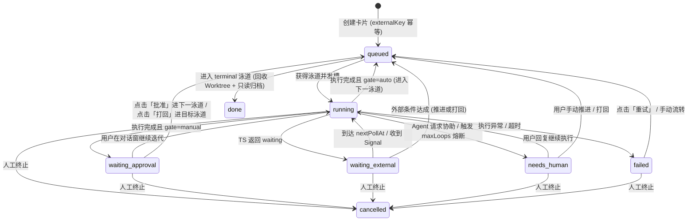
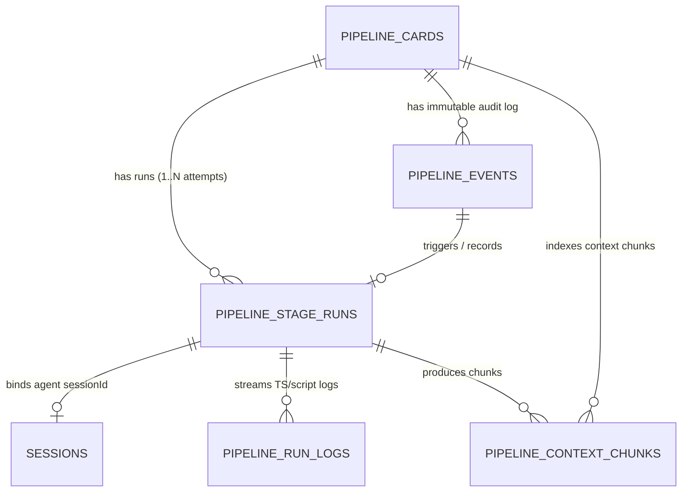

# 09 - 自定义泳道流水线设计（Project Pipeline & Unified Traceable Context）

| 元数据 | 内容 |
| :--- | :--- |
| **文档 ID** | `09-pipeline-workflow` |
| **状态** | `Draft` |
| **创建日期** | 2026-11-24 |
| **目标模块** | `src/pipeline/`、`src/domain/`、`src/persistence/`、`src/workspace/`、`src/project/runtime.ts`、`src/task/sdk.ts`、`src/actions/`、`src/gateway/`、`web/src/` |
| **前置依赖** | [01-task-and-action](../01-task-and-action/README.md)、[05-native-runtime-config-and-single-repo-workspace](../05-native-runtime-config-and-single-repo-workspace/README.md)、[07-drizzle-persistence-refactor](../07-drizzle-persistence-refactor/README.md)、[08-model-usage-tracking](../08-model-usage-tracking/README.md) |

---

## 1. 背景与动机

### 1.1 现状痛点

当前 Agent Orchestrator 提供两类主要执行原语：**`Sessions`**（人机自由对话）和 **`Tasks`**（Cron 定时或手动触发的单次作业）。在典型的研发自动化场景（例如基于 GitHub Issue / PR 的多阶段研发闭环）中，团队不得不通过「无状态定时 Agent Prompt + GitHub Label + Issue/PR 评论区」来硬模拟多阶段交付流程，带来以下结构性问题：

1. **状态机靠 Prompt 脆弱维持**：需要维护大量外部 Label（`issue:triage`、`issue:needs-info`、`issue:ready`、`pr:changes-requested` 等）和 `needsInfoFrom` 手工字典，依赖模型遵守约定，既消耗 Token 又容易遗漏或重复评论。
2. **交互体验割裂**：方案讨论、澄清追问与确认流转被迫分散在 GitHub 评论区与零散的 `dispatch_agent_task` 会话中，用户无法在 Studio 对话窗口里直接完成多轮讨论并一键推进阶段。
3. **缺少工作项级共享 Workspace**：每次派发会话都会新建孤立的 Git Worktree 与分支，前一阶段产出的设计文档、代码改动和后续 Review/返工阶段难以围绕同一条分支连续协作，也无法在合并后自动统一回收。
4. **全链路难以追溯与复用上下文**：单个 Issue 从「需求分析 → 开发实现 → Code Review → 返工修复 → PR 合并」跨越多次会话和外部事件，缺乏统一的工作项聚合视图、不可变审计时间线和结构化上下文载体，后期也无法针对历史交付经验做语义检索。

### 1.2 核心定位：与 `Sessions` / `Tasks` 的边界

引入 **`Pipelines`（自定义泳道流水线）** 后，平台三层能力职责完全解耦：

| 模块 | 核心实体 | 职责边界 |
| :--- | :--- | :--- |
| **`Sessions`** | 对话会话（`Session`） | 临时的、探索性的人机即兴协作。 |
| **`Tasks`** | 周期作业（`Task`） | 轻量入口触发器（如 0 Token 的 TS 定时任务扫描 GitHub Issue / Jira 并向 Pipeline 投递卡片）以及单步周期巡检（日报、健康监控、数据同步）。 |
| **`Pipelines`** | **工作项卡片（`Card`）** | 长生命周期、跨阶段、带人工门禁与受控返工的持久化交付状态机；同一张 Card 共享一个 Git Worktree，全流程可追溯、可干预、完成后统一归档。 |

---

## 2. 目标与非目标

### 目标

1. **项目级自定义泳道拓扑**：每个项目通过 `projects/<id>/pipelines/*.yaml` 声明专属泳道顺序、执行器类型（`agent` / `ts` / `script` / `human`）、并发上限、门禁策略（`auto` / `manual`）与打回返工目标，支持不同项目定制差异化 Review / CI / PR 流程。
2. **工作项级共享 Workspace 生命周期**：一张 Card 启动时分配独立 Git Worktree 与分支（`pipeline/<cardId>`），贯穿所有阶段；阶段切换时释放单阶段 Runtime Session 但保留 Worktree，直至进入终态（`Done / Archived`）后自动回收磁盘空间。
3. **全流程强可追溯性（End-to-End Traceability）**：通过四张协同持久化表（`pipeline_cards`、`pipeline_stage_runs`、`pipeline_events`、`pipeline_context_chunks`）+ 执行日志表，完整记录每一次状态变迁、人工确认/打回批注、Context 版本快照与 Diff、以及关联的 Session / Turn / Artifact。
4. **统一上下文与状态抽象（`PipelineState` & `PipelineContext`）**：在整条 Pipeline 内用统一、强类型、带版本号的 `PipelineState` / `PipelineContext` 类承载跨阶段状态传递、产物索引、历史回查与只读 Agent 工具，避免上下文碎片化。
5. **面向未来轻量级向量检索的零破坏扩展**：从第一天起将关键阶段结论、设计方案、Review 意见与人工批注规范化切分为 `pipeline_context_chunks`，通过可插拔 `PipelineContextRetriever` 接口提供「结构化 + 关键词」检索，后期无缝升级为轻量级向量/混合检索（支持卡内长周期召回与跨卡项目记忆），不破坏上层契约。
6. **清晰的人工在环与异步等待**：
   - `waiting_approval` / `needs_human` 期间用户在对话窗口自由多轮迭代，真正流转或打回由 UI 显式操作按钮控制；
   - 长耗时外部阶段（等 PR CI / Review / Merge）通过 TS 泳道轻量无状态轮询 + HTTP Signal/Webhook 双驱动；
   - 复用现有 `NotificationOutbox`（飞书/企微）推送精简提醒与卡片深链。

### 非目标

- **不做通用可视化 DAG 拖拽编排器**：Phase 1–3 以声明式 YAML + Prompt/TS 文件为唯一配置源（配置即代码、可 Git 版本化），不提供数据库态图形连线编辑器。
- **不做多分支并行汇合（Fork/Join）拓扑**：本期聚焦以「横向泳道（Lane）」为核心的有环线性状态机（顺序推进 + 指定目标打回循环），保持心智与看板展示清晰直观。
- **不在 Phase 1 强制引入外部向量数据库**：不依赖 Qdrant / Milvus / Weaviate 等重型外部服务；向量能力作为 Phase 4 可选插件落在 `pgvector` 或轻量本地索引上。
- **不做 IM 双向对话/审批改造**：飞书/企微仅负责精简通知与卡片深链跳转，人机深度交互统一在 Web Studio 卡片工作台完成。

---

## 3. 详细技术设计

### 3.1 总体架构与组件拓扑



### 3.2 核心领域状态机

每张 Card 在任意时刻只位于一个 `currentLaneId`，并处于以下状态之一：

- `queued`：已进入目标泳道，等待该泳道的 `concurrency` 并发槽位。
- `running`：当前 `StageRun` 正在执行（Agent Turn 或 TS/Script 处理器运行中）。
- `waiting_approval`：阶段执行完成，因泳道配置 `gate: manual` 暂停，等待用户在 UI 确认批准或打回；期间用户可在当前阶段对话窗口与 Agent 多轮继续修改。
- `needs_human`：执行中 Agent 主动调用 `pipeline_request_human_input` 或达到返工熔断上限 `maxLoops`，需要人工介入答复或决策。
- `waiting_external`：TS 泳道返回 `{ status: "waiting", nextCheckMs }`，无状态挂起等待外部异步条件（如 PR CI / 合并），由轻量轮询器按 `nextPollAt` 定期重查或由 HTTP Signal 立即唤醒。
- `failed`：执行异常或超时失败，可原地点击重试、在对话中介入或手动流转。
- `done`：进入 `terminal: true` 的最右列 **`Done / Archived`** 泳道；系统自动回收 Card Worktree 并将所有关联 Session 锁定为只读归档。
- `cancelled`：人工主动终止，同样回收 Worktree 并锁定归档。



---

### 3.3 全链路可追溯数据表设计（Drizzle PostgreSQL Schema）

为保证**每一步操作、每一次状态变更、每一次返工与人工决策都可精确回溯**，同时保证看板查询 `O(1)` 高效，采用 **「物化当前态 + 不可变执行记录 + 不可变审计事件账本 + 规范化上下文索引块」** 的 4 表设计（外加复用/对齐日志表），并同步提供 `MemoryStore` 与 `PostgresStore` 双实现。

#### ER 关系概览



#### 表 1：`pipeline_cards`（工作项卡片聚合根）

保存卡片当前状态、共享 Workspace 元数据以及物化后的最新 `PipelineState` 快照，支持看板按泳道高效渲染与 `Done / Archived` 列游标滚动加载。

```ts
export const pipelineCards = pgTable(
  "pipeline_cards",
  {
    id: bigserial("id", { mode: "number" }).primaryKey(),
    cardId: varchar("card_id", { length: 100 }).notNull(),
    projectId: varchar("project_id", { length: 100 }).notNull(),
    pipelineId: varchar("pipeline_id", { length: 100 }).notNull(),
    /** 外部业务幂等键，如 "github:owner/repo#42"；手动建卡可为 null */
    externalKey: varchar("external_key", { length: 255 }),
    externalUrl: text("external_url"),
    title: varchar("title", { length: 255 }).notNull(),
    description: text("description").notNull().default(""),
    currentLaneId: varchar("current_lane_id", { length: 100 }).notNull(),
    status: varchar("status", { length: 40 }).$type<PipelineCardStatus>().notNull(),
    /** Card 级共享 Worktree 路径与分支名；归档回收后保留 branchName 便于追溯 */
    workspacePath: text("workspace_path"),
    branchName: varchar("branch_name", { length: 200 }),
    workspaceStatus: varchar("workspace_status", { length: 30 })
      .$type<"pending" | "ready" | "cleaned">()
      .notNull()
      .default("pending"),
    /** 乐观锁版本号：每次 PipelineState 变更单调递增 */
    stateVersion: integer("state_version").notNull().default(1),
    /** 物化后的最新 PipelineStateData JSONB，用于 O(1) 读取 */
    stateData: jsonb("state_data").$type<PipelineStateData>().notNull().default({}),
    /** 记录各返工边累计次数，如 { "review->develop": 2 }，用于 maxLoops 熔断 */
    loopCounts: jsonb("loop_counts").$type<Record<string, number>>().notNull().default({}),
    /** 看板卡片摘要（如 "等待方案确认" / "PR #42 CI 运行中"） */
    statusSummary: text("status_summary"),
    /** 当前活跃 StageRun ID，方便快速定位 */
    activeRunId: varchar("active_run_id", { length: 100 }),
    /** 卡片创建来源（如 "task:demo:issue-feeder" / "user:web"） */
    createdBy: varchar("created_by", { length: 150 }).notNull().default("system"),
    finishedAt: timestamp("finished_at", { withTimezone: true }),
    archivedAt: timestamp("archived_at", { withTimezone: true }),
    createdAt: timestamp("created_at", { withTimezone: true }).notNull().defaultNow(),
    updatedAt: timestamp("updated_at", { withTimezone: true }).notNull().defaultNow(),
    deletedAt: bigint("deleted_at", { mode: "number" }).notNull().default(NOT_DELETED),
  },
  (table) => [
    uniqueIndex("idx_pipeline_cards_card_id").on(table.cardId, table.deletedAt),
    /** 同一项目同一流水线下 externalKey 唯一（未删除），实现定时任务投递严格幂等 */
    uniqueIndex("idx_pipeline_cards_external_key")
      .on(table.projectId, table.pipelineId, table.externalKey, table.deletedAt)
      .where(sql`external_key IS NOT NULL`),
    /** 看板活跃泳道查询与 Done/Archived 列按 id DESC 游标分页 */
    index("idx_pipeline_cards_board").on(
      table.projectId,
      table.pipelineId,
      table.currentLaneId,
      table.id.desc(),
    ),
    index("idx_pipeline_cards_status").on(table.projectId, table.status, table.updatedAt.desc()),
  ],
);
```

#### 表 2：`pipeline_stage_runs`（阶段执行记录表）

每次进入泳道（含重试与打回返工）都会创建一条**全新且不可覆盖**的 `StageRun`，并记录进入前后的 `PipelineState` 版本与快照、绑定的 `sessionId` 及因果触发事件 `triggeredByEventId`。

```ts
export const pipelineStageRuns = pgTable(
  "pipeline_stage_runs",
  {
    id: bigserial("id", { mode: "number" }).primaryKey(),
    runId: varchar("run_id", { length: 100 }).notNull(),
    cardId: varchar("card_id", { length: 100 }).notNull(),
    projectId: varchar("project_id", { length: 100 }).notNull(),
    pipelineId: varchar("pipeline_id", { length: 100 }).notNull(),
    laneId: varchar("lane_id", { length: 100 }).notNull(),
    /** 同一 Card 在同一泳道的第几次尝试（1, 2, 3...），返工清晰可区分 */
    attempt: integer("attempt").notNull().default(1),
    /** 全局阶段执行序号（同一 Card 内严格递增：1, 2, 3, 4...） */
    sequence: integer("sequence").notNull(),
    executorType: varchar("executor_type", { length: 30 })
      .$type<PipelineExecutorType>()
      .notNull(),
    /** Agent 阶段绑定的独立 Session ID（source="pipeline"），关联 turns/events/artifacts */
    sessionId: varchar("session_id", { length: 100 }),
    /** 触发本次执行的 pipeline_events.event_id（因果链指针） */
    triggeredByEventId: varchar("triggered_by_event_id", { length: 100 }),
    status: varchar("status", { length: 40 }).$type<PipelineStageRunStatus>().notNull(),
    /** 阶段开始与结束时的 PipelineState 版本与快照（支持任意时刻时间旅行追溯） */
    stateVersionBefore: integer("state_version_before").notNull(),
    stateVersionAfter: integer("state_version_after"),
    stateSnapshotBefore: jsonb("state_snapshot_before").$type<PipelineStateData>().notNull(),
    stateSnapshotAfter: jsonb("state_snapshot_after").$type<PipelineStateData>(),
    /** 实际注入给该阶段的结构化输入摘要（含上游交接、打回原因、检索召回片段 ID） */
    inputPayload: jsonb("input_payload").$type<Record<string, unknown>>().notNull().default({}),
    /** 阶段产出摘要（显式写入或末条助手回复兜底） */
    outputSummary: text("output_summary"),
    /** 阶段产出的结构化数据补丁 */
    outputData: jsonb("output_data").$type<Record<string, unknown>>(),
    /** 用户批准或打回该阶段时填写的批注 */
    humanDecision: varchar("human_decision", { length: 30 })
      .$type<"approved" | "rejected" | "retried" | "skipped" | "cancelled">(),
    humanNote: text("human_note"),
    errorMessage: text("error_message"),
    /** TS 异步等待阶段的下一次轮询时间（status = waiting_external 时生效） */
    nextPollAt: timestamp("next_poll_at", { withTimezone: true }),
    pollCount: integer("poll_count").notNull().default(0),
    startedAt: timestamp("started_at", { withTimezone: true }),
    finishedAt: timestamp("finished_at", { withTimezone: true }),
    durationMs: bigint("duration_ms", { mode: "number" }),
    createdAt: timestamp("created_at", { withTimezone: true }).notNull().defaultNow(),
  },
  (table) => [
    uniqueIndex("idx_pipeline_stage_runs_run_id").on(table.runId),
    uniqueIndex("idx_pipeline_stage_runs_card_seq").on(table.cardId, table.sequence),
    index("idx_pipeline_stage_runs_card_lane").on(table.cardId, table.laneId, table.attempt.desc()),
    index("idx_pipeline_stage_runs_session").on(table.sessionId),
    /** 轮询调度器高效扫描到期等待任务 */
    index("idx_pipeline_stage_runs_due_poll")
      .on(table.nextPollAt)
      .where(sql`status = 'waiting_external' AND next_poll_at IS NOT NULL`),
  ],
);
```

#### 表 3：`pipeline_events`（不可变全链路审计事件账本）

**只追加、永不修改**。每张卡片上的每一次创建、排队、启动、状态补丁、Agent 提问、人工批准/打回、外部 Signal 到达、Worktree 回收与归档，全部按 `sequence` 严格顺序落盘。

```ts
export const pipelineEvents = pgTable(
  "pipeline_events",
  {
    id: bigserial("id", { mode: "number" }).primaryKey(),
    eventId: varchar("event_id", { length: 100 }).notNull(),
    cardId: varchar("card_id", { length: 100 }).notNull(),
    projectId: varchar("project_id", { length: 100 }).notNull(),
    /** 同一 Card 内严格单调递增序号，保证完整因果序 */
    sequence: integer("sequence").notNull(),
    stageRunId: varchar("stage_run_id", { length: 100 }),
    eventType: varchar("event_type", { length: 60 }).$type<PipelineAuditEventType>().notNull(),
    /** 操作主体：system | agent | user | task | webhook */
    actorType: varchar("actor_type", { length: 30 }).$type<PipelineActorType>().notNull(),
    actorId: varchar("actor_id", { length: 150 }),
    fromLaneId: varchar("from_lane_id", { length: 100 }),
    toLaneId: varchar("to_lane_id", { length: 100 }),
    fromStatus: varchar("from_status", { length: 40 }),
    toStatus: varchar("to_status", { length: 40 }),
    /** 变更后的 PipelineState 版本号及本次写入的增量 JSON Patch */
    stateVersion: integer("state_version"),
    statePatch: jsonb("state_patch").$type<Record<string, unknown>>(),
    note: text("note"),
    payload: jsonb("payload").$type<Record<string, unknown>>().notNull().default({}),
    createdAt: timestamp("created_at", { withTimezone: true }).notNull().defaultNow(),
  },
  (table) => [
    uniqueIndex("idx_pipeline_events_event_id").on(table.eventId),
    uniqueIndex("idx_pipeline_events_card_seq").on(table.cardId, table.sequence),
    index("idx_pipeline_events_project_type").on(table.projectId, table.eventType, table.id.desc()),
  ],
);
```

#### 表 4：`pipeline_context_chunks`（规范化上下文切片表 · 为轻量向量检索预留）

将整条流水线沉淀出的高信号上下文（原始 Issue、确认后的设计方案、代码变更摘要、Review 意见、人工批注、关键产物片段）拆分为细粒度、可追溯到具体 `cardId` / `stageRunId` 的知识切片。

```ts
export const pipelineContextChunks = pgTable(
  "pipeline_context_chunks",
  {
    id: bigserial("id", { mode: "number" }).primaryKey(),
    chunkId: varchar("chunk_id", { length: 100 }).notNull(),
    projectId: varchar("project_id", { length: 100 }).notNull(),
    pipelineId: varchar("pipeline_id", { length: 100 }).notNull(),
    cardId: varchar("card_id", { length: 100 }).notNull(),
    stageRunId: varchar("stage_run_id", { length: 100 }),
    laneId: varchar("lane_id", { length: 100 }),
    /**
     * 切片来源类别：
     * "issue" | "design_doc" | "stage_summary" | "review_comment" |
     * "human_note" | "artifact" | "pr_feedback" | "commit_summary"
     */
    sourceType: varchar("source_type", { length: 40 }).$type<PipelineChunkSourceType>().notNull(),
    title: varchar("title", { length: 255 }),
    content: text("content").notNull(),
    /** SHA-256 内容哈希：避免重复切块与重复生成 Embedding */
    contentHash: varchar("content_hash", { length: 64 }).notNull(),
    tokenEstimate: integer("token_estimate").notNull().default(0),
    /** 结构化元数据（如 filePath、prNumber、attempt、tags、artifactId） */
    metadata: jsonb("metadata").$type<Record<string, unknown>>().notNull().default({}),
    /** 后期轻量级向量检索预留字段（Phase 1 保持 skipped，Phase 4 启用后异步回填） */
    embeddingModel: varchar("embedding_model", { length: 120 }),
    embeddingDim: integer("embedding_dim"),
    embeddingStatus: varchar("embedding_status", { length: 20 })
      .$type<"pending" | "ready" | "skipped" | "failed">()
      .notNull()
      .default("skipped"),
    createdAt: timestamp("created_at", { withTimezone: true }).notNull().defaultNow(),
  },
  (table) => [
    uniqueIndex("idx_pipeline_chunks_chunk_id").on(table.chunkId),
    index("idx_pipeline_chunks_card").on(table.cardId, table.laneId, table.sourceType),
    index("idx_pipeline_chunks_project_type").on(table.projectId, table.sourceType, table.id.desc()),
    index("idx_pipeline_chunks_embedding_pending")
      .on(table.embeddingStatus, table.id)
      .where(sql`embedding_status = 'pending'`),
  ],
);
```

> **关于 TS/Script 阶段日志**：新增与 `task_execution_logs` 同构的 `pipeline_run_logs` 表（`runId`, `cardId`, `projectId`, `sequence`, `level`, `message`, `fields`, `createdAt`），直接复用 `TaskLogBuffer`（无界缓冲 + 批量落盘 + 熔断保护 + 自动脱敏）和前端 [TaskExecutionDetail.tsx](../../../web/src/components/task/TaskExecutionDetail.tsx) 终端日志组件。

---

### 3.4 统一上下文类：`PipelineState` 与 `PipelineContext`

整个流水线里禁止各阶段自行拼接散落的 JSON 字符串，所有状态读写、交接传递与历史查询全部收敛到 **`PipelineState`（状态模型）** 与 **`PipelineContext`（运行时上下文类）**。

#### 3.4.1 `PipelineState`（强类型、可版本化、可审计的状态载体）

```ts
/** 跨阶段流转的标准结构化状态（持久化在 pipeline_cards.state_data） */
export interface PipelineStateData {
  /** 外部来源信息（如 GitHub Issue / Jira Ticket） */
  readonly source?: {
    readonly provider?: string;        // "github" | "jira" | "manual"
    readonly externalKey?: string;     // "github:owner/repo#42"
    readonly url?: string;
    readonly number?: number;
    readonly author?: string;
    readonly labels?: readonly string[];
    readonly body?: string;
  };

  /** Card 级共享 Git 元数据 */
  readonly git?: {
    readonly baseBranch?: string;
    readonly branchName?: string;
    readonly headSha?: string;
    readonly changedFiles?: readonly string[];
  };

  /** 方案设计阶段沉淀 */
  readonly design?: {
    readonly summary?: string;
    readonly docPath?: string;         // Worktree 内路径或 Artifact ID
    readonly approvedAt?: string;
    readonly approvalNote?: string;
  };

  /** 开发实现阶段沉淀 */
  readonly implementation?: {
    readonly summary?: string;
    readonly commits?: readonly string[];
    readonly testSummary?: string;
  };

  /** Review 阶段沉淀（本地 Agent Review 或外部 PR CI Review 统一落到这里） */
  readonly review?: {
    readonly verdict?: "approved" | "changes_requested" | "commented";
    readonly summary?: string;
    readonly comments?: readonly {
      readonly file?: string;
      readonly line?: number;
      readonly severity?: "blocker" | "major" | "minor" | "nit";
      readonly message: string;
    }[];
    readonly reviewerType?: "agent" | "ci" | "human";
  };

  /** PR / MR 跟踪元数据 */
  readonly pr?: {
    readonly number?: number;
    readonly url?: string;
    readonly state?: "open" | "merged" | "closed";
    readonly ciStatus?: "pending" | "success" | "failure";
    readonly mergedAt?: string;
  };

  /** 按 laneId 索引的各泳道最新交接摘要与产物引用（支持任意自定义泳道） */
  readonly lanes?: Readonly<
    Record<
      string,
      {
        readonly lastRunId: string;
        readonly attempt: number;
        readonly summary?: string;
        readonly artifactIds?: readonly string[];
        readonly updatedAt: string;
      }
    >
  >;

  /** 项目自定义的任意扩展命名空间（适配非 Issue/PR 类流水线） */
  readonly custom?: Readonly<Record<string, unknown>>;
}

/**
 * 不可变状态封装类：负责深合并补丁、路径读取、生成精简 Prompt 交接视图与结构化 Diff。
 */
export class PipelineState {
  constructor(
    readonly version: number,
    readonly data: Readonly<PipelineStateData>,
  ) {}

  /** 读取命名空间或自定义键 */
  get<K extends keyof PipelineStateData>(key: K): PipelineStateData[K] {
    return this.data[key];
  }

  /** 应用受控补丁并返回新版本实例 + 标准化 patch（不原地修改） */
  applyPatch(patch: DeepPartial<PipelineStateData>): {
    next: PipelineState;
    normalizedPatch: Record<string, unknown>;
  };

  /**
   * 生成注入下游 Agent Prompt 的精简、结构化上下文摘要（控制 Token 预算）。
   * 仅包含当前阶段所需的上游核心结论、分支/PR 信息、最近一次打回原因与用户批注。
   */
  toHandoffPrompt(options: {
    currentLaneId: string;
    attempt: number;
    rejectionFeedback?: { fromLaneId: string; summary?: string; humanNote?: string };
    retrievedChunks?: readonly RetrievedContextChunk[];
    maxChars?: number;
  }): string;
}
```

#### 3.4.2 `PipelineContext`（统一注入给 TS 处理器与 Agent 工具的运行时类）

`PipelineContext` 是单个 `StageRun` 执行期间的唯一上下文门面：
- **TS 泳道处理器**直接以入参形式拿到 `run(ctx: PipelineContext)`；
- **Agent 泳道**通过一组极薄的内置 Action / Tool 代理调用同一个 `PipelineContext` 实例，保证**代码阶段与 Agent 阶段使用完全同一套状态读写、审计和检索语义**。

```ts
export interface RetrievedContextChunk {
  readonly chunkId: string;
  readonly cardId: string;
  readonly laneId?: string;
  readonly stageRunId?: string;
  readonly sourceType: PipelineChunkSourceType;
  readonly title?: string;
  readonly content: string;
  readonly score: number;
  readonly matchMode: "structured" | "keyword" | "vector" | "hybrid";
  readonly metadata: Readonly<Record<string, unknown>>;
}

export interface ContextRetrieveOptions {
  /** "card" 仅检索当前卡片历史；"project" 跨卡片检索本项目归档经验 */
  readonly scope?: "card" | "project";
  readonly laneIds?: readonly string[];
  readonly sourceTypes?: readonly PipelineChunkSourceType[];
  readonly topK?: number;          // 默认 6
  readonly maxTotalChars?: number; // Token/字符预算上限，默认 8000
}

export class PipelineContext {
  readonly projectId: string;
  readonly pipelineId: string;
  readonly cardId: string;
  readonly laneId: string;
  readonly stageRunId: string;
  readonly attempt: number;
  readonly workspacePath: string;
  readonly branchName: string;
  readonly env: Readonly<Record<string, string>>;
  readonly logger: Logger;
  readonly signal?: AbortSignal;

  /** 当前阶段持有的最新 PipelineState 视图 */
  get state(): PipelineState;

  /**
   * 原子更新共享状态：
   * 1) 校验 optimistic lock (stateVersion)；
   * 2) 更新 pipeline_cards.state_data 与 state_version；
   * 3) 向 pipeline_events 追加不可变 "state.patched" 审计事件。
   */
  patchState(
    patch: DeepPartial<PipelineStateData>,
    reason?: string,
  ): Promise<PipelineState>;

  /** 显式提交当前阶段的结构化交接摘要（并自动写入 pipeline_context_chunks） */
  setStageOutput(params: {
    summary: string;
    data?: Record<string, unknown>;
    indexAs?: PipelineChunkSourceType;
  }): Promise<void>;

  /** 主动挂起当前阶段并向用户求助（状态置为 needs_human + 触发通知） */
  requestHumanInput(params: {
    question: string;
    options?: readonly string[];
  }): Promise<void>;

  /** 写入产物并自动关联到当前 Card 与 StageRun */
  createArtifact(params: CreateArtifactParams): Promise<ArtifactRecord>;

  /** ===== 全链路历史回查 API（同时暴露为 Agent 只读 Tool） ===== */

  /** 列出当前 Card 所有历史阶段执行记录（含返工 attempts） */
  getStageRuns(filter?: { laneId?: string }): Promise<PipelineStageRunRecord[]>;

  /** 按需读取指定历史 StageRun 的精简或完整对话转录/日志 */
  getStageTranscript(
    runId: string,
    options?: { maxMessages?: number; includeToolOutputs?: boolean },
  ): Promise<StageTranscriptView>;

  /** 读取当前 Card 的不可变审计事件流 */
  getAuditEvents(afterSequence?: number): Promise<PipelineEventRecord[]>;

  /**
   * 统一上下文检索入口（Phase 1 走结构化 + 关键词检索，Phase 4 无缝升级轻量向量混合检索）
   */
  retrieveContext(
    query: string,
    options?: ContextRetrieveOptions,
  ): Promise<RetrievedContextChunk[]>;

  /** 发送项目通知 / 调用内置 Action */
  notify(message: NotificationMessage, options?: NotificationOptions): Promise<void>;
  invokeAction<T = unknown>(name: string, params: Record<string, unknown>): Promise<ActionResult<T>>;
}
```

#### 3.4.3 Agent 阶段暴露的内置工具清单

| Tool / Action 名称 | 权限 | 说明 |
| :--- | :--- | :--- |
| `pipeline_get_state` | 只读 | 获取当前 Card 的完整结构化 `PipelineState` 与各泳道最新摘要。 |
| `pipeline_patch_state` | 写（自动记审计） | 写入结构化交接字段（如 `design.docPath`、`review.comments`、`pr.url`）。 |
| `pipeline_get_stage_runs` | 只读 | 查看前面各泳道（含历史返工 attempt）的耗时、状态、摘要与人工批注。 |
| `pipeline_read_stage_history` | 只读 | 按需翻查指定 `stageRunId` 的对话详情、TS 日志或产物内容。 |
| `pipeline_retrieve_context` | 只读 | 调用 `PipelineContext.retrieveContext(...)` 检索卡内或本项目历史归档经验。 |
| `pipeline_request_human_input` | 状态流转 | 遇到需求歧义或高风险决策时主动挂起为 `needs_human` 并推送通知。 |

> **混合交接兜底保障**：即使 Agent 未显式调用 `pipeline_patch_state` / `setStageOutput`，阶段完成或用户点击「批准 / 打回」时，引擎会自动捕获**该阶段最后一条已完成的助手回复 + 用户输入的批注**，写入 `stageRun.outputSummary`、`state.lanes[laneId]` 并索引进 `pipeline_context_chunks`，确保下游绝不会拿到空白交接。

---

### 3.5 后期轻量级向量检索预留架构（Phase 4 可插拔设计）

为避免过度设计同时防止未来返工，检索层从一开始就通过**统一接口**隔离存储与检索算法：

```ts
export interface EmbeddingProvider {
  readonly model: string;
  readonly dimensions: number;
  embed(texts: readonly string[]): Promise<number[][]>;
}

export interface PipelineContextRetriever {
  /** 写入/更新切片（同步落盘 pipeline_context_chunks，向量化异步后台进行） */
  upsertChunks(chunks: readonly NewPipelineContextChunk[]): Promise<void>;

  /** 按作用域、元数据与语义/关键词综合召回 */
  search(params: {
    projectId: string;
    cardId?: string;
    query: string;
    laneIds?: readonly string[];
    sourceTypes?: readonly PipelineChunkSourceType[];
    topK: number;
    maxTotalChars?: number;
  }): Promise<RetrievedContextChunk[]>;
}
```

#### 分阶段演进路径（零破坏升级）

1. **Phase 1–3（默认实现：`LexicalContextRetriever`）**：
   - 仅依赖 PostgreSQL 原生能力（精确元数据过滤 + `content` 关键词/全文检索 + 时间衰减排序），内存模式使用轻量分词打分。
   - **零外部依赖、零 Embedding API 成本**，立即满足卡内按需检索与结构化上下文拼接。
2. **Phase 4（轻量向量升级：`HybridVectorContextRetriever`）**：
   - **存储选择（二选一，保持极轻）**：
     - **方案 A（推荐 · Postgres 原生）**：启用 `pgvector` 扩展，通过增量 Migration 在 `pipeline_context_chunks`（或独立副表 `pipeline_chunk_embeddings`）增加 `embedding vector(dim)` 列 + HNSW 索引，零新增运维组件；
     - **方案 B（零扩展回退）**：进程内轻量本地向量索引（按项目加载 float32 向量做余弦检索，适合万级切片以内的小型单机部署）。
   - **异步容错写入**：切片写入后 `embeddingStatus = "pending"`，由后台轻量队列批量调 `EmbeddingProvider`（支持 OpenAI 兼容 `/v1/embeddings` 或本地 Ollama / Transformers 模型）回填向量；失败自动重试或降级为关键词检索，**绝不阻塞 Pipeline 主流程**。
   - **混合打分（RRF）**：先按 `projectId`（及可选 `cardId` / `sourceType`）硬过滤，再使用 Reciprocal Rank Fusion 融合「向量相似度 + 关键词匹配 + 时间/阶段近因权重」，兼顾代码符号精确匹配（如函数名、PR 号）与自然语言语义召回。
   - **两大高价值场景**：
     1. **卡内长流程召回**：多轮打回返工时，精准召回之前的设计决策、被驳回过的方案原因与人工批注，无需塞入整段历史对话。
     2. **跨卡项目记忆**：新 Issue 进入阶段 1 时，自动检索本项目过往已归档卡片的相似设计方案与 Review 踩坑记录，让项目越用越聪明。

---

### 3.6 共享 Workspace 解耦、并发控制与异步轮询引擎

#### 1. Card 级共享 Worktree（复用 `WorkspaceManager`）
- 在 [src/workspace/workspace.ts](../../../src/workspace/workspace.ts) 中提取通用 Worktree 原语：
  - `ensureCardWorkspace(project, cardId, branchName)`：在 `<sessionRoot>/<projectId>/pipelines/<cardId>` 从最新 `origin/<baseBranch>` 创建分支 `pipeline/<cardId>`（幂等，已存在则直接返回）。
  - `removeCardWorkspace(project, cardId)`：卡片进入 `done` 或 `cancelled` 后执行 `git worktree remove --force` + `prune` 并清理目录。
- 在 [src/project/runtime.ts](../../../src/project/runtime.ts) 中：
  - `createSession(metadata, source, runtimeOverride, options?: { workspacePath?: string })`：传入 `workspacePath` 时直接挂载该共享目录，跳过新建 `agent/<sessionId>` Worktree。
  - `cleanupSession(sessionId, { deleteFromStore: false, preserveWorkspace: true })`：阶段流转切换时仅释放 `runtimeSession` 并将该阶段 Session 标记为 `closed`（只读），**不删除共享 Worktree**。
  - `reconcileSessions()` 仅自动清理 `source === "task"`，确保服务重启后处于 `waiting_approval` / `needs_human` 的 `source === "pipeline"` 会话完好保留，可继续在 Web UI 中对话。

#### 2. 泳道并发控制与排队（WIP Limit）
- 每个泳道可配置 `concurrency`（默认 `2`）。
- 卡片进入泳道时先落盘为 `status = "queued"` 并写入 `stage.queued` 审计事件；`PipelineEngine` 调度器按 `(projectId, pipelineId, laneId)` 检查运行中数量，有空槽即原子抢占转为 `running` 并创建 `StageRun`。
- 服务重启时自动扫描处于 `running`（因进程崩溃中断）的 `StageRun` 标记为 `failed`（原因 `runtime_restarted`，可一键重试），同时恢复 `queued` 队列调度与 `waiting_external` 轮询定时器。

#### 3. TS 异步等待与外部 Signal 唤醒
TS 泳道处理器支持显式返回阶段决策：

```ts
export type PipelineStageOutcome =
  | { readonly status: "completed"; readonly summary?: string; readonly statePatch?: DeepPartial<PipelineStateData> }
  | { readonly status: "waiting"; readonly summary?: string; readonly nextCheckMs?: number; readonly statePatch?: DeepPartial<PipelineStateData> }
  | { readonly status: "rejected"; readonly targetLane: string; readonly reason: string; readonly statePatch?: DeepPartial<PipelineStateData> }
  | { readonly status: "needs_human"; readonly question: string; readonly statePatch?: DeepPartial<PipelineStateData> };
```

- 返回 `waiting` 时，不占并发槽，记录 `nextPollAt = now + (nextCheckMs ?? lane.pollIntervalMs ?? 60_000)`；调度器按秒级 tick 扫出到期记录重新调用同一 `StageRun`（递增 `pollCount`）。
- 若外部 Webhook 或脚本调用 `POST /projects/:projectId/pipelines/cards/:cardId/signal`，立即将 `nextPollAt = now` 并把 Signal payload 注入 `ctx`，秒级唤醒校验。
- 返回 `rejected` 时，递增 `card.loopCounts["<from>-><to>"]`；若超过 `lane.maxLoops`（默认 `3`），自动熔断转为 `needs_human` 并推送飞书/企微通知。

---

### 3.7 Gateway API 与 Web Studio UI 设计

#### REST & SSE 接口规划（`src/gateway/routes/pipelines.ts`）

| 方法与路径 | 说明 |
| :--- | :--- |
| `GET /projects/:projectId/pipelines` | 列出项目已加载的 Pipeline 定义与泳道拓扑（含各列卡片计数）。 |
| `GET /projects/:projectId/pipelines/:pipelineId/cards` | 查询卡片列表；支持 `laneId`、`status`、`beforeId` 游标分页（供 `Done / Archived` 列无限滚动）与关键字搜索。 |
| `POST /projects/:projectId/pipelines/:pipelineId/cards` | 手动创建或外部幂等投递卡片（携带 `externalKey` 时重复投递返回已有卡片与 `deduplicated: true`）。 |
| `GET /projects/:projectId/pipelines/cards/:cardId` | 获取卡片详情、最新 `PipelineState`、全部 `StageRuns` 列表。 |
| `GET /projects/:projectId/pipelines/cards/:cardId/events` | 获取卡片不可变审计事件时间线（支持 `afterSequence`）。 |
| `GET /projects/:projectId/pipelines/runs/:runId/logs` | 获取 TS/Script 阶段运行日志（与 `/tasks/executions/:id/logs` 同构游标分页）。 |
| `POST /projects/:projectId/pipelines/cards/:cardId/approve` | 人工批准当前阶段并流转至下一泳道（支持附带 `note` 与可选 `statePatch`）。 |
| `POST /projects/:projectId/pipelines/cards/:cardId/reject` | 人工打回至指定上游泳道（必填 `targetLaneId` 与 `note` 返工意见）。 |
| `POST /projects/:projectId/pipelines/cards/:cardId/retry` | 重试当前失败阶段（新建 `attempt + 1` 的 `StageRun`）。 |
| `POST /projects/:projectId/pipelines/cards/:cardId/cancel` | 人工终止卡片并回收 Worktree、锁定归档。 |
| `POST /projects/:projectId/pipelines/cards/:cardId/signal` | 外部 Webhook/脚本信号唤醒处于 `waiting_external` 的卡片。 |
| `POST /projects/:projectId/pipelines/cards/:cardId/context/search` | 调试与查询当前卡片/项目的 `PipelineContextRetriever` 召回结果。 |
| `GET /projects/:projectId/pipelines/stream` | SSE 实时推送卡片状态变更、泳道移动与新卡片投递，看板零刷新同步。 |

#### Web Studio 界面设计

1. **左侧主导航新增 `Pipelines`（与 `Sessions`、`Tasks` 并列）**。
2. **看板视图（`/:projectId/pipelines/:pipelineId`）**：
   - 顶栏：Pipeline 切换器（项目仅 1 条时自动精简）、搜索/状态过滤、`+ New Card` 手动建卡按钮。
   - 横向多泳道列：每列顶部展示泳道名称、执行器徽章（`agent` / `ts` / `script` / `human`）、活跃/并发数（如 `1/2`）；卡片展示标题、外部编号（如 `#42`）、状态色点（`queued` / `running` / `waiting_approval` / `needs_human` / `waiting_external` / `failed` / `done`）、当前阶段耗时与一句话摘要。
   - 最右侧 **`Done / Archived`** 列：按完成时间倒序，复用 Tasks 面板的 180px 阈值 `IntersectionObserver` 游标滚动加载。
3. **卡片专属工作台（`/:projectId/pipelines/:pipelineId/cards/:cardId`，平滑过渡动画）**：
   - **顶部 48px 操作栏**：返回看板按钮 + 卡片标题/外部链接 + 分支名 + PR 链接 + 显式干预按钮组（`批准并进入 <下一泳道>`、`打回至 <目标泳道>`、`重试`、`终止`；点击批准/打回弹出轻量化批注框）。
   - **横向 Stage Stepper**：完整展示从左到右各泳道状态与当前所在位置。
   - **中间主画布**：直接复用 [SessionConversation.tsx](../../../web/src/components/session/SessionConversation.tsx)（当选中活跃的 `waiting_approval` / `needs_human` 阶段时开放输入框自由对话迭代；选中历史阶段或已归档卡片时自动只读回放）或 [TaskExecutionDetail.tsx](../../../web/src/components/task/TaskExecutionDetail.tsx)（TS/Script 阶段日志终端）。
   - **右侧信息栏（可切换 Tab）**：
     - **`Runs`**：按时间线列出所有阶段执行记录（如 `Design #1 → Develop #1 → Review #1 → Develop #2 → PR Watch #1`），点击切换中间主画布回放；
     - **`State & Context`**：查看当前 `PipelineState` 结构化视图、关键产物、以及前后版本 Diff；
     - **`Audit`**：查看 `pipeline_events` 完整不可变追溯时间线（谁在何时批准/打回、写了什么批注、改了哪些状态字段）。

---

## 4. 配置规范

### 4.1 目录约定

每个项目在 `projects/<projectId>/pipelines/` 下维护一条或多条流水线：

```text
projects/example-service/
├── project.yaml
├── tasks/
│   └── github-issue-feeder.ts      # 轻量 TS 定时入口（0 Token 拉 Issue 投卡）
└── pipelines/
    ├── issue-to-pr.yaml            # 泳道拓扑声明
    ├── prompts/
    │   ├── design.md               # 阶段 1：Issue 分析与方案设计 Prompt
    │   ├── develop.md              # 阶段 2：编码实现 Prompt
    │   └── review.md               # 阶段 3：本地 Code Review Prompt
    └── handlers/
        └── pr-watch.ts             # 阶段 4：建 PR + 轮询 CI/Review/Merge 处理器
```

### 4.2 YAML Schema 与 Zod 校验规则

```yaml
id: issue-to-pr
name: GitHub Issue to PR Delivery
description: "从 Issue 方案设计、人工确认、开发实现、Review 返工到 PR 合并归档的完整交付流水线"
enabled: true

# 触发飞书/企微通知的事件集合（默认：waiting_approval, needs_human, failed）
notifyOn:
  - waiting_approval
  - needs_human
  - failed
  - done

# 卡片上下文检索配置（Phase 1 默认 lexical，Phase 4 可切换 hybrid）
context:
  autoRetrieveOnStageStart: true
  topK: 6
  crossCardMemory: false           # 开启后阶段 1 自动参考历史归档卡片经验

lanes:
  - id: design
    name: Issue Review & 方案设计
    executor: agent
    prompt: ./prompts/design.md
    runtime:
      reasoningEffort: high        # 可按泳道覆盖 runtime / model / reasoningEffort
    concurrency: 2
    gate: manual                   # 方案完成后等待用户在对话窗口确认，点击按钮才进入开发

  - id: develop
    name: 开发实现
    executor: agent
    prompt: ./prompts/develop.md
    concurrency: 2
    gate: auto                     # 开发完成自动流转至下一泳道

  - id: review
    name: Code Review
    executor: agent                # 若项目走 PR 内置 Review CI，此处直接删除或改为 executor: ts
    prompt: ./prompts/review.md
    concurrency: 2
    gate: manual                   # Review 意见交用户确认：可打回 develop 或放行至 pr_watch
    rejectTargets:
      - develop
    maxLoops: 3

  - id: pr_watch
    name: PR 创建与合并跟踪
    executor: ts
    handler: ./handlers/pr-watch.ts
    pollIntervalMs: 60000          # 每 60s 无状态轮询一次 PR CI / Review / Merge 状态
    rejectTargets:
      - develop
    maxLoops: 3
    gate: auto

  - id: done
    name: Done / Archived
    terminal: true                 # 终态泳道：进入即回收 Worktree、锁定会话与记录只读归档
```

### 4.3 TS 入口任务与 TS 泳道处理器示例

**入口定时任务（轻量 TS 投递器，取代原基于 Label 的周期 Agent 巡检）**：

```ts
// projects/example-service/tasks/github-issue-feeder.ts
import type { TaskExtensionAPI } from "../../../src/task/sdk.ts";

export default function (api: TaskExtensionAPI) {
  api.registerTask({
    id: "github-issue-feeder",
    name: "GitHub Issue 定时投递",
    cron: "*/5 * * * *",
    enabled: true,
    async run(ctx) {
      const issues = await fetchOpenTriageIssues(ctx.env);
      for (const issue of issues) {
        const res = await ctx.dispatchPipelineCard({
          pipelineId: "issue-to-pr",
          externalKey: `github:${issue.repo}#${issue.number}`,
          externalUrl: issue.htmlUrl,
          title: `#${issue.number} ${issue.title}`,
          description: issue.body,
          initialState: {
            source: {
              provider: "github",
              externalKey: `github:${issue.repo}#${issue.number}`,
              url: issue.htmlUrl,
              number: issue.number,
              author: issue.author,
              labels: issue.labels,
              body: issue.body,
            },
          },
        });
        if (!res.deduplicated) {
          ctx.logger.info("dispatched issue card", { cardId: res.cardId, issue: issue.number });
        }
      }
    },
  });
}
```

**差异化 PR / CI 跟踪处理器（`handlers/pr-watch.ts`）**：

```ts
import type { PipelineStageHandler } from "../../../src/pipeline/sdk.ts";

export const run: PipelineStageHandler = async (ctx) => {
  let prNumber = ctx.state.get("pr")?.number;
  if (!prNumber) {
    const created = await createPullRequestFromWorkspace(ctx);
    prNumber = created.number;
    await ctx.patchState(
      { pr: { number: created.number, url: created.url, state: "open", ciStatus: "pending" } },
      "created pull request",
    );
  }

  const pr = await inspectPullRequest(ctx.env, prNumber);
  if (pr.merged) {
    await ctx.patchState(
      { pr: { state: "merged", mergedAt: pr.mergedAt, ciStatus: "success" } },
      "pull request merged",
    );
    return { status: "completed", summary: `PR #${prNumber} 已合并，流水线归档结束。` };
  }

  if (pr.ciFailed || pr.hasNewReviewRequests) {
    await ctx.patchState(
      {
        pr: { ciStatus: pr.ciFailed ? "failure" : "success" },
        review: { verdict: "changes_requested", summary: pr.feedbackSummary, reviewerType: "ci" },
      },
      "pr ci or review requested changes",
    );
    return {
      status: "rejected",
      targetLane: "develop",
      reason: pr.feedbackSummary,
    };
  }

  return {
    status: "waiting",
    summary: `等待 PR #${prNumber} CI 与合并（当前 checks: ${pr.checksSummary}）`,
    nextCheckMs: 60_000,
  };
};
```

---

## 5. 实施阶段与测试计划

### Phase 1：数据持久化、Workspace 解耦与核心状态机引擎

- **核心改动**：
  - 在 `src/domain/types.ts` 定义 Pipeline 领域类型、`PipelineStateData` 与审计事件枚举。
  - 在 `src/persistence/schema.ts` 新增 `pipeline_cards`、`pipeline_stage_runs`、`pipeline_events`、`pipeline_context_chunks`、`pipeline_run_logs` 并生成 Drizzle Migration；补齐 `PostgresStore` 与 `MemoryStore` 双实现。
  - 在 `src/workspace/workspace.ts` 与 `src/project/runtime.ts` 实现 Card 级共享 Worktree、`createSession({ workspacePath })`、`cleanupSession({ preserveWorkspace: true })` 及 `source === "pipeline"` 会话隔离。
  - 实现 `src/pipeline/state.ts`（`PipelineState` / `PipelineContext`）、`src/pipeline/loader.ts`（YAML + Prompt + TS 热加载校验）、`src/pipeline/engine.ts`（并发队列、门禁、打回熔断、TS 轮询、终态归档与通知）与 `LexicalContextRetriever`。
- **测试覆盖**：
  - 单元测试：`PipelineState` 不可变补丁与乐观锁冲突检测、YAML Schema 校验、返工 `maxLoops` 熔断、Worktree 共享与归档回收。
  - 集成测试：使用 `FakeRuntime` + `MemoryStore` 跑通「投递幂等 → Design 等待审批 → 多轮对话修改 → 批准进入 Develop → 自动进 Review → 打回 Develop (attempt=2) 拿到 Review 意见 → 再次 Review 通过 → TS 泳道 waiting 轮询后收到 Signal 合并 → 进入 Done 自动归档并回收 Worktree」完整闭环。

### Phase 2：Agent 工具、TS Task 联动与 Gateway REST/SSE API

- **核心改动**：
  - 注册 6 个 Pipeline 内置 Action/Tool，接入 `ActionContext` 并仅在 `scope: "pipeline"` 生效。
  - 扩展 `TaskRunContext`（`src/task/sdk.ts`）增加 `ctx.dispatchPipelineCard(...)`。
  - 实现 `src/gateway/routes/pipelines.ts` 全部 REST 接口与 `/pipelines/stream` SSE 实时推送。
- **测试覆盖**：
  - API 契约测试：幂等投递、`Done / Archived` 列 `beforeId` 游标分页、`approve / reject / retry / cancel / signal` 状态合法性校验与非合法状态 `409 Conflict` 防护、审计事件完整性断言。

### Phase 3：Web Studio 看板视图与卡片专属工作台

- **核心改动**：
  - 左侧导航新增 `Pipelines`，扩展 `StudioContext` 路由解析 `/:projectId/pipelines/:pipelineId` 与 `/:projectId/pipelines/:pipelineId/cards/:cardId`。
  - 实现 `PipelinesBoardView`（横向多泳道 + SSE 增量同步 + `Done / Archived` 列 180px 阈值游标滚动加载 + 手动建卡弹窗）。
  - 实现 `PipelineCardWorkbench`（Stage Stepper + 批准/打回/重试/终止操作栏 + 复用 `SessionConversation` 与 `TaskExecutionDetail` + 右侧 `Runs / State & Context / Audit` 三标签栏）。
- **测试与验收**：
  - `cd web && bun test && bun run build` 全通过；
  - 容器内跑通端到端真实 Git 仓库 + PostgreSQL 联调，验证通知深链跳转与页面切换动画流畅无闪烁。

### Phase 4：轻量级向量检索插件（可选演进）

- **核心改动**：
  - 新增 `EmbeddingProvider` 配置（支持 OpenAI 兼容 `/v1/embeddings` 或本地 Ollama）与 `HybridVectorContextRetriever`（基于 `pgvector` HNSW 或轻量本地向量索引）。
  - 新增后台非阻塞向量化 worker，将 `embedding_status = 'pending'` 切片批量回填并支持失败降级。
  - 在 `pipeline_retrieve_context` 与阶段启动自动召回中启用混合打分（RRF），并验证卡内返工召回与跨卡历史经验召回效果。

---

## 6. 备选方案与权衡

| 决策点 | 选定方案 | 备选方案 | 权衡结论 |
| :--- | :--- | :--- | :--- |
| **返工时的 Session 策略** | 每次进入/打回泳道新建干净 `StageRun` + 新 Session，共享同一 Card Worktree | 原地唤醒旧 Session 继续追加 Turn | 新建 Session 避免多轮返工撑爆上下文窗口，服务重启无内存依赖，且每次 attempt 在时间线上独立可回放；通过 `PipelineContext` 注入精简交接 + 按需回查工具可弥补原始记忆缺失。 |
| **状态持久化模式** | `pipeline_cards.state_data` 物化最新态 + `pipeline_events` 不可变审计账本 + `StageRun` 前后快照 | 纯 Event Sourcing（每次读卡片重放所有事件） | 混合模式兼顾看板列表 `O(1)` 读取性能与 100% 审计可追溯性，且 `stateVersion` 乐观锁避免并发写覆盖。 |
| **上下文向量检索方案** | `pipeline_context_chunks` 统一切片表 + `PipelineContextRetriever` 接口（Phase 1 关键词，Phase 4 升级 `pgvector`/本地轻量索引） | 第一期直接引入 Qdrant / Milvus 独立向量库 | 避免过早增加运维复杂度与部署成本；通过统一 `PipelineContext.retrieveContext()` 抽象保证后期升级向量检索对业务层零侵入。 |
| **外部长耗时等待驱动** | TS 泳道无状态轻量轮询（`waiting_external`）+ HTTP Signal 双支持 | 纯 Webhook 推送 或 全交外部 Cron Task | 本地/内网环境无需暴露公网 Webhook 即可开箱跑通 PR CI/Merge 等待，同时保留 Webhook 即时唤醒通道，逻辑内聚在泳道处理器内部。 |
