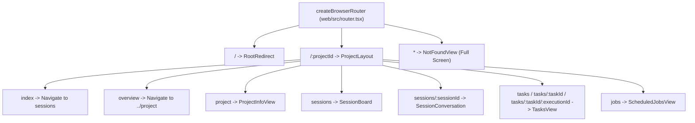

# Design 12: Web Routing Standardization

| Field | Value |
| --- | --- |
| **Title** | Web Routing Standardization (`react-router` Migration) |
| **Status** | Accepted |
| **Target Module** | `web/` |
| **Date** | 2026-11-25 |

---

## 1. Context & Motivation

当前 `web/` 虽然安装了轻量路由库 `wouter`，但并未采用声明式路由表，而是仅使用 `useLocation()` 读取 `pathname`，并将所有路由逻辑耦合在业务 Context 与手写正则中：

1. **手写正则解析路径**：`web/src/utils/routing.ts` 靠多条正则表达式手动解析 `/:projectId/...`、`/:projectId/sessions/:sessionId`、`/:projectId/tasks/:taskId/:executionId` 等路径，每次新增页面或嵌套子路由都需要手改正则并注意匹配顺序。
2. **Context 与路由强耦合**：`StudioContext` 同时承担数据管理（`projects`、`sessions`、`isReady`）、UI 状态（`showInspector`）以及路由状态与跳转（`activeView`、`activeSessionId`、`activeTaskId`、`activeExecutionId`、`isNotFound`、`setActiveView`、`openSession`、`openTask`、`goHome`）。
3. **布局与 404 依赖条件分支补丁**：`App.tsx` 通过 `if (isNotFound) return <NotFoundView />` 区分全屏 404 与主布局，而不是通过嵌套路由天然隔离布局作用域；`SessionsView.tsx` 仅仅为了 `if (!activeSessionId)` 而作为多余包装层存在。
4. **元信息重复维护**：视图标题（`viewTitles`）、左侧导航高亮（`ActivityBar`）、过渡动画 key（`viewKey`）分散在不同组件里硬编码，没有统一的路由元信息来源。

随着后续新增页面（如 Pipeline 视图、独立全屏页面、路由懒加载等），当前做法维护成本高且容易引入边界 bug，因此需要迁移为标准的声明式嵌套路由架构。

---

## 2. Goals & Non-Goals

### Goals
- 使用 `react-router`（v7 单包）替换 `wouter`，以集中式路由表作为前端路由唯一真相源。
- 通过嵌套路由 + `<Outlet />` 自然隔离 `ProjectLayout`（顶栏 + 侧边栏 + 主画布）与独立全屏页面（如 `404`）。
- 为路由提供结构化元信息 `RouteHandle`（类似 Vue Router `meta`），统一驱动导航高亮、顶栏标题与页面切换动画。
- 彻底剥离 `StudioContext` 中的路由解析与跳转逻辑，组件直接使用 `useParams()`、`useNavigate()`、`<NavLink>`。
- 删除手写正则路由解析器（`web/src/utils/routing.ts`）与多余的包装视图（`SessionsView.tsx`）。
- 保持所有现有 URL 结构、重定向行为与 Task 左侧列表不卸载的动画体验完全兼容。

### Non-Goals
- 不引入 SSR 或 React Router Framework Mode（Vite 插件 / 数据 loader / action）；继续保持纯 SPA 模式，数据获取沿用现有 `web/src/api/` 模块。
- 不改动后端 Gateway 路由结构（`/api/v1/*` 及其未知路径返回 `404 JSON` 的逻辑保持不变）。
- 不在本次重构中重新设计页面视觉样式或新增业务视图。

---

## 3. Detailed Technical Design

### 3.1 Architecture Overview



### 3.2 Route Table & `RouteHandle` Contract (`web/src/router.tsx`)

定义统一的路由元信息接口 `RouteHandle`：

```ts
import type { StudioView } from "./types";

export interface RouteHandle {
  /** Active ActivityBar navigation item */
  nav: StudioView;
  /** Breadcrumb section title displayed in StudioHeader */
  title: string;
  /**
   * Animation grouping key for AnimatedOutlet.
   * - Omit to animate per pathname (e.g. SessionBoard <-> SessionConversation).
   * - Set a shared key (e.g. "tasks") to keep the view mounted across sub-route parameter changes.
   */
  transitionKey?: string;
}
```

路由表集中声明：

```tsx
export const routes: RouteObject[] = [
  {
    path: "/",
    element: <RootRedirect />,
  },
  {
    path: "/:projectId",
    element: <ProjectLayout />,
    children: [
      {
        index: true,
        element: <Navigate to="sessions" replace />,
      },
      {
        path: "overview",
        element: <Navigate to="../project" replace />,
      },
      {
        path: "project",
        element: <ProjectInfoView />,
        handle: { nav: "project", title: "Overview" } satisfies RouteHandle,
      },
      {
        path: "sessions",
        element: <SessionBoard />,
        handle: { nav: "sessions", title: "Sessions" } satisfies RouteHandle,
      },
      {
        path: "sessions/:sessionId",
        element: <SessionConversationRoute />,
        handle: { nav: "sessions", title: "Sessions" } satisfies RouteHandle,
      },
      {
        path: "tasks",
        element: <TasksView />,
        handle: { nav: "tasks", title: "Tasks", transitionKey: "tasks" } satisfies RouteHandle,
      },
      {
        path: "tasks/:taskId",
        element: <TasksView />,
        handle: { nav: "tasks", title: "Tasks", transitionKey: "tasks" } satisfies RouteHandle,
      },
      {
        path: "tasks/:taskId/:executionId",
        element: <TasksView />,
        handle: { nav: "tasks", title: "Tasks", transitionKey: "tasks" } satisfies RouteHandle,
      },
      {
        path: "jobs",
        element: <ScheduledJobsView />,
        handle: { nav: "jobs", title: "Scheduled Jobs" } satisfies RouteHandle,
      },
    ],
  },
  {
    path: "*",
    element: <NotFoundView />,
  },
];
```

> 说明：`SessionConversation` 既作为独立页面路由渲染，也被 `TasksView` 嵌入复用（`readOnly` 模式，通过 prop 传入 `sessionId`），因此 `SessionConversationRoute` 为一个轻量薄入口（读取 `useParams().sessionId` 透传给 `<SessionConversation sessionId={sessionId} />`），避免破坏嵌入式调用签名。

### 3.3 Root Redirect, Project Guard & Full-Screen 404

1. **根路径跳转（`RootRedirect`）**
   - 监听 `StudioContext` 中的 `projects` 与 `projectsLoaded`。
   - 加载完成后优先读取 `localStorage.getItem("last_active_project")`（且校验仍在 `projects` 中），否则回退到 `projects[0].projectId`，通过 `<Navigate to={`/${encodeURIComponent(target)}/sessions`} replace />` 跳转。
   - 若项目列表为空（尚未配置项目），展示轻量空态提示，而非死循环跳转。

2. **无效子路径自动全屏 404**
   - `/:projectId` 父路由下**不定义**通配子路由 `*`。
   - 当用户访问 `/:projectId/unknown-view`、`/:projectId/sessions/a/b` 或 `/a/b/c/d` 时，均无法匹配 `/:projectId` 下的任何子路由，React Router 自动回落至顶层 `*` 路由，直接全屏渲染 `NotFoundView`，完全不挂载 `ProjectLayout`。

3. **不存在的 `projectId` 守卫（`ProjectLayout`）**
   - `ProjectLayout` 从 `useParams()` 读取 `projectId`，在 `projects` 中查找对应项目：
     - 项目列表尚未加载完成（`!projectsLoaded`）：渲染空白背景画布（避免首屏闪现 404）。
     - 加载完成且 `projectId` 不存在：直接 `return <NotFoundView />`（同样是全屏 404，不渲染 `StudioHeader` / `ActivityBar`，不污染 `localStorage`，不触发该无效项目的 `sessionsApi.list`）。
     - 存在：将 `projectId` 写入 `localStorage("last_active_project")`，同步加载该项目 sessions，并正常渲染 `StudioHeader` + `ActivityBar` + `AnimatedOutlet`。

### 3.4 Route Transition Animation (`AnimatedOutlet`)

在 `web/src/layouts/ProjectLayout.tsx` 中实现声明式过渡动画组件 `AnimatedOutlet`：

- 使用 `useOutlet()` 捕获当前匹配的子树快照，配合 `motion/react` 的 `<AnimatePresence mode="wait" initial={false}>`。
- 通过 `useMatches()` 获取最深层匹配路由的 `handle`：
  - 若存在 `handle.transitionKey`，则动画 `key` 为 `${projectId}:${handle.transitionKey}`（例如 `tasks`、`tasks/:taskId`、`tasks/:taskId/:executionId` 共享同一 key，切换任务或执行记录时左侧 Task Explorer 保持挂载、不重置滚动位置也不闪烁）。
  - 否则动画 `key` 为 `location.pathname`（例如切换顶层视图、`SessionBoard` ↔ `SessionConversation` 均平滑播放过渡动画）。

```tsx
function AnimatedOutlet({ projectId }: { projectId: string }) {
  const location = useLocation();
  const outlet = useOutlet();
  const handle = useCurrentRouteHandle();

  const transitionKey = handle?.transitionKey
    ? `${projectId}:${handle.transitionKey}`
    : location.pathname;

  return (
    <AnimatePresence mode="wait" initial={false}>
      <m.div
        key={transitionKey}
        initial={{ opacity: 0, y: 8 }}
        animate={{ opacity: 1, y: 0 }}
        exit={{ opacity: 0, y: -5 }}
        transition={{ duration: 0.16, ease: EASE_OUT_EXPO }}
        className="flex-1 flex overflow-hidden min-w-0"
      >
        {outlet}
      </m.div>
    </AnimatePresence>
  );
}
```

### 3.5 `StudioContext` Slimming & Component Migration

`StudioContext` 位于 `RouterProvider` 之上（或根部），**彻底移除所有路由派生字段与跳转方法**，只保留全局数据与工作台 UI 状态：

| 保留（纯业务/UI 状态） | 移除（改由 React Router 原生提供） |
| --- | --- |
| `projects`, `projectsLoaded`, `refreshProjects` | `activeProjectId`, `activeProject` → `useParams()` / `useCurrentProject()` |
| `sessions`, `setSessions`, `refreshSessions(projectId)` | `activeView`, `setActiveView` → `RouteHandle.nav` + `<NavLink>` / `useNavigate()` |
| `isReady` | `activeSessionId`, `activeSession`, `setActiveSessionId` → `useParams().sessionId` |
| `showInspector`, `setShowInspector`, `toggleInspector` | `activeTaskId`, `activeExecutionId` → `useParams()` |
| `resolveDefaultProjectId()` | `isNotFound`, `openSession`, `closeToBoard`, `openTask`, `closeToTasks`, `goHome` → `useNavigate()` / `<Link>` |

各组件迁移方式：
- **`ActivityBar.tsx`**：使用 `<NavLink to={`/${encodeURIComponent(projectId)}/${item.view}`}>` + `handle.nav` 驱动滑动指示器，支持原生右键新标签打开与无障碍语义。
- **`StudioHeader.tsx`**：通过 `useParams()` 获取 `projectId` / `sessionId`，通过 `useCurrentRouteHandle()` 获取 `title`；切换项目时调用 `navigate(`/${encodeURIComponent(nextId)}/${currentNav}`)`。
- **`TasksView.tsx`**：通过 `useParams<{ projectId: string; taskId?: string; executionId?: string }>()` 读取当前选中任务与执行记录，使用 `useNavigate()` 跳转。
- **`SessionBoard.tsx` / `SessionConversation.tsx` / `ScheduledJobsView.tsx` / `ProjectInfoView.tsx`**：统一改为 `useParams()` + `useNavigate()`。
- **`NotFoundView.tsx`**：使用 `useLocation().pathname` 展示错误路径，使用 `useNavigate()` 返回上一页或跳转主页（`/`）。

### 3.6 Files Added, Modified & Removed

- **新增**：
  - `web/src/router.tsx`（路由表、`RouteHandle`、`useCurrentRouteHandle`、`RootRedirect`）
  - `web/src/layouts/ProjectLayout.tsx`（项目守卫、工作台外壳、`AnimatedOutlet`）
- **删除**：
  - `web/src/utils/routing.ts`
  - `web/src/utils/routing.test.ts`
  - `web/src/components/views/SessionsView.tsx`
- **修改**：
  - `web/package.json` & `web/bun.lock`（移除 `wouter`，新增 `react-router`）
  - `web/src/App.tsx`（挂载 `<RouterProvider router={router} />` 与全局 Providers）
  - `web/src/context/StudioContext.tsx`（剥离路由职责）
  - `web/src/components/studio/ActivityBar.tsx`、`StudioHeader.tsx`
  - `web/src/components/views/ProjectInfoView.tsx`、`TasksView.tsx`、`ScheduledJobsView.tsx`、`NotFoundView.tsx`
  - `web/src/components/workspace/SessionBoard.tsx`、`web/src/components/session/SessionConversation.tsx`

### 3.7 Backend SPA Fallback Alignment

后端 `src/gateway/server.ts` 已确保：
- 未知 `/api/*` 路径直接返回 `404 { "error": "not_found" }` JSON。
- 其余非静态文件 GET 路径返回 `web/dist/index.html`，交由 `createBrowserRouter` 接管前端路由与 404 渲染。

---

## 4. Configuration Specification

- **包依赖变更**（`web/package.json`，使用 Bun 管理并同步 `web/bun.lock`）：
  - 移除：`wouter`
  - 新增：`react-router`（`^7`）
- **服务配置变更**：无（不涉及 `config.yaml` 或环境变量变更）。

---

## 5. Implementation Phases & Testing Plan

### Phase 1: Dependencies & Core Routing Infrastructure
1. 在 `web/` 执行 `bun remove wouter && bun add react-router`。
2. 创建 `web/src/router.tsx` 与 `web/src/layouts/ProjectLayout.tsx`。
3. 瘦身 `web/src/context/StudioContext.tsx` 并更新 `web/src/App.tsx`。

### Phase 2: Component Migration & Cleanup
1. 迁移 `ActivityBar`、`StudioHeader`、`ProjectInfoView`、`TasksView`、`ScheduledJobsView`、`SessionBoard`、`SessionConversation`、`NotFoundView` 至标准 Router hooks / `<NavLink>`。
2. 删除 `web/src/utils/routing.ts`、`web/src/utils/routing.test.ts`、`web/src/components/views/SessionsView.tsx`。

### Phase 3: Verification & Tests
1. **自动化路由测试**（`web/src/router.test.ts`）：使用 `matchRoutes(routes, pathname)` 验证：
   - `/` 匹配 `RootRedirect`
   - `/:projectId`、`/:projectId/overview`、`/:projectId/project`、`/:projectId/sessions`、`/:projectId/sessions/:sessionId`、`/:projectId/tasks`、`/:projectId/tasks/:taskId`、`/:projectId/tasks/:taskId/:executionId`、`/:projectId/jobs` 均正确匹配且携带预期 `handle` 元信息与参数
   - `/:projectId/unknown`、`/:projectId/sessions/a/b`、`/a/b/c/d` 均回落至顶层 `*`（全屏 404），不匹配 `ProjectLayout`
2. **构建与回归检查**：
   - `cd web && bun test && bun run build`（含 `tsc` 类型检查）
   - `bun run check`（确认后端未受影响）
3. **人工端到端验证**：
   - 访问 `/` → 自动跳转到默认项目 `/sessions`
   - 切换左侧 4 个导航项 → 动画正常、URL 同步、支持浏览器前进/后退
   - 在 Tasks 视图内切换不同 Task / Execution → 左侧栏不重新挂载、URL 正常更新
   - 在 Sessions 列表与对话页之间切换 → 过渡动画正常
   - 访问 `/nonexistent-proj/sessions` 与 `/<valid-proj>/bogus` 与 `/a/b/c` → 均展示全屏 404，点击「返回主页」正常恢复

---

## 6. Alternatives & Tradeoffs

| 方案 | 优点 | 缺点 | 结论 |
| --- | --- | --- | --- |
| **`react-router` v7（选用）** | 行业标准；支持 `createBrowserRouter` 集中路由表、嵌套 `<Outlet />`、`handle` 路由元信息、`<NavLink>`、`matchRoutes` 单测；与 Vue Router 概念高度一致 | 比 `wouter` 多 ~20KB gzip（在当前 808KB bundle 中占比 <2.5%） | **采纳** |
| **继续使用 `wouter`** | 体积小、无需改依赖 | 无标准 `<Outlet />`、无路由表 `handle` 元信息、无 `<NavLink>` 激活态，仍需手写布局包装与状态映射 | 放弃 |
| **`@tanstack/react-router`** | 强类型路由参数与 search params 推导 | 配置与代码生成（routeTree）偏重，超出当前 SPA 复杂度需求 | 放弃 |
