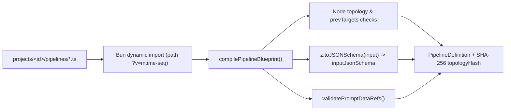
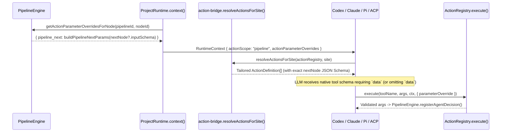

# Design 13: TypeScript Pipeline SDK & Typed Node Data Contracts

| Field | Value |
| --- | --- |
| **Title** | TypeScript Pipeline SDK (`definePipeline` / `defineHandler` / `node.*`) & Typed Node Data Contracts |
| **Status** | Accepted |
| **Target Module** | `src/pipeline/`, `src/actions/`, `src/runtime/`, `src/project/`, `src/persistence/`, `src/gateway/`, `web/src/` |
| **Related Designs** | [09-pipeline-workflow](../09-pipeline-workflow/README.md), [10-prompt-template-variables](../10-prompt-template-variables/README.md) |
| **Reference Guide** | [docs/references/pipeline-sdk.md](../../references/pipeline-sdk.md) |
| **Date** | 2026-11-26 |

---

## 1. Context & Motivation

在 [09-pipeline-workflow](../09-pipeline-workflow/README.md) 一期实现中，流水线通过 `projects/<id>/pipelines/*.yaml` 声明，节点间传递的 `data` 是一个无约束的 `Record<string, unknown>`。在真实落地（例如 `issue-to-pr` 流水线的 `open_pr -> pr_watch` 衔接）过程中暴露出四类核心架构痛点：

1. **下游强依赖字段缺少契约，被迫写 workaround**：`pr_watch` 代码节点依赖上游 `open_pr` Agent 传入 `{ prNumber, prUrl, branch }`，但 YAML 与 `pipeline_next` Tool Schema 均无法表达该要求。一旦 Agent 漏传，TS Handler 不得不通过 `git rev-parse` 反推分支再去调 GitHub API 猜 PR——属于典型的脆弱 workaround。
2. **YAML 无法提供类型推断，也不适合承载复杂校验逻辑**：若在 YAML 中发明一套自定义 schema DSL（type / required / enum / default），既重复造轮子，又无法让 `node.code` 在编写时获得 TypeScript 静态类型提示（`ctx.data.xxx` 仍然是 `unknown`）。
3. **Prompt 注入约束不可靠**：仅在提示词里口头要求 Agent“请在 `data` 中传入 `prNumber`”属于软约束，LLM 仍可能在 Tool Call 中省略字段或填错类型；只有把下游节点的 schema 直接作为 `pipeline_next` Tool Call 的原生参数 Schema，才能由模型工具调用协议层强制补齐。
4. **返工回退（`pipeline_prev` / `reject`）与强类型契约冲突**：若节点 4 打回节点 2，而节点 2 要求强类型 `input`（如 `{ suggestedBranch }`），节点 4 并不应该为了打回而重新构造节点 2 的初始入参。

因此，本设计彻底使用 **纯 TypeScript + Zod** 取代 YAML 定义流水线，并将**显式强类型 `data` 契约 + 自由 `metadata` 通道 + Session 级原生动态 Tool Schema + 返工数据自动继承**确立为 Pipeline 引擎的一等核心能力。

---

## 2. Goals & Non-Goals

### Goals
- **完全用 TypeScript 替代 YAML 流水线定义**：扫描 `projects/<projectId>/pipelines/*.ts`，提供 `definePipeline`、`defineHandler`、`node.agent` / `node.code` / `node.human` / `node.end` 以及统一 re-export 的 `z`。
- **`node.code` 同时支持内联与外部复用**：支持内联 `{ id, name, input?, run(ctx) }` 与外部复用 `defineHandler({ input?, run(ctx) })` + `node.code({ id, name, handler })`，两种写法均具备完整的 `ctx.data` 编译期类型推断，且在编译期与运行期禁止混用 `handler` 与 `input`/`run`。
- **显式声明 `data` + 独立自由通道 `metadata`**：
  - 节点通过 `input: z.object(...)` 显式声明入参契约；未声明时运行时 `data` 严格为空 `{}`（类型 `Readonly<Record<string, never>>`）。
  - 所有流转入口（`startRun`、`pipeline_next`、`pipeline_prev`、`pipeline_request_confirmation`、`pipeline_fail`、`approveRun`、`rejectRun`、`PipelineTsResult`）新增不受 schema 限制的 `metadata?: Record<string, unknown>`。
- **Agent Prompt 原生 `{{ data.xxx }}` 渲染与加载期静态校验**：`buildAgentNodePrompt` 将校验后的节点 `data` 与合并后的 `metadata` 注入模板上下文；Loader 在加载阶段静态扫描 `{{ data.xxx }}`，若引用了未声明字段且无 `| default` 回退则立即 fail-fast。
- **全 Runtime 原生 Session 级动态 `pipeline_next` Tool Schema**：Codex、Claude、Pi、ACP 四个 Runtime 均按当前节点下一跳的 `inputSchema` 动态生成 `pipeline_next` 参数定义（下游有 `input` 时 `data` 为必填强类型对象；下游无 `input` 或为终态时直接省略 `data`）。
- **返工回退自动继承 + 可选局部覆盖**：`pipeline_prev` / `rejectRun` 自动继承目标节点最近一次已校验的 `inputContext`，浅合并可选覆盖 `data` 后重新通过目标节点的 `inputSchema` 校验，并向 `node.code` 暴露 `ctx.rework`。
- **`input` 归属 Live Definition（与 `prompt`/`handler` 同生共死）**：`input` 契约不进入 `topologyHash`，微调节点入参不会无故分裂看板版本；引擎在校验与构造动态 Tool Schema 时统一读取实时定义，首节点 JSON Schema 通过实时列表接口的 `entryInputSchema` 暴露给前端表单。

### Non-Goals
- 不保留旧版 `.yaml` 流水线兼容加载路径（直接替换为 `.ts`）。
- 不在本设计范围内新增用于 AI 对话触发流水线的 builtin actions（如 `list_project_pipelines` / `dispatch_pipeline_run`），留待后续独立演进。
- 不改变 `PipelineRun` 的共享 Worktree、单跳线性拓扑与人工审批状态机主干。

---

## 3. Detailed Technical Design

### 3.1 Authoring SDK (`src/pipeline/sdk.ts`)

核心导出集中在 [src/pipeline/index.ts](file:///home/ranchangxin/Documents/projects/learning/agent-orchestrator/src/pipeline/index.ts)：

```ts
export type PipelineInputSchema = z.ZodObject<z.ZodRawShape>;
export type InferNodeData<TInput> = TInput extends z.ZodObject<z.ZodRawShape>
  ? Readonly<z.infer<TInput>>
  : Readonly<Record<string, never>>;
```

1. **`defineHandler({ input?, run })`**：返回带内部品牌标记（`__brand: "PipelineTsHandlerSpec"`）的 `TsHandlerSpec<TInput>`，将 `input` schema 与 `run(ctx: PipelineTsRunContext<InferNodeData<TInput>>)` 绑定为单一真相源。
2. **`node.*` 构造器命名空间**：
   - `node.agent({ id, name, prompt, input?, runtime?, gate?, concurrency?, allowPrev?, prevTargets?, maxLoops?, timeoutMs? })`
   - `node.code(...)` 两组互斥重载：
     - 内联模式：`{ id, name, input?, run, handler?: never, ... }`
     - 外部模式：`{ id, name, handler: TsHandlerSpec<TInput>, input?: never, run?: never, ... }`
     - 运行时同样校验并抛出 `PipelineValidationError`，防止无类型调用方混用。
   - `node.human({ id, name, input?, allowPrev?, prevTargets?, maxLoops? })`
   - `node.end({ id, name, description? })`
3. **`definePipeline({ id?, name, description?, enabled?, notifyOn?, nodes })`**：返回带品牌标记的 `PipelineBlueprint`，由 Loader 编译为 `PipelineDefinition`。

### 3.2 Loader 与加载期静态校验 (`src/pipeline/loader.ts`)



- **模块热重载安全**：遵循 `src/task/loader.ts` 的 Bun 约定，使用文件系统路径 + 查询参数（`${absPath}?v=${mtimeMs}-${seq}`）绕过 Bun ESM 模块缓存，避免 `file://` URL 被剥离 query 导致 `syncDefinitions()` 无法感知变更。
- **Prompt 静态校验 `validatePromptDataRefs`**：复用 `extractPromptVarRefs(template, ["data"])`，检查所有无 `| default` 回退的 `{{ data.<key> }}` 引用；若节点未声明 `input` 或 `input.shape` 不含 `<key>`，加载时直接报错失败。
- **实时契约与拓扑版本边界**：`PipelineNodeSnapshot` 与 `topologyHash` 仅冻结结构骨架与纯状态机规则（`id`、`name`、`executor`、`terminal`、`gate`、`allowPrev`、`prevTargets`、`maxLoops`）；`input` 与 `prompt`、`handler`、`runtime`、`concurrency` 同属 live definition，由引擎实时读取，避免单靠冻结 JSON Schema 制造“老 Run 能安全跑新 handler”的假象，也不会因为调整入参字段而把看板裂成多套版本。

### 3.3 `data` 与 `metadata` 的流转不变量

| 阶段 / 动作 | `data` 校验与存储规则 | `metadata` 规则 |
| --- | --- | --- |
| `startRun` | 使用 `nodes[0].inputSchema` 校验 `params.data`（未声明则恒为 `{}`），写入 `run.data` 与首个 `nodeRun.inputContext` | 存入 `run.metadata`（默认 `{}`） |
| `pipeline_next` / `ts_result("next")` | 使用 `nextNode.inputSchema` 校验（未声明则恒为 `{}`），直接写入 `nextNodeRun.inputContext`；`register_decision` 阶段即刻校验以便 Agent 同轮自纠 | 随 `PipelineActionRecord.context.metadata` 持久化 |
| `approveRun` | 先通过 `resolveApprovalHandoff` 读取基础交接上下文（`manual` gate 取本节点挂起前记录，`node.human` 透传上游记录），将人工提交的可选 `data` **浅合并覆盖**到 `handoff.data`（`{ ...handoff.data, ...params.data }`），再用 `nextNode.inputSchema` 校验并写入 `nextNodeRun.inputContext`（未声明则恒为 `{}`） | 同样浅合并覆盖 `handoff.metadata`（`{ ...handoff.metadata, ...params.metadata }`）并持久化 |
| `pipeline_prev` / `ts_result("prev")` / `rejectRun` | 读取目标节点最近一次 `nodeRun.inputContext`，浅合并本次可选 `data` 后使用 `targetNode.inputSchema` 重校验，写入新 `targetNodeRun.inputContext` | 随 `PipelineActionRecord.context.metadata` 持久化 |
| `retryRun` | 直接保留失败 `nodeRun.inputContext` | 在 `human_retry` 记录的 `metadata` 中记录 `{ preserveStepState }` |
| `node.code` 执行 | `ctx.data = Object.freeze({ ...nodeRun.inputContext })`；若由打回触发则填充 `ctx.rework` | `ctx.metadata = Object.freeze({ ...run.metadata, ...(upstreamAction?.context.metadata ?? {}) })` |
| `node.agent` Prompt | 注入 `data: nodeRun.inputContext` 与 `pipeline.data` | 注入合并后的 `metadata` 与 `pipeline.metadata` |

`nodeRun.inputContext` 不再混入 `{ handoffFrom, handoffRecordId, context }` 等包装字段，只存**纯净且已通过校验的当前节点 `data`**；交接摘要、交付物与打回理由统一通过 `nodeRun.triggeredByRecordId` 关联 `PipelineActionRecord` 读取。

### 3.4 Session 级原生动态 Tool Schema（4 Runtime 统一架构）



- `buildPipelineNextParams(nextInputSchema?)`（[src/actions/builtin/pipeline.ts](file:///home/ranchangxin/Documents/projects/learning/agent-orchestrator/src/actions/builtin/pipeline.ts)）：
  - 若 `nextInputSchema` 存在：返回 `z.object({ summary, content, artifacts?, metadata?, data: nextInputSchema })`。
  - 若 `nextInputSchema` 不存在：返回 `z.object({ summary, content, artifacts?, metadata? })`（完全省略 `data` 字段）。
- **通用兜底 Schema 与引擎最终裁决**：`ActionRegistry` 中静态注册的 `pipeline_next` 保留通用兜底定义（`data` 为可选 `Record<string, unknown>`）。若因 session metadata 缺失 `pipelineId`/`pipelineNodeId`、实时定义文件已被删除/改名而查不到节点，或外部直接绕过 `ProjectRuntime` 调用 `ActionRegistry`，导致未生成 session 级 `actionParameterOverrides`，则会回退使用该通用参数定义；但状态机 `resolveNodeData` 在落盘前仍会做最终裁决（未声明 `input` 或定义缺失时一律归为 `{}` 并剥离多余 `data`）。
- `RuntimeContext` 与 `ActionCallSite` 新增 `actionParameterOverrides?: Readonly<Record<string, z.ZodObject<z.ZodRawShape>>>`。
- `ProjectRuntime.context()` 在 `actionScope === "pipeline"` 时从 session metadata（`pipelineId`, `pipelineNodeId`）查询并注入覆盖项，对新建与 `resumeSession` 同样生效。
- 四个 Runtime 统一复用 `resolveActionsForSite` 并将 `parameterOverride` 透传给 `ActionRegistry.execute`：
  - **Codex**：`threadParams()` + `handleDynamicToolCall()`
  - **Claude**：`createActionServer()`（直接传入 Zod object shape 给 SDK MCP tool）
  - **Pi**：`bridgeActionsToPiTools()`
  - **ACP**：`ACPMcpBridge.toolsForSite()`（存在 session override 时绕过 scope 级 `toolCache`，实时输出当前 session 的 `tools/list`）+ `tools/call`

### 3.5 持久化、API 与 Web Studio

- **数据库迁移**（`database/migrations/0005_*.sql`）：
  - `pipeline_runs` 表将原 `input` 列清理替换为 `data jsonb NOT NULL DEFAULT '{}'::jsonb`，并新增 `metadata jsonb NOT NULL DEFAULT '{}'::jsonb`（不保留旧列兼容别名）。
- **REST API**（[src/gateway/routes/pipelines.ts](file:///home/ranchangxin/Documents/projects/learning/agent-orchestrator/src/gateway/routes/pipelines.ts)）：
  - `PipelineSummaryWithVersions` 暴露实时首节点 `entryInputSchema?`（`PipelineNodeSnapshot` 保持纯骨架，不含 `inputSchema`）；
  - `PipelineRunRecord` 暴露 `data` 与 `metadata`；
  - `POST .../runs`、`/approve`、`/reject` 均支持 `data` 与 `metadata`。
- **Web Studio**：
  - `NewPipelineRunModal` 读取实时 `entryInputSchema`，存在契约时展示 Entry Data 字段提示（含必填标记 `*`），并提供独立可选 `Metadata` JSON 输入。
  - `PipelineRunSidebar` 分别展示 `Entry Data` 与 `Metadata`；`PipelineOverviewPanel` 的关联链接提取同时扫描 `action.context.data`、`action.context.metadata`、`run.data` 与 `run.metadata`。

---

## 4. Authoring Specification

完整编写指南与示例见 [docs/references/pipeline-sdk.md](../../references/pipeline-sdk.md)。最小骨架如下：

```ts
import { defineHandler, definePipeline, node, z } from "../../../src/pipeline/index.ts";

const watchPr = defineHandler({
  input: z.object({
    prNumber: z.number().int().positive(),
    prUrl: z.string().url(),
    branch: z.string().min(1),
  }),
  async run(ctx) {
    const { prNumber, prUrl, branch } = ctx.data; // 强类型推断 + 运行期保证
    return {
      action: "next",
      summary: `PR #${prNumber} merged`,
      content: `Merged ${prUrl} on ${branch}`,
      metadata: { prNumber, prUrl, branch },
    };
  },
});

export default definePipeline({
  id: "issue-to-pr",
  name: "Issue to PR",
  nodes: [
    node.agent({
      id: "design",
      name: "Design",
      input: z.object({ issueNumber: z.number().int().positive() }),
      prompt: "Analyze issue #{{ data.issueNumber }}",
    }),
    node.code({ id: "pr_watch", name: "Watch PR", handler: watchPr }),
    node.end({ id: "done", name: "Done" }),
  ],
});
```

---

## 5. Implementation Phases & Testing Plan

### Implementation Phases (Completed)
1. **Phase 1 — SDK & Loader**：实现 `src/pipeline/sdk.ts`、更新 `src/pipeline/types.ts`、`src/pipeline/loader.ts`、`src/pipeline/index.ts`。
2. **Phase 2 — Persistence, Machine, TS Runner & Engine**：更新 `schema.ts` + 生成 `0005` 迁移、更新 `pipeline-repo.ts`、`machine.ts`、`ts-node.ts`、`context.ts`、`engine.ts` 与 `actions/builtin/pipeline.ts`。
3. **Phase 3 — Per-Session Tool Schema Across All Runtimes**：打通 `runtime.ts`、`action-bridge.ts`、`registry.ts`、`project/runtime.ts` 以及 Codex / Claude / Pi / ACP 四个适配层。
4. **Phase 4 — Routes, Examples, Web UI & Docs**：更新 Gateway 路由、Web Studio、将 `projects/example` 与 `projects/shortlink` 迁移至 `.ts`、补充参考文档与本设计文档。
5. **Phase 5 — Verification**：更新并新增自动化测试，执行全量校验与构建。

### Test Coverage
- [tests/pipeline-sdk.test.ts](../../../tests/pipeline-sdk.test.ts)：覆盖 `node.code` 内联与外部复用及混用拒绝、`{{ data.xxx }}` 加载期静态校验、修改 `inputSchema` 保持 `topologyHash` 稳定、`startRun` 强校验、Pi/ACP/Bridge 动态 `pipeline_next` Schema、未声明 `input` 时 `data === {}` 且 `metadata` 透传、以及 `pipeline_prev` 返工自动继承 `data` 端到端闭环。
- [tests/pipeline.test.ts](../../../tests/pipeline.test.ts) & [tests/pipeline-machine.test.ts](../../../tests/pipeline-machine.test.ts)：全量迁移至 TypeScript Pipeline SDK 并验证热重载版本递增、状态机不变量、并发限流、持久化 `step`/`waitUntil` 与 REST/SSE 全链路。

---

## 6. Alternatives & Tradeoffs

| 决策点 | 备选方案 | 最终方案与权衡 |
| --- | --- | --- |
| 流水线定义载体 | 继续用 YAML + 自定义 schema 字段 | **纯 TypeScript + Zod**：避免发明受限 DSL；获得 `ctx.data` 端到端编译期类型推断；与 Bun 原生 TS 执行及现有 `tasks/*.ts` 扩展体系一致；直接 `z.toJSONSchema()` 输出标准 JSON Schema。 |
| `input` 是否进 `topologyHash` | 序列化 JSON Schema 进 `PipelineRevision`，尝试按旧版本校验在途 Run | **归属 Live Definition，不进 `topologyHash`**：`prompt` 与 `handler` 均读实时代码而非冻结快照，单冻结 JSON Schema 不仅无法阻止老 Run 在新 handler 中崩溃，还会丢失 Zod `.default()`/`.refine()` 语义并无故分裂看板版本。增量改法（新增可选或带默认值字段）天然兼容在途 Run；破坏性变更在流转期明确报 `PipelineValidationError`。 |
| 约束 Agent 传参方式 | 在系统 Prompt 中拼接 JSON 格式要求 | **Session 级原生动态 Tool Schema**：由各 Runtime 的工具协议层原生下发强类型 Schema，同时在 `ActionRegistry.execute` 与 `PipelineEngine.registerAgentDecision` 双重校验，零 Prompt 注入 hack。 |
| 强类型字段 vs 自由透传 | 全部塞进一个宽松的 `data` 对象 | **显式拆分 `data` 与 `metadata`**：未声明 `input` 的节点 `data` 强制为 `{}`，防止隐式字段耦合；临时诊断信息、审计标签、外部链接走自由 `metadata`，边界清晰。 |
| 回退返工的数据处理 | 要求打回方重新构造目标节点的 `data` | **自动继承 + 可选局部覆盖**：打回方（如 PR Watch）无需感知上游（如 Implement）的入参结构；引擎自动继承目标节点最近一次已通过校验的 `inputContext` 并支持按需局部覆盖后重校验。 |
