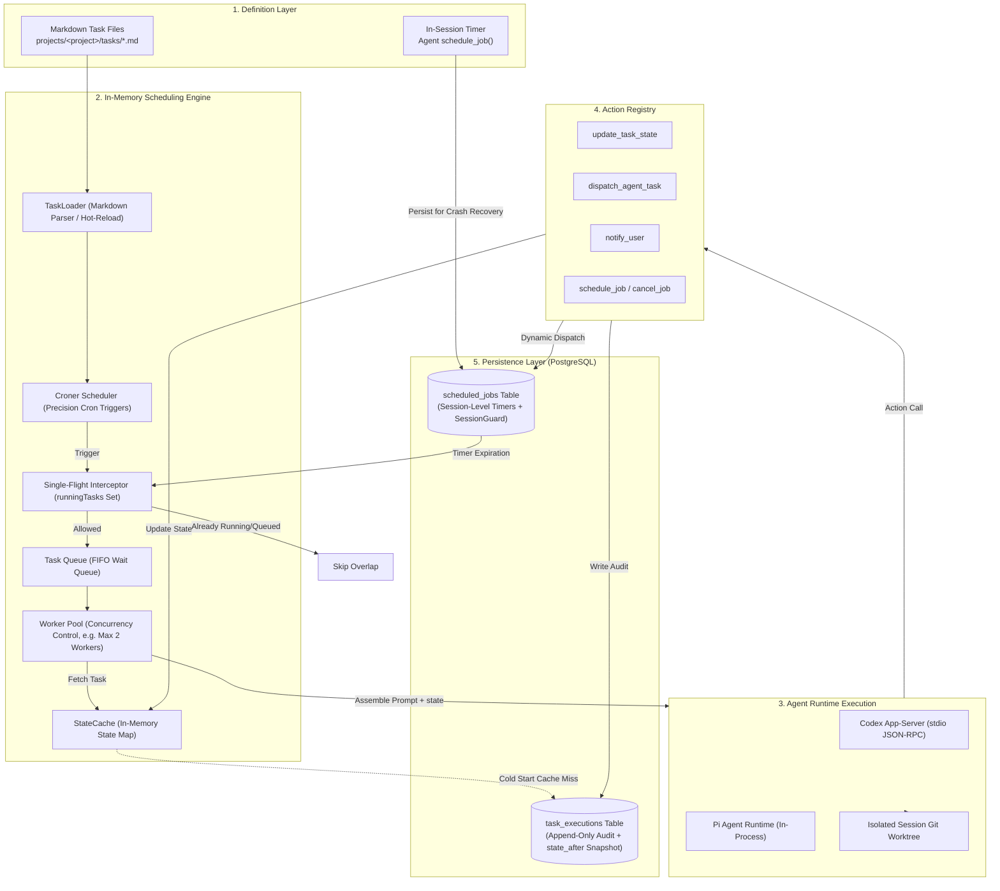

# In-Memory Engine (Queue + Pool + Worker) Task & Action Architecture Design

This document specifies the task scheduling and action execution architecture for **Agent Orchestrator**. This design replaces legacy trigger tables with a modern architecture featuring **Markdown-declared configurations, pure in-memory queue & worker pool scheduling, append-only execution auditing with state snapshots, and native ToolCall-driven Actions**.

---

## 1. Core Principles & Architectural Evolution

### 1. Markdown as Single Source of Truth for Static Configuration
* **No Database Task Definition Tables**: Avoids storing static task definitions in relational tables, eliminating configuration drift and overwrite synchronization issues on cold start.
* Tasks are declared under `projects/<project_id>/tasks/*.md`. Schedules (Cron) and status are defined via YAML Frontmatter, while business prompts reside in Markdown body.
* File changes take effect immediately with hot-reload support.

### 2. In-Memory Engine (Queue + Pool + Worker) & Resource Protection
* **LLM Resource Protection (Worker Pool Concurrency Limits)**: Agent execution is resource-heavy (Git worktree setup, inference latency, token usage). An in-memory `WorkerPool` (default concurrency: 2-3) prevents CPU and memory exhaustion when multiple scheduled tasks fire simultaneously.
* **Single-Flight Guard**: If a task is currently executing, incoming triggers are intercepted by an in-memory `runningTasks` set and skipped with zero database overhead.
* **Zero Deadlock Risk**: If the process crashes due to OOM or SIGKILL, in-memory state is cleanly reset upon restart without stale database row locks or complex recovery logic.

### 3. Minimal Database Persistence (Only 2 Tables)
The database does not handle queue scheduling or locks; it only stores audits and commitments:
1. **`task_executions` (Audit History & State Snapshots)**:
   * **Append-Only** pattern recording duration, status, and error logs.
   * Stores `state_after` snapshots upon completion (e.g. `{ "last_issue_id": 1052 }`).
   * **State Hydration**: On restart, cold-start tasks read their latest successful snapshot by `task_key` to resume incremental state immediately.
2. **`scheduled_jobs` (Dynamic In-Session Timers)**:
   * Stored in PostgreSQL when user or agent calls `schedule_job` (e.g., "remind me in 20 minutes") to survive restarts.
   * Supports session liveness guards (abandoned if the session was closed).

### 4. Native ToolCall-Driven Actions
* Agent side-effects (state updates, dispatching child tasks, sending notifications, scheduling timers) are defined as standard Actions.
* **Codex**: Intercepts App-Server stdio JSON-RPC `item/tool/call`.
* **Pi Agent**: Dispatches directly via in-process tool callbacks.

---

## 2. Overall Architecture



---

## 3. Schema & Task Specifications

### 1. Database DDL Definitions
| File Path | Description |
| :--- | :--- |
| [docs/task-and-action/schema/scheduled_jobs.sql](file:///home/ranchangxin/Documents/projects/learning/agent-orchestrator/docs/task-and-action/schema/scheduled_jobs.sql) | Dynamic in-session timers with session binding, trigger time, payload, and cancellation status. |
| [docs/task-and-action/schema/task_executions.sql](file:///home/ranchangxin/Documents/projects/learning/agent-orchestrator/docs/task-and-action/schema/task_executions.sql) | Task execution audit logs indexed by `task_key` for fast history lookup and cold-start state hydration. |

### 2. Task Specifications
| File Path | Description |
| :--- | :--- |
| [docs/task-and-action/examples/tasks/sync-github-issues.md](file:///home/ranchangxin/Documents/projects/learning/agent-orchestrator/docs/task-and-action/examples/tasks/sync-github-issues.md) | **Production Example 1 (Inspection & Dispatch)**: Periodically scan GitHub issues, filter by `last_processed_issue_id`, call `dispatch_agent_task` for isolated fix sessions, and call `update_task_state` to advance cursor. |
| [docs/task-and-action/examples/tasks/daily-health-check.md](file:///home/ranchangxin/Documents/projects/learning/agent-orchestrator/docs/task-and-action/examples/tasks/daily-health-check.md) | **Production Example 2 (Daily Health Inspection)**: Run read-only verification checks daily, call `notify_user` to send notifications, and persist inspection state. |
| [docs/task-and-action/examples/tasks/in-session-scheduling.md](file:///home/ranchangxin/Documents/projects/learning/agent-orchestrator/docs/task-and-action/examples/tasks/in-session-scheduling.md) | **In-Session Scheduling Flow**: Demonstrates `schedule_job`, `cancel_job`, and session liveness guard handling. |

---

## 4. Frontmatter Specification

Task markdown files use YAML Frontmatter:

```markdown
---
id: sync-github-issues         # Task unique ID (defaults to filename without .md)
name: Periodic GitHub Issue Sync
cron: "*/10 * * * *"           # Standard 5-field cron expression
timezone: Asia/Shanghai        # Optional timezone, defaults to system timezone
enabled: true                  # Whether enabled
description: Scan unhandled issues and dispatch isolated repair sessions
---

## Instructions
You are an Issue dispatch assistant. Current processing cursor:
```json
{{state}}
```

Use the `gh` tool to fetch new issues above this cursor:
1. If no new issues exist, call `update_task_state` to maintain current state.
2. If new issues exist, call `dispatch_agent_task` to create repair sessions.
3. Update `update_task_state` with the latest `issue_id`.
```
